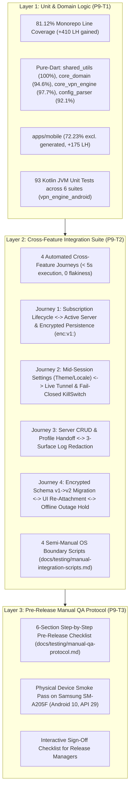
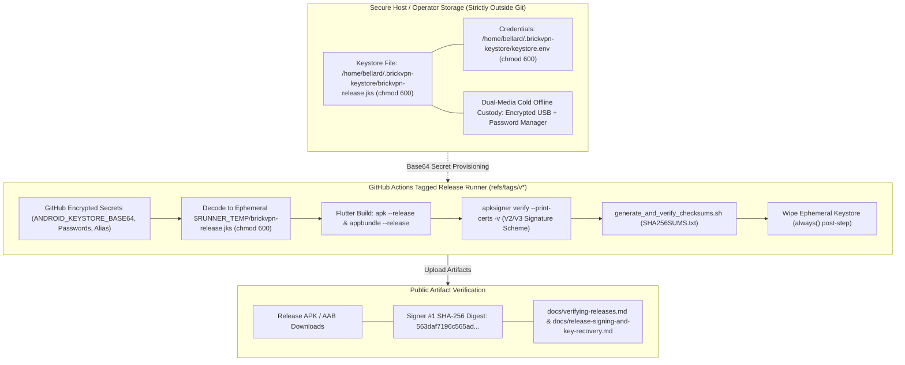
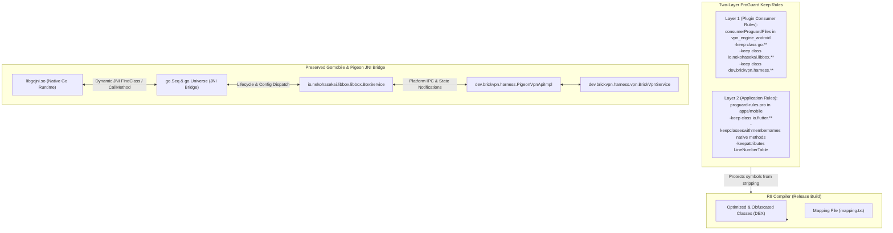
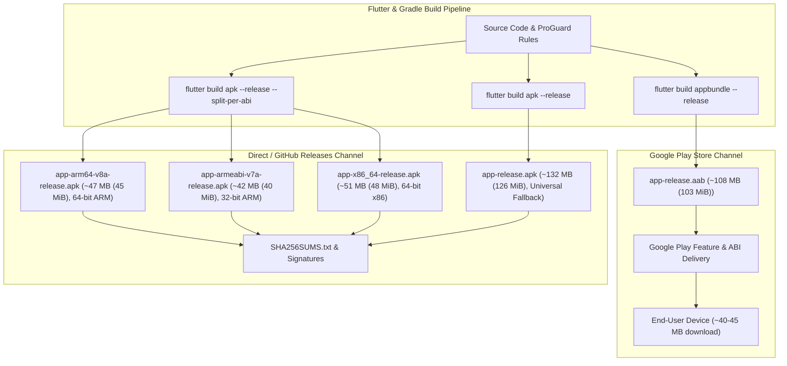
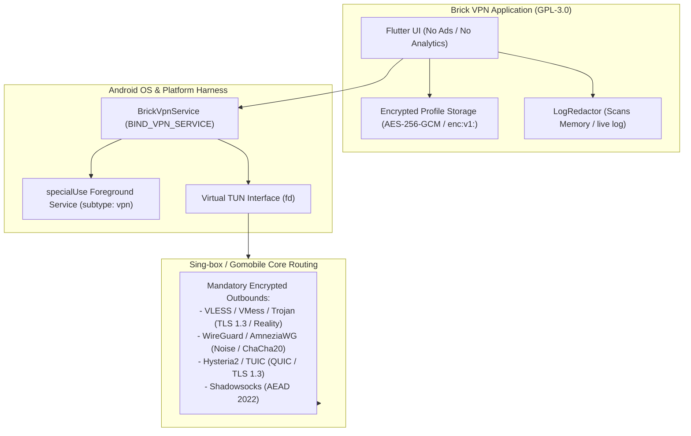

# ARCHITECTURE.md — Brick VPN Technical Architecture

> **Status**: Living document. This file is the single source of truth for 
> *why* technical decisions were made. Every AI Agent working on this 
> codebase MUST read this file before writing any code. If a decision here 
> seems wrong for a new situation, STOP and ask the human maintainer before 
> deviating — do not silently override architecture decisions.

---

## 0. Context: Why This Document Exists

This project is a ground-up rewrite of a previous VPN client attempt 
(codename: the "legacy prototype") that was abandoned due to accumulated 
technical debt and architectural mistakes — not because the core idea was 
wrong. The root causes of that failure, verified through static analysis, 
were:

1. A native bridge layer (JS ↔ Kotlin ↔ Go core) that was written without 
   rigorous error handling, leading to silent failures (e.g., stats 
   pipeline failing silently, VPN service failing to stop cleanly).
2. No separation between "VPN connection lifecycle" and "traffic 
   statistics reporting" — bugs in one bled into the other.
3. No formal state machine for VPN lifecycle (connect/disconnect races, 
   orphaned TUN interfaces, blocking calls on the main thread during 
   teardown).
4. Insufficiently tested platform integration code, treated as an 
   afterthought rather than the most critical layer of the system.

**Every architectural decision in this document is deliberately designed 
to prevent a repeat of these specific failure modes.** Where relevant, 
this document explicitly calls out which lesson from the legacy prototype 
informed a decision.

---

## 1. High-Level Technology Stack

| Layer | Technology | Rationale |
|---|---|---|
| UI Framework | **Flutter** (Dart) | Single codebase compiles to native ARM/x64 across mobile, desktop. No JS bridge overhead. Proven at scale for this exact use case (Hiddify uses the same stack + sing-box in production with millions of users). |
| VPN Core | **sing-box** (via `libbox`, Go) | Industry-proven multi-protocol proxy core (VLESS, VMess, Trojan, Shadowsocks, Hysteria2, TUIC, REALITY). Actively maintained, used by multiple production VPN clients. We integrate it, we do NOT reimplement proxy protocols ourselves. |
| Monorepo Tooling | **Melos** (on top of Dart Native Workspaces, Dart SDK ≥3.6) | Official/standard tool for Dart/Flutter monorepos. Turborepo (JS ecosystem) is not applicable here since the project is Dart-first. |
| State Management | **Riverpod** (with `riverpod_generator`, `Notifier`/`AsyncNotifier`) | Compile-time safety, low boilerplate, excellent testability. Chosen over Bloc for solo-developer + AI-agent-assisted velocity without sacrificing architectural rigor. |
| Navigation | **go_router** | Official Flutter team package, declarative routing, deep-link ready. |
| Linting | **very_good_analysis** | Stricter ruleset than default `flutter_lints`, industry-respected (Very Good Ventures). |
| Localization | **easy_localization** | Structured i18n from day one (Persian + English), even though UI polish comes later. |
| Logging (dev-only) | **logger** | Structured local logging for development/debugging. Explicitly NOT wired to any remote telemetry service. |
| Telemetry/Analytics | **None** (by design) | This is a censorship-circumvention / privacy tool. No Google Analytics, no Firebase, no default crash reporting to third parties. If crash reporting is ever added, it must be self-hosted or privacy-first, and opt-in only. |
| CI/CD | **GitHub Actions** | Lint + type-check + test + build matrix run on every push/PR from the first task onward — not bolted on later. |
| License | **GPL v3** | Ensures derivative/commercial forks must remain open source, protecting the project from being silently absorbed into closed-source commercial products. |

---

## 2. Monorepo Structure
brick-vpn/
├── apps/
│ └── mobile/ # Main Flutter app (targets Android first;
│ # later Windows/macOS/Linux/iOS build
│ # targets are added to this SAME app,
│ # per Flutter's multi-platform model —
│ # this is NOT a separate app per platform)
├── packages/
│ ├── core_domain/ # Pure Dart: Entities, Use Cases,
│ │ # Repository interfaces. Zero Flutter
│ │ # dependency. Fully unit-testable in
│ │ # isolation.
│ ├── core_vpn_engine/ # The VPN abstraction layer (see Section 3)
│ ├── config_parser/ # Pure Dart parser: vless://, vmess://,
│ │ # trojan://, ss://, hysteria2://, tuic://
│ │ # subscription URLs → sing-box JSON config.
│ │ # Zero UI dependency, heavily unit-tested.
│ ├── ui_theme/ # Shared design tokens (colors, typography,
│ │ # spacing) — NOT full components yet.
│ └── shared_utils/ # Cross-cutting utilities: logger wrapper,
│ # error types, result/either types.
├── native/
│ ├── android/ # Kotlin native module source
│ │ # (VpnService, libbox JNI bridge)
│ ├── ios/ # Swift native module source (future phase)
│ └── desktop/ # Go source for brick_vpn_daemon
│ # (standalone privileged daemon binary,
│ # embeds sing-box directly — future phase,
│ # see Section 3.6)
├── AI_ROLES/ # This governance folder
├── melos.yaml
├── pubspec.yaml # Workspace root (Dart Native Workspace)
└── README.md

text


### 2.1 Critical Setup Note — Dart Native Workspaces (Learned the Hard Way)

Melos ≥8.x is built on top of Dart's **native pub workspace** feature 
(Dart SDK ≥3.6). This has two non-obvious requirements that MUST be 
followed for every new package added to this monorepo, or Melos will 
silently report `0 packages bootstrapped` / `No packages were found`:

1. The root `pubspec.yaml` MUST explicitly list every package path under 
   a `workspace:` field:
   ```yaml
   workspace:
     - apps/mobile
     - packages/core_domain
     - packages/core_vpn_engine
     # ... every package, listed explicitly
Every individual package's own pubspec.yaml MUST include:
YAML

resolution: workspace
Action for AI Agents: Whenever you create a new package under
apps/ or packages/, you MUST update the root pubspec.yaml's
workspace: list AND add resolution: workspace to the new package's
pubspec.yaml as part of the same task. Forgetting this is the single
most common setup error in this repo — verify with melos list after
adding any package.

3. The VPN Engine Abstraction Layer (Most Critical Architectural Decision)
This is the layer that caused the legacy prototype to fail. It receives
the highest engineering scrutiny in this project.

3.1 Design Principle
The rest of the app (UI, state management, business logic) must NEVER
know or care whether it's running on Android (Platform Channel), iOS
(Platform Channel), or Desktop (privileged daemon + local IPC). It only
interacts with an abstract Dart interface. This is a direct application
of the Dependency Inversion Principle and is what makes the domain layer
testable without a real device/VPN connection.

3.1.1 Legal State Transition Graph (normative)
The `VpnEngine` lifecycle is a finite state machine over the sealed
`ConnectionState` hierarchy (`packages/core_domain/lib/src/
connection_state.dart`). The graph below is NORMATIVE: every engine
implementation, native or mock, must permit exactly these transitions and
must reject everything else. An illegal transition is a programmer error
and must be surfaced (the mock throws `StateError`; a native engine must
log and refuse, per Section 3.5) - never silently coerced into a
plausible-looking state. Silently "fixing" an impossible transition is
precisely what produced the legacy prototype's "Connected over a dead
tunnel" bug.

From | To | Meaning
Disconnected | Connecting | User-requested connect accepted; attempt begins.
Connecting | Connected | Attempt succeeded; tunnel is up and traffic may flow.
Connecting | Error | Attempt failed; the tunnel was never established.
Connecting | Disconnecting | User stopped the attempt before it settled.
Connected | Disconnecting | User-requested teardown begins.
Connected | Error | The tunnel died without being asked to (unexpected disconnect). **Added 2026-09-26 (P1-T5).** A live tunnel can fail spontaneously, so `Error` must be reachable from `Connected`; otherwise an unexpected drop could only be reported as a clean teardown, losing the failure reason and misrepresenting the tunnel's state.
Disconnecting | Disconnected | Teardown completed. The ONLY legal exit from `Disconnecting` (enforced by the stop watchdog - see Section 3.5).
Error | Connecting | Explicit retry.
Error | Disconnecting | User dismissed/cleared the failure.

Deliberately NOT legal, and each for a reason:
- `Connected -> Connecting` without an intervening `Disconnecting` /
  `Disconnected`. A second attempt must never be layered over a live
  tunnel; this is the legacy prototype's core bug class (Section 0).
- `Disconnecting -> Error` and `Disconnecting -> Connecting`. Once a
  teardown has been announced the machine must converge on
  `Disconnected`; this is what lets the 5000 ms stop watchdog
  (Section 3.5) force a stuck teardown to a legal resting state instead
  of needing an escape hatch.
- `Disconnected -> Error`, `Disconnected -> Disconnecting`. Nothing has
  been attempted, so there is no failure to report and nothing to tear
  down.

Session tokens (Section 3.5) and the 5000 ms stop watchdog (Section 3.5)
are the two mechanisms that keep this graph honest under concurrency: the
first prevents a superseded attempt's late callback from applying a
transition that is legal in the abstract but wrong for the current
session; the second guarantees `Disconnecting` can never be terminal.

3.1.2 Native Android Harness State Vocabulary (8-state)
The native Android engine (`packages/vpn_engine_android`, Gate A) does NOT reuse the five
Dart `ConnectionState` variants directly. P3-T5 implemented an 8-state
vocabulary in `VpnState.kt`, a sealed class whose only legal transitions are:

    Idle       -> Preparing, Revoked
    Preparing  -> Starting, Stopping, Error, Revoked
    Starting   -> Running, Stopping, Error, Revoked
    Running    -> Stopping, Error, Revoked
    Stopping   -> Stopped, Revoked
    Stopped    -> Preparing, Idle, Revoked
    Error(r)   -> Preparing, Stopping, Revoked
    Revoked    -> Idle

Every other pair is refused. An illegal transition is a programmer error that
the native engine logs and refuses (never coerces, never throws across the
boundary); the refusal is recorded in `lastRejection`.

Mapping onto the normative Section 3.1.1 graph:

| Native `VpnState` | Dart `ConnectionState` | Note |
|---|---|---|
| `Idle`                | `Disconnected` | nothing attempted yet |
| `Preparing`           | `Connecting`   | config validation / TUN setup |
| `Starting`            | `Connecting`   | engine start in flight |
| `Running`             | `Connected`    | tunnel up |
| `Stopping`            | `Disconnecting`| teardown announced |
| `Stopped`             | `Disconnected` | teardown completed cleanly |
| `Error(reason)`       | `Error(reason)`| 1:1 |
| `Revoked`             | `Error(PermissionDenied)` | no Dart equivalent |

Why the native side needs a finer vocabulary: it must distinguish "never
attempted" (`Idle`) from "finished cleanly" (`Stopped`) — a distinction Dart's
single `Disconnected` deliberately collapses — and it must distinguish "still
validating config" (`Preparing`) from "engine is starting" (`Starting`), because
a stop request must cancel cleanly in both. `Revoked` has no Dart counterpart
because VPN permission revocation is an Android-specific concept: the OS can
withdraw the VPN slot from under a running tunnel, and that must not be
reported as an ordinary teardown.

The 8-state graph is a strict refinement of Section 3.1.1 — no edge exists here
that is illegal there. Two consequences worth stating: `Running -> Error` is
legal (an unexpected drop must not be laundered into a clean teardown), and
`Stopping -> Error` is NOT legal, which is precisely what lets the 5000 ms stop
watchdog force a stuck teardown to `Stopped` as a legal resting state.

3.2 The Abstraction
text

packages/core_vpn_engine/
├── lib/
│   ├── core_vpn_engine.dart              # Public exports
│   └── src/
│       ├── vpn_engine.dart               # Abstract interface (the contract)
│       ├── vpn_connection_state.dart     # Sealed class: Disconnected,
│       │                                 # Connecting, Connected, Disconnecting,
│       │                                 # Reconnecting, Error(reason) — explicit
│       │                                 # state machine, no ambiguous states.
│       ├── vpn_traffic_stats.dart        # Value object: upload/download
│       │                                 # bytes, connection duration.
│       ├── platform/
│       │   ├── android/
│       │   │   └── android_vpn_engine.dart   # Implements VpnEngine via
│       │   │                                 # Pigeon-generated typed
│       │   │                                 # channels (see 3.5)
│       │   ├── ios/                          # (future) Implements VpnEngine
│       │   │                                 # via Platform Channel
│       │   └── desktop/                      # (future) Implements VpnEngine
│       │                                     # via local IPC to
│       │                                     # `brick_vpn_daemon` (see 3.6)
│       └── vpn_engine_factory.dart       # Returns the correct platform
│                                          # implementation at runtime
│                                          # (Platform.isAndroid, etc.)
3.3 Key Interface Contract (conceptual — final Dart syntax defined at
implementation time)

The VpnEngine abstract interface exposes:

Future<void> connect(VpnConfig config)
Future<void> disconnect()
Stream<VpnConnectionState> get connectionState
Stream<VpnTrafficStats> get trafficStats
Future<VpnConnectionState> getCurrentState()
Explicit separation lesson applied: connectionState and
trafficStats are TWO SEPARATE streams with independent failure domains.
A failure in the stats pipeline must NEVER be able to affect or block the
connection state pipeline, and vice versa. This directly addresses the
legacy prototype's Problem 1 (stats silently failing) and its coupling
with Problem 2 (connection issues).

Note: This interface is expected to be amended during Phase 3
(see P3-T12 in ROADMAP.md) to add an explicit prepare()-style
permission-consent command, mirroring Android's VpnService.prepare()
flow, which was not present in the original interface design above.

3.4 Platform Implementation Strategy
Platform	Mechanism	Notes
Android	Platform Channel (Pigeon-generated MethodChannel + EventChannel equivalents) → Kotlin → VpnService → libbox AAR	OS-mandated: only a VpnService can create a TUN interface. No way around this.
iOS (future)	Platform Channel → Swift → NetworkExtension (NEPacketTunnelProvider) → libbox XCFramework	OS-mandated equivalent of Android's VpnService.
Desktop (Phase 12+)	Separate privileged daemon process (brick_vpn_daemon, a standalone Go binary embedding the sing-box core directly — no gomobile/cgo bridge needed since no JNI is involved on desktop) ↔ local IPC (Unix domain socket on Linux/macOS, named pipe on Windows; loopback-only, token-authenticated) ↔ unprivileged Flutter GUI process	The GUI process never links against the VPN core directly and never requires elevated privileges itself. Control-plane commands and stats/log streaming use sing-box's built-in Clash API (REST/WS over localhost) wherever it covers the need, avoiding a custom IPC protocol for those concerns. This pattern matches production precedent (WireGuard, Tailscale, Mullvad, Hiddify's hiddify-core) and provides privilege separation and crash isolation between the GUI and the TUN-owning process. In-process dart:ffi directly wrapping sing-box is explicitly rejected as the primary desktop architecture — see Section 3.6 and the Decision Log.
3.5 Native Layer Engineering Standards (Android — Phase 3 focus)
Because the legacy prototype's Kotlin native module was the primary
source of failure, the following are non-negotiable requirements for
the native Android implementation:

Explicit state machine: The VPN service lifecycle must be modeled
as an explicit finite state machine (not implicit booleans/flags).
Invalid transitions must be rejected and logged, not silently ignored.
No blocking calls on the main thread, ever — especially during
onDestroy()/teardown. All blocking libbox calls (disconnect(),
close()) must run on a dedicated background dispatcher, with
explicit timeouts.
Guaranteed TUN cleanup: Every code path that opens a TUN file
descriptor must have a corresponding guaranteed cleanup path (using
Kotlin's try/finally or equivalent), including error/exception paths.
The legacy prototype leaked TUN interfaces when startOrReloadService
failed after openTun succeeded — this must be structurally
impossible in the new implementation.
ACTION_STOP explicit handshake: Stopping the VPN must use an
explicit intent action + stopSelf() pattern, never a bare
context.stopService() call from outside the service.
Retain the ParcelFileDescriptor handle: The Java/Kotlin side
must always retain a handle capable of force-closing the TUN
interface, even if the Go/libbox side becomes unresponsive.
No callback re-entrancy deadlocks: Native callbacks from libbox
(e.g., a Go-side serviceStop() callback) must never directly call
back into a function that could be waiting on the same lock/thread
that triggered it in the first place.

Outbound socket protection is MANDATORY for any real tunnel, and it
is gated, not automatic. In pinned sing-box v1.10.7, libbox reaches the
host for per-socket protection through
`PlatformInterface.autoDetectInterfaceControl(fd)`; the reference
Android client implements that method as `VpnService.protect(fd)`. It
fires only when BOTH conditions hold: (a) the platform interface
returns true from `usePlatformAutoDetectInterfaceControl()`, and (b)
the config sets `route.auto_detect_interface = true`. If either is
missing, libbox silently falls back to interface-based socket binding.
Once the TUN claims `0.0.0.0/0` without protection being active,
libbox's own connection to the proxy server is routed back into the TUN
it created — a self-inflicted routing loop. Protection and full-route
capture are therefore a matched pair and must be enabled together; a
wide route with protection disabled is a bug, not a tuning choice.
(Verified 2026-10-03 against pinned source. Since P3-T7 Part 2 the harness
wires all three halves — `usePlatformAutoDetectInterfaceControl() = true`,
`VpnService.protect(fd)` in `autoDetectInterfaceControl`, and
`route.auto_detect_interface = true` in the config — and an instrumented
test asserts the callback actually fires on a real dial. The Gate A route
stays restricted, which remains safe regardless.)

The pinned libbox AAR's build tags define its transport ceiling.
sing-box gates several protocols behind build tags, and the shipping
AAR was built without `with_utls`. Because sing-box v1.10.7 routes
every Reality outbound through `NewRealityClient`, which is a stub
without that tag, **Reality cannot function at all** with this AAR.
Protocol support must therefore be asserted against the AAR's actual
build tags rather than assumed from the library's advertised protocol
list; a supported protocol in upstream docs is not necessarily
available in our binary.

As of P3-T7 Part 2 (2026-10-03) the shipping AAR **does** carry
`with_utls`: `scripts/build_libbox_aar.sh` passes it explicitly, with
the justification sourced from the pinned tree rather than assumed.
This is the standing model for build-tag decisions — the tag set is
part of the dependency contract and must be re-verified whenever the
AAR is rebuilt, because a tag silently missing produces a binary that
compiles, installs, and only fails at connection time.
Session tokens are mandatory on every start()/stop() command.
Every command carries a session token identifying the lifecycle
attempt it belongs to; callbacks or events tagged with a stale/
superseded token must be discarded silently at the point of receipt
(though still logged for diagnostics) and must never be applied to
the current state — this directly prevents the kind of state-race
bugs (e.g., a "stopping" state being overwritten by a late callback
from a previous session) that affected the legacy prototype.
Stop watchdog with a hard timeout: Any transition into a
STOPPING state must be guarded by a watchdog with a hard 5000ms
timeout. If libbox teardown has not completed within that window,
the watchdog must forcibly close the retained ParcelFileDescriptor
and force the state machine into STOPPED/ERROR regardless of
libbox's own reported status. A stuck STOPPING state is always
treated as a P0 bug, never as acceptable behavior. This guarantee is
bounded by an upstream, process-level risk: sing-box v1.10.7's
BoxService.Close() calls os.Exit(1) internally on its own
C.FatalStopTimeout, so a hung libbox close can terminate the entire
app process before this watchdog can act — it is therefore not a
full substitute for process-level supervision (see
PROJECT_STATE.md "Known deviations").
Type-safe generated channels only: All platform-channel commands
must use Pigeon-generated type-safe interfaces, never hand-written
MethodChannel string-keyed method names or raw argument maps.
High-frequency streams (connection state, traffic stats, logs) must
use EventChannel (or a typed equivalent generated/wrapped for type
safety) rather than repeated method-channel polling.
Command acceptance is separate from final state: start() and
stop() calls must return quickly with one of a fixed set of
acceptance results — accepted, rejectedBusy,
rejectedInvalidConfig, rejectedPermissionDenied, or failed —
describing only whether the command was accepted for processing.
The actual resulting connected/stopped transition must be
communicated exclusively via the state stream, and must never be
inferred or assumed from a command's return value.
3.6 Desktop Engine Architecture (Planned, Phase 12+)
Status: Planning placeholder. This section documents the current
best-informed target architecture for desktop support, based on
synthesis of production VPN client precedent available at the time of
writing. It is explicitly flagged for re-verification against the
actual state of the sing-box/Go/desktop-OS ecosystem when Phase 12 is
actually started (see ROADMAP.md task P12-T1) — do not treat any
specific claim below as guaranteed to still be current at
implementation time.

3.6.1 Rationale
Desktop operating systems do not impose the same "only a privileged
OS-mediated service can own a TUN interface" restriction that Android's
VpnService and iOS's NEPacketTunnelProvider enforce. This means a
desktop implementation could technically call into sing-box directly
from within the Flutter GUI process via dart:ffi. This was considered
and explicitly rejected as the primary architecture, for three reasons:

Privilege separation. Creating a TUN interface and routing system
traffic requires elevated/administrator privileges on every desktop
OS. Running the entire GUI process with elevated privileges (which
in-process FFI would effectively require) unnecessarily expands the
attack surface of a large, complex, frequently-updated UI codebase
to root/admin level. A small, minimal, auditable privileged daemon
process is a much smaller and more defensible trust boundary.
Crash isolation. A crash or hang in the Flutter GUI process (UI
rendering bugs, plugin issues, memory issues) must never be able to
take down an active VPN tunnel, and vice versa — a daemon crash
should be independently recoverable without necessarily killing the
user's open GUI session. In-process FFI couples these two failure
domains together permanently.
Lifecycle independence. A privileged background daemon can
continue running (maintaining the VPN connection) independently of
whether the GUI is open, closed, or restarted — mirroring the
Android foreground-service model's "VPN survives GUI process death"
property, which this project already depends on and tests for
(see ROADMAP.md Phase 7).
This matches directly-observed production precedent: WireGuard, Tailscale,
Mullvad, OpenVPN, and Hiddify's own hiddify-core (which this project's
research explicitly reviewed) all run their VPN-core/TUN-owning logic as
a separate privileged daemon or service process, communicating with an
unprivileged GUI client over local IPC — never as an in-process library
call from the GUI itself.

3.6.2 Target Architecture
text

┌─────────────────────────┐         local IPC          ┌──────────────────────────┐
│   Flutter Desktop GUI     │  (Unix socket / named pipe, │   brick_vpn_daemon         │
│   (unprivileged process)  │◄────loopback-only, token───►│   (privileged process,     │
│                            │        authenticated)        │    embeds sing-box core)   │
│  - core_vpn_engine's       │                              │                            │
│    desktop VpnEngine impl  │   Control plane / stats /    │  - Owns TUN interface      │
│    talks over IPC          │   logs: sing-box's Clash     │    (Wintun / utun /        │
│  - Never elevated          │   API (REST/WS, localhost)   │    /dev/net/tun)           │
│  - Never links VPN core    │   wherever it covers the     │  - Runs as OS service/     │
│    directly                │   need; custom daemon        │    launchd job/helper      │
└─────────────────────────┘   commands only where needed  └──────────────┬───────────┘
                                                                          │
                                                                          ▼
                                                            TUN device / system routing
3.6.3 Per-OS Notes
OS	TUN mechanism	Privilege/service model	Notes
Windows	Wintun	Windows Service	Daemon installed/managed as a Windows Service for privilege and lifecycle management independent of any logged-in user session.
macOS	utun	launchd-managed privileged helper	A launchd-managed privileged helper process is used initially. NetworkExtension/System Extension is deliberately deferred and should be reconsidered specifically if/when Mac App Store distribution is pursued, since NetworkExtension is generally the App-Store-mandated mechanism for macOS VPN apps, whereas the launchd helper + utun approach is appropriate for direct/notarized distribution outside the App Store.
Linux	/dev/net/tun + CAP_NET_ADMIN	systemd service, or a polkit-authorized helper	Either a systemd service (for systemd-based distributions, the large majority of modern Linux desktops) or a polkit-authorized helper/capability-based approach may be used, to be decided with documented rationale at implementation time given Linux's more heterogeneous privilege-management landscape.
3.6.4 Control Plane
Wherever possible, control-plane operations (start/stop/status queries),
traffic statistics, and log streaming should use sing-box's own built-in
Clash API (REST/WS interface over localhost), rather than inventing a
fully custom IPC protocol for concerns sing-box already exposes natively.
A custom protocol layer over the authenticated local IPC channel
(Section 3.4) is used only for what the Clash API does not cover — e.g.,
daemon lifecycle management itself (start/stop/install the daemon
process) and privilege-elevation coordination during first-run setup.

3.6.5 Explicit Rejection of In-Process FFI as Primary Architecture
dart:ffi remains a permissible tool in this project only for
isolated, non-privileged utility functions where it offers a clear,
narrow benefit. It must never be used as the mechanism by which the
GUI process owns or directly controls the VPN/TUN lifecycle on desktop.
See the Decision Log entry below for the formal record of this decision.

4. Clean Architecture — Feature Structure
Within apps/mobile/lib/features/<feature_name>/, every feature follows
the same three-layer structure:

text

features/traffic_stats/
├── data/            # Repository implementations, data sources
│                     # (e.g., wraps core_vpn_engine's trafficStats stream)
├── domain/           # Feature-specific entities/use cases NOT shared
│                     # across the app (shared ones live in core_domain)
└── presentation/     # Screens, widgets, Riverpod providers/notifiers
Rule for AI Agents: When implementing a new feature, always mirror
this exact structure. Do not put business logic in presentation/. Do
not put Flutter/widget imports in domain/.

5. Security Architecture (Summary — full detail in SECURITY.md)
Key architectural implications relevant to this document:

No plaintext storage of server configs or credentials anywhere —
uses platform-native secure storage (Android Keystore-backed encrypted
storage, equivalent mechanisms per platform later).
No default logging of sensitive data (server IPs, user configs)
even in dev-mode logger output — sensitive fields must be
redacted at the logging utility level in shared_utils.
Config parser (packages/config_parser) is a pure, sandboxed
function with no side effects, network calls, or file I/O — this
makes it trivially fuzz-testable and reduces attack surface from
malicious subscription URLs/configs.
6. Explicitly Deferred Decisions (Not Yet Made — Do Not Assume)
The following are intentionally NOT decided yet and must not be
architected around prematurely:

Exact per-OS desktop daemon/IPC implementation details (Windows
Wintun service specifics, macOS launchd helper installation
mechanism, Linux systemd-vs-polkit choice) — Section 3.6 documents
only the current best-informed target architecture and is
explicitly flagged for re-verification at Phase 12 start; do not
treat it as final implementation detail.
iOS NetworkExtension implementation details (Phase 13) — also
explicitly gated behind a feasibility assessment before any
implementation commitment (see ROADMAP.md P13-T1).
Subscription/Premium backend architecture (Phase 14) — deliberately
kept out of the current monorepo's dependency graph so the free/open
client never structurally depends on a commercial backend, and itself
gated behind a feasibility assessment (see ROADMAP.md P14-T1).
Final UI/UX design system specifics (Phase 11) — ui_theme package
currently holds only placeholder tokens.
7. Decision Log
Date/Phase	Decision	Alternatives Considered	Rationale
Phase 0	Flutter over React Native	React Native + Expo (used in legacy prototype)	Fewer abstraction layers to native code, official desktop support, proven identical architecture in Hiddify at scale.
Phase 0	Melos over Turborepo	Turborepo (used in legacy prototype)	Turborepo is JS/TS-oriented; not applicable to a Dart-first codebase.
Phase 0	Riverpod over Bloc	Bloc, Provider, GetX	Lower boilerplate, strong compile-time safety, good fit for solo/AI-assisted development velocity.
Phase 0	GPL v3 license	MIT, Apache 2.0, AGPL v3	Prevents closed-source commercial forks while remaining less restrictive than AGPL for the eventual separate premium backend.
Phase 0	No default telemetry/analytics	Firebase Analytics, Google Analytics	Product is a censorship-circumvention/privacy tool; any default data collection is a trust and security liability.
Pre-Phase 3 (peer-review synthesis)	Desktop VPN core runs as a separate privileged daemon process + local IPC, not in-process Dart FFI	In-process dart:ffi directly wrapping sing-box as a c-shared library, called from the GUI process	Matches production precedent (WireGuard, Tailscale, Mullvad, and Hiddify's own hiddify-core all use a privileged daemon/service + unprivileged GUI + local IPC pattern); provides privilege separation (GUI never needs elevation), crash isolation (GUI and VPN-core failures are independent), and lifecycle independence (VPN can outlive GUI process, consistent with the Android foreground-service model already adopted). Status: Confirmed, pending Phase 12 detailed design and ecosystem re-verification — see Section 3.6.
Phase 5 (P5-T1)	Local Persistent Storage for Server Profiles & Subscriptions via Versioned Atomic JSON-File Store	Isar, Hive (v2/v3), Drift/sqlite3, raw SharedPreferences	Zero third-party database or native binary dependencies; ServerProfile and sealed OutboundConfig hierarchy already serialize to canonical sing-box-compatible JSON with `schema_version: 1` (`toJson()`) and deserialize via `readSingBoxOutboundJson()`; in-memory cache gives sub-millisecond reads while atomic write-then-rename (`.tmp` -> final file) guarantees resilience against crashes/corruption; preserves a clean seam for Phase 8 encryption (encrypting sensitive fields or the serialized payload via Android Keystore / iOS Keychain).
Phase 5 (P5-T3)	QR Code Scanner & Permission Handling via mobile_scanner & permission_handler	qr_code_scanner, zxing2, camera + google_mlkit_barcode_scanning	mobile_scanner uses modern CameraX on Android and AVFoundation on iOS, actively maintained with Flutter 3 / Dart 3 workspace support; permission_handler provides precise 3-state runtime permission checks (granted, denied, permanentlyDenied) and direct system settings redirection; both wrapped behind testable abstractions for 100% hermetic widget tests.
Phase 5 (P5-T6)	Full-Replace Diffing Policy on Subscription Refresh	Diff-by-tag/endpoint, merge heuristics	Subscription feeds lack stable identifiers across refreshes (URLs, remarks, and ports rotate); diff heuristics risk orphan servers or silent drift. Full-replace atomically swaps child profiles on >=1 valid config and preserves existing profiles untouched on failure.
Phase 5 (P5-T7)	Active Server Selection Persistence via AppPreferencesRepository with Auto-Fallback Policy	Dedicated active_server storage file, complex favorites graph	Per SECURITY.md Section 3, activeServerId is an opaque identifier with None/Low sensitivity safe for SharedPreferences (key: brick.preferences.active_server_id). A reactive activeServerProvider resolves the active profile against the valid server list, falling back to the first valid profile when unselected or when the active profile is deleted (or null when empty), avoiding dangling ID references or crashes.
Phase 5 (P5-T8)	Real Connect/Disconnect Flow with Stream-Truth State, lastUsedAt Stamping & Clean Mid-Connection Switch	Optimistic UI state, in-place re-start without stopping previous tunnel	Enforces VpnEngine Invariant 1 (UI connection state renders exclusively from the connectionState stream, never from optimistic controller booleans). Primary toggle on active server card provides intuitive 1-tap connect/disconnect. Stamping lastUsedAt into ServerProfileRepository on accepted start dispatch records usage history without disrupting active tunnels on storage errors. Clean mid-connection switching calls engine.stop() before prepare() and start(newProfile), preventing VpnCommandRejectedBusy collisions. Surfaces all command rejections (permission denied, invalid config, busy, platform error) via ErrorMapper and AppFeedback.
(This table is appended to, never rewritten, as new major decisions are
made throughout the project.)

### 7.2 P5-T3 QR Scanner & Camera Permission Architecture

#### Package Evaluation Summary
- **`qr_code_scanner`**: Deprecated, relies on obsolete Android Camera 1 / Camera 2 APIs without CameraX support, unmaintained since 2022.
- **`zxing2` / manual camera pipelines**: Requires heavy manual frame piping and native image conversions; unnecessary maintenance surface.
- **`mobile_scanner` (Chosen)**: Official standard for modern Flutter barcode/QR scanning. Utilizes Android CameraX and ML Kit, with active maintenance, zero legacy native bridge dependencies, and clean lifecycle support.
- **`permission_handler` (Chosen)**: Standard cross-platform permission abstraction providing explicit distinction between `granted`, `denied` (retryable), and `permanentlyDenied` (requiring `openAppSettings()`).

#### Architectural Principles & Concurrency Control
1. **Single-Scan Debounce Lock**: Scanners produce continuous camera frames. On first valid non-empty scan event, a synchronous boolean flag (`_isProcessing = true`) engages before any async parsing or persistence to prevent duplicate server profile creation.
2. **Hermetic Testability**: Hardware camera dependencies and permission checks are fully isolated behind `CameraPermissionService` (injected via Riverpod) and an optional `scannerBuilder` on `QrScanScreen`. Automated widget tests exercise all 3 permission states and simulated QR inputs in milliseconds without physical device camera access.
3. **Zero Leaks**: Scanned raw payloads are treated as untrusted secrets per `SECURITY.md` and are never logged or reflected in UI error messages.

### 7.1 P5-T1 Storage Architecture & Schema Specification

#### Storage Engine Evaluation Summary
- **Isar:** Abandoned/stalled maintenance on modern Dart 3, requires complex native binaries and heavy codegen.
- **Hive:** Hive v2 is unmaintained; Hive v3/CE still stabilizing; lacks clean migration primitives.
- **Drift / SQLite3:** Heavy relational engine with SQLite C-bindings and boilerplate; unjustified for VPN client datasets (<500 profiles, <500 KB payload) that are naturally document/tree-structured.
- **Versioned Atomic JSON-File Store (Chosen):** Pure Dart logic using `dart:io` and `path_provider` application documents/support directory. Atomic write (`File.writeAsString` to temp file + `rename`) guarantees ACID-like durability against sudden process termination. In-memory cache ensures zero disk reads on normal UI queries.

#### P1-T3 Serialization Resolution
The P1-T3 design question is resolved in favor of the **fully-typed sealed class hierarchy** already in `core_domain`:
- Storage serializes `ServerProfile` instances via `toJson()` which includes the polymorphic `OutboundConfig.toJson()` (carrying the `'type'` discriminator matching the protocol scheme).
- Deserialization executes `readSingBoxOutboundJson` from `config_parser` to reconstitute the concrete `OutboundConfig` (`VlessOutbound`, `TrojanOutbound`, `ShadowsocksOutbound`, etc.).
- A storage envelope wraps all records with a top-level `"schema_version": 1`.

#### Top-Level Storage Envelope Schema
```json
{
  "schema_version": 1,
  "updated_at": "2026-10-31T02:00:00.000Z",
  "server_profiles": [
    {
      "id": "uuid-or-id",
      "name": "My Server",
      "config": {
        "type": "vless",
        "server": "example.com",
        "server_port": 443,
        ...
      },
      "added_at": "2026-10-31T02:00:00.000Z",
      "last_used_at": null,
      "subscription_id": null,
      "schema_version": 1
    }
  ],
  "subscriptions": [
    {
      "id": "sub-id",
      "url": "https://example.com/sub",
      "name": "Primary Subscription",
      "last_refreshed_at": "2026-10-31T02:00:00.000Z",
      "associated_server_ids": ["uuid-or-id"],
      "schema_version": 1
    }
  ],
  "broken_servers": {
    "broken-id": "Error reason message"
  }
}
```

#### SubscriptionMetadata Schema Specification
- `id`: Non-empty `String` identifier (UUID or unique local id).
- `url`: `String` (HTTP/HTTPS subscription endpoint). Sensitive; no `toString()` leak per `SECURITY.md`.
- `name`: `String` user-facing display label.
- `lastRefreshedAt`: Nullable `DateTime` timestamp of last successful update.
- `associatedServerIds`: Immutable `List<String>` tracking which server profiles belong to this subscription for sync/cleanup.
- `userInfo`: Optional `SubscriptionUserInfo` (upload, download, total, expire).
- `schemaVersion`: Integer schema version (currently `1`).

### 7.3 P5-T6 Server Management & Subscription Refresh Architecture

#### Full-Replace Subscription Refresh Diffing Policy
- **Background & Problem:** Subscription feeds (HTTP/HTTPS payloads containing Base64 or multi-line sing-box configs) rarely contain immutable cross-fetch server IDs. Remarks and IP endpoints can change between updates. Complex heuristic diffing (e.g. matching by host:port or fuzzy remark) introduces high risk of stale zombies, duplicated nodes, or phantom configuration mutations.
- **Diffing Policy:**
  - When manual refresh is triggered on a subscription, the endpoint is fetched and parsed via `SubscriptionFetcher`.
  - **Success Path:** If the fetch succeeds and produces at least 1 valid server configuration, all existing `ServerProfile`s associated with `subscription.id` are atomically deleted and replaced with the newly parsed profiles. `SubscriptionMetadata` is updated with the new `associatedServerIds`, new `lastRefreshedAt`, and latest `SubscriptionUserInfo` in a **single atomic disk write** (`replaceSubscriptionProfiles`).
  - **Failure / Zero-Valid Path:** If the network request fails or the payload yields 0 valid servers, the existing stored server profiles are **preserved completely untouched**, preventing transient network drops from wiping a user's working servers. A user-facing error message is surfaced via `AppFeedback.showError`.

### 7.4 P5-T8 Real Connect/Disconnect Flow Architecture

#### Stream-Driven Truth (VpnEngine Invariant 1)
- The primary Connect/Disconnect toggle button on `home_active_server_card` (`home_connect_toggle_button`) and the live status badge render their state exclusively from the `connectionStateProvider` stream (`Disconnected`, `Connecting`, `Connected`, `Disconnecting`, `Error`).
- Optimistic UI state transitions are strictly prohibited: tapping Connect awaits command acceptance from `VpnEngine.prepare()` and `VpnEngine.start(profile)`. If accepted, UI state remains untouched until the native engine stream emits an actual state transition.

#### Mid-Connection Server Switch Policy
- When the VPN tunnel is in `Connected` or `Connecting` state and the user requests connection to a different server profile (either by selecting a new active server or tapping Connect on another profile), `ConnectionController.connect` cleanly halts the active session via `await engine.stop()` before dispatching `engine.prepare()` and `engine.start(newProfile)`.
- This eliminates `VpnCommandRejectedBusy` race conditions and guarantees seamless switching between nodes without forcing the user to manually disconnect first.

#### lastUsedAt Timestamp Stamping & Fault Tolerance
- Upon successful dispatch of `engine.start(profile)` returning `VpnCommandAccepted`, `ConnectionController` asynchronously persists an updated profile with `lastUsedAt: DateTime.now().toUtc()` to `ServerProfileRepository` and invalidates `savedServersProvider`.
- Storage operations are wrapped in an isolated exception guard so that potential local storage failures or disk write delays never interrupt or terminate an established, healthy VPN tunnel.

## 8. Phase 6 — Traffic Stats & Live Logs Architecture

### 8.1 P6-T1 Traffic Stats Data Plumbing & Rate Calculation Architecture

#### Native Android Stats Plumbing & Audit (`packages/vpn_engine_android`)
- **Native Implementation Class:** `dev.brickvpn.harness.VpnEngineAndroidPlugin.PluginTrafficStatsEventsStreamHandler` in `packages/vpn_engine_android/android/src/main/kotlin/dev/brickvpn/harness/VpnEngineAndroidPlugin.kt`.
- **Pigeon Event Channel:** Registered under typed channel `dev.flutter.pigeon.vpn_engine_android.VpnEngineEventChannels.trafficStatsEvents` via `TrafficStatsEventsStreamHandler.register(messenger, trafficHandler)`.
- **Collection Mechanism & Polling Frequency:**
  - When the native `VpnStateMachine` enters `VpnState.Running`, `startPollingIfRunning(machine)` launches a Kotlin coroutine in plugin lifecycle `scope`.
  - While `isActive && machine.currentState is VpnState.Running`, it polls at a fixed 1 Hz interval (`delay(1000L)`).
  - Collects cumulative bytes via a two-tier strategy:
    1. First reads kernel network statistics `/sys/class/net/tun0/statistics/rx_bytes` and `/sys/class/net/tun0/statistics/tx_bytes`.
    2. Falls back to Android OS runtime statistics `android.net.TrafficStats.getUidRxBytes(Process.myUid())` and `android.net.TrafficStats.getUidTxBytes(Process.myUid())`.
  - Emits typed `TrafficStatsEvent(txBytes = tx, rxBytes = rx, epochMillis = System.currentTimeMillis())` directly through `sink.success(...)`.
  - Cancels immediately on tunnel termination (`onCancel` / `onServiceDestroyed`).
- **Structural Absence of Legacy Swallowed-Error Bug:**
  - The legacy prototype failed because it polled an external TCP `CommandClient` where socket connection failures were silently downgraded to warnings and masked by JavaScript-side state gates.
  - In Brick VPN, stats are collected in-process directly from the Linux kernel virtual network interface and Android OS process accounting. There is no external TCP socket or IPC daemon that can fail to connect or be swallowed.
- **Dart Platform Adapter:**
  - `AndroidVpnEngine` (`packages/vpn_engine_android/lib/src/android_vpn_engine.dart`) maps `TrafficStatsEvent` to domain `TrafficStats(txBytes, rxBytes, timestamp)` while enforcing Invariant 2 (stream errors on stats are absorbed cleanly without bubbling to connection state).

#### SessionTrafficMetrics State Model
- Immutable value entity (`apps/mobile/lib/features/connection/domain/entities/session_traffic_metrics.dart`) annotated with `@immutable` from `package:meta/meta.dart`, tracking:
  - `txBytes`: cumulative session upload bytes.
  - `rxBytes`: cumulative session download bytes.
  - `txBytesPerSec`: real-time upload speed in bytes per second.
  - `rxBytesPerSec`: real-time download speed in bytes per second.
  - `lastUpdated`: timestamp of latest snapshot calculation.
- Strictly adheres to `SECURITY.md` Section 4 by omitting `toString()` to prevent connection telemetry from leaking into system logs.

#### Delta Rate Calculation Invariants
- Enforced by `SessionTrafficMetricsCalculator` (`apps/mobile/lib/features/connection/domain/usecases/session_traffic_metrics_calculator.dart`):
  1. *First tick of a session:* instantaneous speeds `txBytesPerSec` and `rxBytesPerSec` are clamped to `0.0`, eliminating false initial speed spikes if the native counter begins with accumulated bytes.
  2. *Subsequent ticks:* throughput rates are computed as `(deltaBytes * 1000.0) / deltaMs`.
  3. *Zero-duration & clock-skew protection:* if `deltaMs <= 0` (duplicate timestamp or clock skew), rate is clamped to `0.0` (guaranteeing zero division prevention).
  4. *Counter-reset protection:* if `deltaBytes < 0`, rate is clamped to `0.0`.
  5. *Strict zero-NaN/Infinity guarantee:* output rates are guaranteed non-negative, finite numbers.

#### Lifecycle Synchronization & Session Reset
- `sessionTrafficMetricsProvider` (`apps/mobile/lib/features/connection/presentation/providers/session_traffic_metrics_provider.dart`) synchronizes with `connectionStateProvider`:
  - Subscribes to `engine.trafficStats` in `build()`.
  - Ignores duplicate `Connected` -> `Connected` transitions (e.g. app lifecycle resume health-checks) so the baseline is never wiped out mid-session.
  - When transitioning from non-`Connected` to `Connected`: resets `_calculator` baseline and zeros state for a clean session.
  - When transitioning to `Disconnected`, `Connecting` (new session starting), or `Error`, resets `_calculator` baseline and zeros state (`SessionTrafficMetrics.zero`) to prevent stale data bleeding across sessions.
  - When transitioning to `Disconnecting`, clamps rates to `0.0` while preserving session-cumulative byte totals until `Disconnected`.

#### Failure Domain Isolation (VpnEngine Invariant 2)
- The traffic stats pipeline is strictly decoupled from the connection state pipeline:
  - Any error on `engine.trafficStats` stream is caught and absorbed gracefully (rates clamped to `0.0`, cumulative bytes retained).
  - Stream errors on stats never crash the UI, never disrupt `sessionTrafficMetricsProvider`, and never affect `connectionStateProvider`.

#### Formatting Utilities (TrafficFormatter)
- Zero-dependency binary IEC unit formatter (1024 basis) in `apps/mobile/lib/features/connection/domain/formatters/traffic_formatter.dart`:
  - `formatBytes(bytes)` -> `0 B`, `1.5 KiB`, `2.0 MiB`, `1.2 GiB`.
  - `formatSpeed(bytesPerSec)` -> `0 B/s`, `512 B/s`, `12.4 KiB/s`, `3.5 MiB/s`.
  - Defensively clamps negative values, `NaN`, and `Infinity` to safe zero representations.
  - Replaces ad-hoc string formatting in `ThroughputReadout`, preserving 100% test compatibility.

### 8.2 P6-T2 Traffic Stats UI Display & Fine-Grained `.select()` Rebuild Isolation

#### Rebuild Isolation Architecture
- The native stats engine ticks at 1 Hz during an active VPN session. Naively watching `sessionTrafficMetricsProvider` or `trafficStatsProvider` at the screen or card level would trigger continuous high-frequency widget rebuilds, causing UI jank and battery drain.
- `ThroughputReadout` (`apps/mobile/lib/features/connection/presentation/widgets/throughput_readout.dart`) enforces strict rebuild isolation:
  1. Neither `HomeScreen` nor `ThroughputReadout` watches the full metrics state.
  2. `ThroughputReadout` watches only `sessionTrafficMetricsProvider.select((m) => m.hasError)` to render `'connection.traffic_unavailable'` on stream faults (Invariant 2).
  3. `_CumulativeTotalsText` watches `sessionTrafficMetricsProvider.select((m) => (TrafficFormatter.formatBytes(m.txBytes), TrafficFormatter.formatBytes(m.rxBytes)))`.
  4. `_InstantaneousSpeedText` watches `sessionTrafficMetricsProvider.select((m) => (TrafficFormatter.formatSpeed(m.txBytesPerSec), TrafficFormatter.formatSpeed(m.rxBytesPerSec)))`.
  5. Selecting the **formatted string tuple** leverages Dart record equality: if raw byte counters change by an amount that does not alter the displayed text (e.g. `1.0 MiB` -> `1.0 MiB`), Riverpod short-circuits and prevents even the leaf `Text` widget from rebuilding.
  6. Verified by automated widget test in `traffic_stats_plumbing_test.dart` confirming zero parent or sibling widget rebuilds across continuous traffic ticks.

### 8.3 P6-T3 Live Log Capture, Structured `LogEntry` & Bounded Ring Buffer Architecture

#### Native Android Log Stream Plumbing & Audit (`packages/vpn_engine_android`)
- **Native Log Source:** sing-box/libbox Go engine invokes `PlatformInterface.writeLog(log: String)` in `packages/vpn_engine_android/android/src/main/kotlin/dev/brickvpn/harness/vpn/LibboxPlatformInterface.kt`.
- **Global Consumer Forwarding:** `LibboxPlatformInterface.writeLog` writes to Android logcat (`Log.i("LibboxPlatformInterface", "libbox: $log")`) and routes each raw string through `onLogReceived(log)`. `LibboxTunnelEngine.globalLogConsumer` receives this callback.
- **Platform EventChannel Registration:** In `dev.brickvpn.harness.VpnEngineAndroidPlugin.onAttachedToEngine`, an `EventChannel` named `dev.brickvpn.harness/log_events` is registered with `PluginLogEventsStreamHandler`. `LibboxTunnelEngine.globalLogConsumer` dispatches each line directly to `logHandler.onLog(log)` (`sink?.success(log)`).
- **Dart Ingestion:** `AndroidVpnEngine.logEvents` maps `EventChannel('dev.brickvpn.harness/log_events').receiveBroadcastStream()` to `Stream<String>`.

#### Structured `LogEntry` & `LogLevel` Domain Model
- `LogEntry` (`apps/mobile/lib/core/logging/log_entry.dart`) is an immutable, structured representation keeping log fields distinct:
  - `timestamp: DateTime` (parsed UTC timestamp or fallback timestamp).
  - `level: LogLevel` enum (`trace`, `debug`, `info`, `warning`, `error`, `fatal`).
  - `message: String` (clean message payload stripped of timestamp, level, and source prefixes).
  - `source: String?` (subsystem or component tag, e.g. `'router'`, `'tun'`, `'dns'`).
  - `raw: String` (original unparsed string preserved for debugging and text display).
- **Deterministic Parser (`LogEntry.parseEngineLine`):**
  - Transparently parses structured JSON lines (sing-box JSON format: `{"time":..., "level":..., "msg":..., "tag":...}`).
  - Parses sing-box standard lines with timezone offsets (e.g. `+0000 2026-11-05 12:00:00 INFO [inbound] starting`).
  - Parses standard bracketed or level-word log formats (`[WARN] ...`, `ERROR: ...`, `level=info`).
  - Safely falls back to `LogLevel.info` and fallback timestamp for plain text lines.

#### Bounded In-Memory Ring Buffer (`LogBuffer`)
- **Memory Bounding & O(1) Eviction:** `LogBuffer` (`apps/mobile/lib/core/logging/log_buffer.dart`) wraps a `ListQueue<LogEntry>` with a strict capacity bound (default `300` entries per P6-T3 architecture, synchronized with `LogManager.maxBufferSize`). When the queue reaches capacity, `removeFirst()` evicts the oldest entry in $O(1)$ time, guaranteeing that long-running VPN sessions cannot cause unbounded memory growth or OOM crashes.
- **Stress-Tested Bounding:** Verified by automated stress test emitting 5,000 log lines into a capacity-300 buffer, retaining exactly the newest 300 entries (`#4701` through `#5000`) in strict chronological sequence (and custom capacity buffers like 500 retaining `#4501` through `#5000`).

#### Burst Coalescing & Stream Fault Resilience
- **Microtask Burst Coalescing:** High-frequency bursts (e.g. 1,000 log lines emitted in a tight loop during handshake or routing table setup) are enqueued synchronously into `LogBuffer`, while UI state notification is scheduled via `scheduleMicrotask`. Multiple log arrivals within the same event-loop turn trigger exactly one consolidated UI state emission, preventing UI thread saturation and eliminating dropped frames.
- **Single Subscription & Stream Error Resilience:** `LogManager` (`apps/mobile/lib/core/logging/log_manager.dart`) is the single subscriber to `engine.logEvents`. Stream errors on `engine.logEvents` are captured and absorbed by `onError(..., cancelOnError: false)` without crashing the app, without terminating the subscription, and without disturbing the VPN connection.
- **Buffer Clearance (`clear()`):** `LogManager.clear()` atomically flushes both the string buffer and structured ring buffer, truncates `brick_vpn_live.log`, and immediately notifies listeners.

#### Mandatory Phase 8 Log Redaction Known Limitation Flag
- **KNOWN LIMITATION (DEFERRED TO PHASE 8):** In Phase 6, live log output captured from the native engine arrives without sensitive data scrubbing. Engine logs may contain sensitive information, including server hostnames/IP addresses, port numbers, routing destinations, or authentication credentials depending on log verbosity. Full structured-field redaction and free-text masking are explicitly deferred to **Phase 8 (P8-T2 — Log Redaction)** per the project roadmap.
- Keeping log entries as structured `LogEntry` records in P6-T3 directly enables Phase 8 to inspect and redact sensitive fields (e.g. redacting known credential fields) cleanly without relying exclusively on fragile regular expressions over free text.

### 8.4 P6-T4 Live Log Viewer Screen Architecture

#### Screen Structure & Route Unification
- **Single Source of Truth:** `LiveLogsScreen` (`apps/mobile/lib/features/settings/presentation/screens/live_logs_screen.dart`) provides the canonical UI for inspecting real-time diagnostic engine logs.
- **Unified Navigation Routes:** Both `/settings/logs` (via `SettingsScreen`) and the bottom navigation `/logs` branch (`LogsScreen` at `apps/mobile/lib/features/logs/presentation/screens/logs_screen.dart`) delegate to `LiveLogsScreen`, guaranteeing identical viewer behavior and state synchronization across both entry points.
- **ConsumerStatefulWidget Lifecycle:** Manages a single `ScrollController` instance that is cleanly disposed in `dispose()` to prevent memory leaks.

#### Virtualized Lazy Rendering (`ListView.builder`)
- **Memory & Render Virtualization:** Driven by `ListView.builder` bound to `structuredLogEntriesProvider` (up to 300 entries in the bounded ring buffer).
- **Lazy Mounting:** Verified by automated widget test that when 300 entries are present, only visible viewport items are mounted; offscreen items (e.g., tile #0 at the top) are unmounted by Flutter's render viewport, eliminating jank and OOM risks during high-throughput logging.
- **Semantic Keys:**
  - Each list tile is tagged with `ValueKey<String>('log_entry_tile_$index')`.
  - Each log level badge is tagged with `ValueKey<String>('log_level_badge_${entry.level.name}_$index')`.

#### Level-Based Visual Differentiation
- **Distinct Visual Badges:** Every log entry renders a dedicated badge with uppercase level text (`INFO`, `WARN`, `ERROR`, `FATAL`, `DEBUG`, `TRACE`).
- **Semantic Color Palette:**
  - `LogLevel.fatal` & `LogLevel.error`: theme `colorScheme.error` with translucent error container background.
  - `LogLevel.warning`: high-contrast amber/orange (`Colors.orange.shade800`).
  - `LogLevel.info`: theme `colorScheme.primary`.
  - `LogLevel.debug` & `LogLevel.trace`: theme `colorScheme.outline` / muted secondary.
- **Structured Metadata Alignment:** Displays deterministic UTC timestamp (`HH:mm:ss`), optional component tag (`[source]`), and clean deduplicated message payload (`SelectableText(entry.message.isNotEmpty ? entry.message : entry.raw)`).

#### Auto-Scroll, Pause Detection & Manual Resume
- **Auto-Scroll Behavior:** Default state has `_autoScrollEnabled = true`. On initial build and whenever new entries arrive (monitored via `ref.listen(structuredLogEntriesProvider)`), `_scrollController.jumpTo(maxScrollExtent)` is invoked post-frame to keep the latest log line visible.
- **Scroll-Up Pause Detection:** A `NotificationListener<ScrollNotification>` inspects `metrics.maxScrollExtent - metrics.pixels`. When `distanceToBottom > 48.0` (indicating the user has scrolled up to inspect previous logs), `_autoScrollEnabled` is set to `false`.
- **"Jump to Latest" Affordance:** When auto-scroll is paused, an overlay `FloatingActionButton.extended` appears (`key: const ValueKey<String>('logs_jump_to_latest_button')`, localized `logs.jump_to_latest`).
- **Auto-Scroll Resume:** Tapping the jump button immediately jumps to `maxScrollExtent` and sets `_autoScrollEnabled = true`. Alternatively, scrolling down manually back to `distanceToBottom <= 12.0` automatically resumes auto-scroll and dismisses the jump button.

#### Atomic Clear Buffer Action
- **AppBar Action:** An `IconButton` (`key: const ValueKey<String>('logs_clear_button')`, localized tooltip `logs.clear_tooltip`) in `AppBar.actions` calls `ref.read(logManagerProvider.notifier).clear()`.
- **Instant Reactive Reset:** Atomically flushes both string and structured ring buffers, resets the live log file, and updates the screen to render the localized empty state (`settings.no_logs`: "No log entries yet").

### 8.5 P6-T5 Log Export / Copy Architecture & Privacy Safeguard

#### Copy-to-Clipboard Action & Disabled State
- **AppBar Integration:** An `IconButton` (`key: const ValueKey<String>('logs_copy_button')`, localized tooltip `logs.copy_tooltip`) sits in `LiveLogsScreen`'s `AppBar.actions`.
- **Empty Buffer Guard:** When `entries.isEmpty`, `onPressed` is set to `null` (disabling the action) to prevent accidental clipboard overwrites when no logs exist.

#### Mandatory Non-Dismissible-by-Accident Privacy Warning Dialog
- **Modal Security Gate:** Before any log data is written to the system clipboard, `_handleCopyLogs` displays an `AlertDialog` (`key: const ValueKey<String>('logs_privacy_warning_dialog')`).
- **Non-Dismissible Barrier (`barrierDismissible: false`):** Tapping outside the dialog or on the background barrier does not dismiss it, preventing users from bypassing or accidentally clearing the warning.
- **Clear Privacy Disclosure:** Warns the user explicitly that logs may contain sensitive connection details (server addresses, ports, or routing paths) and reminds them to review before public sharing pending full Phase 8 automated redaction (`P8-T2`).
- **User Actions:**
  - `TextButton` (`key: const ValueKey<String>('logs_copy_cancel_button')`, localized `logs.copy_cancel`): dismisses the modal with `false` and leaves the system clipboard completely untouched.
  - `FilledButton` (`key: const ValueKey<String>('logs_copy_confirm_button')`, localized `logs.copy_confirm`): dismisses the modal with `true` to initiate the copy sequence.

#### Formatted Export Payload & Feedback Notification
- **Deterministic Structured Formatting:** Each buffered entry is serialized into a newline-separated format:
  `${entry.timestamp.toUtc().toIso8601String()} [${entry.level.label}]${entry.source != null ? ' [${entry.source}]' : ''} ${entry.message.isNotEmpty ? entry.message : entry.raw}`.
- **Clipboard Delivery:** Written asynchronously to the OS clipboard via `Clipboard.setData(ClipboardData(text: payload))`.
- **User Feedback:** Displays a transient confirmation snackbar via `AppFeedback.showInfo(context, 'logs.copied_to_clipboard'.tr())`.

#### Documented File-Export Decision (P6-T5 Criterion 3)
- In accordance with P6-T5 Scope and Criterion 3, `P6-T5` ships Copy-to-Clipboard of the entire buffer as the primary, zero-extra-dependency export mechanism. Platform native share-sheet file export (via `share_plus`) is explicitly deferred and recorded as a documented future enhancement to avoid adding external binary dependencies before Phase 11.

### 8.6 P6-T6 Connection Session Info Panel & Duration Timer Architecture

#### Glanceable Session Consolidation
- **Location:** Mounted on `HomeScreen` directly beneath `ThroughputReadout` and above the active server card.
- **Card Container:** Rendered inside a `Card` (`key: const ValueKey<String>('session_info_panel')`) styled consistently with Material Design 3 surface tokens.
- **Sub-Component Architecture:** To guarantee strict rebuild isolation, `SessionInfoPanel` delegates rendering to three independent leaf `ConsumerWidget`s:
  1. `_ActiveServerText`: Renders the active server name and protocol type (`key: const ValueKey<String>('session_server_text')`), or fallback "None selected".
  2. `_SessionStatusText`: Renders the engine state from `connectionStateProvider` (`key: const ValueKey<String>('session_status_text')`).
  3. `_SessionDurationText`: Renders the formatted elapsed session duration (`key: const ValueKey<String>('session_duration_text')`).

#### Reactive Duration Tracking (`sessionDurationProvider`)
- **1 Hz Deterministic Ticking:** Driven by an in-memory `Timer.periodic(const Duration(seconds: 1), ...)` inside `SessionDurationNotifier`.
- **Authoritative Stream Synchronization:** Listens to `connectionStateProvider`:
  - When the engine transitions to `Connected`, duration resets to `Duration.zero` and starts the 1-second periodic timer.
  - Idempotent against consecutive `Connected` emissions (e.g. app lifecycle resume resyncs) so the running timer is never reset mid-session.
  - Cancels timer and resets duration to `Duration.zero` upon transitioning to `Disconnecting`, `Disconnected`, `Connecting`, or `Error`.
  - Disposes the timer cleanly in `ref.onDispose`.

#### Zero-Dependency Duration Formatting (`TrafficFormatter.formatDuration`)
- Formats standard `Duration` instances into `HH:MM:SS` notation (e.g., `00:00:00`, `01:05:30`).
- Defensive clamping: Clamps negative durations to `00:00:00`. Preserves hours >= 100 without truncation (e.g. `100:00:00`).

#### Rebuild Isolation
- `_SessionDurationText` watches `sessionDurationProvider.select(TrafficFormatter.formatDuration)`.
- 1 Hz timer ticks trigger rebuilds *only* on `_SessionDurationText`. Parent `SessionInfoPanel`, `HomeScreen`, and sibling widgets (`_ActiveServerText`, `_SessionStatusText`, `ConnectionStateBadge`, `ThroughputReadout`) remain completely untouched.

### 8.7 P6-T7 Phase 6 End-to-End User Journey & Two-Cycle Lifecycle Architecture

#### Continuous End-to-End Integration Test (`phase6_e2e_journey_test.dart`)
- **Real App Shell:** Tests the complete widget hierarchy (`MyApp` -> `AppShell` -> `HomeScreen` / `LogsScreen`) without mocking presentation-layer widgets or riverpod providers other than native engine platform channel interfaces (`FakeVpnEngine`).
- **Two Full Connect/Disconnect Cycles:** Proves that state resets, stream subscriptions, timers, and ring buffers survive repeated connection transitions without memory leaks, stale accumulator leakage, or state pollution.

#### Multi-Cycle Lifecycle & State Reset Guarantees
1. **Resting Baseline (Disconnected):**
   - `SessionInfoPanel` displays active server profile name/protocol, `Tunnel: Disconnected`, and `Duration: 00:00:00`.
   - `ThroughputReadout` displays zero cumulative bytes (`0 B up / 0 B down`) and zero transfer rates (`Speed: ↑ 0 B/s · ↓ 0 B/s`).
2. **First Connected Cycle (P6-T1 through P6-T6):**
   - Connect intent dispatches through `ConnectionController` to native engine.
   - Authoritative `Connected` event resets duration to `00:00:00` and starts 1 Hz periodic timer (advances cleanly to `00:00:04`).
   - First `TrafficStats` snapshot clamps rate to 0 B/s to eliminate false initial delta spikes; subsequent snapshots compute exact delta transfer speeds and cumulative totals.
   - Structured native logs arrive over `engine.logEvents` and stream into `LogManager`'s bounded ring buffer.
   - Navigating to the `Logs` tab renders structured log items with level badges (`[INFO]`, `[WARN]`, `[ERROR]`).
   - Copy action invokes non-dismissible privacy warning dialog (`barrierDismissible: false`); barrier taps are ignored; confirmation copies serialized logs to clipboard with user feedback; clear action resets buffer.
   - Disconnect transitions through `Disconnecting` -> `Disconnected`, stopping the duration timer and resetting session duration and speed readouts to zero.
3. **Second Connected Cycle (Baseline Invariant Verification):**
   - Reconnect transitions cleanly to `Connecting` -> `Connected`.
   - The first `TrafficStats` snapshot in Cycle 2 verifies the previous cycle's baseline is wiped: initial delta is clamped to 0 B/s, preventing false spikes across reconnect boundaries.
   - Second snapshot computes accurate delta speed.
   - Session duration timer starts fresh from `00:00:00` (advancing to `00:00:03`), proving no lingering timer tasks or stale offsets leak across sessions.
   - Emitting a fresh log entry verifies that previously cleared Cycle 1 entries do not reappear.
   - Final clean disconnect restores resting baseline.

## 9. Phase 7 — Stability & Lifecycle Hardening Architecture

### 9.1 P7-T1 Auto-Reconnect on Network Change & Drop Recovery Architecture

#### State Machine & State Hierarchy (`AutoReconnectState`)
The auto-reconnect coordinator (`AutoReconnectNotifier`, managed via `autoReconnectProvider`) enforces a deterministic state machine modeled with a sealed class hierarchy:
1. **`AutoReconnectIdle`:** Resting state. Reconnection logic is inactive (either disconnected or successfully connected).
2. **`AutoReconnectWaitingForNetwork`:** Device has completely lost physical network connectivity (`ConnectivityResult.none`). Reconnect backoff timer is paused until connectivity returns.
3. **`AutoReconnectBackoff` (`attempt`, `delay`, `targetProfile`):** Scheduled backoff delay before triggering reconnect. Displays retry countdown and attempt badge in `SessionInfoPanel`.
4. **`AutoReconnectInFlight` (`attempt`, `targetProfile`):** Active dispatch of tunnel teardown (`engine.stop()`) followed by connection initiation (`engine.start(profile)`).
5. **`AutoReconnectExhausted` (`attemptsTaken`, `targetProfile`):** Maximum retry limit (5 attempts) reached without establishing connection. Aborts auto-reconnect sequence, logs diagnostic error, and prompts user intervention.

#### User-Intent Invariant (`_userSessionActive`)
- **Strict User-Intent Tracking:** Auto-reconnect operates strictly within user-intended active sessions. When a user explicitly taps "Connect", `onUserInitiatedConnect(profile)` marks `_userSessionActive = true`. When the user explicitly taps "Disconnect", `onUserInitiatedDisconnect()` sets `_userSessionActive = false`.
- **Zero Spontaneous Connections:** Network transitions (Wi-Fi <-> Mobile, airplane mode toggle, interface up/down) occurring when `_userSessionActive == false` will **never** trigger tunnel initialization.
- **Immediate Cancellation:** If a user taps "Disconnect" at any point during backoff delay, network waiting, or in-flight reconnect, the sequence is cancelled immediately, all timers are disposed, and state reverts to `AutoReconnectIdle`.

#### Exponential Backoff Policy & Single-Flight Flap Debounce
- **Exponential Backoff (`AutoReconnectPolicy`):**
  - Base delay: `1.0s`
  - Multiplier: `2.0` (delays: 1s, 2s, 4s, 8s, 16s)
  - Maximum cap: `30.0s`
  - Maximum attempts: `5`
- **Flap Debounce (300ms):** Connectivity changes are guarded with a 300ms debounce timer. Rapid network flapping (e.g. Wi-Fi RSSI threshold bounces) does not trigger redundant reconnect cascades or concurrent dispatch storms.
- **Offline Pause / Resume:** When transitioning to `ConnectivityResult.none`, any pending backoff timer is cancelled and the coordinator enters `AutoReconnectWaitingForNetwork`. As soon as physical network returns (`wifi`, `mobile`, `ethernet`, or `vpn`), the backoff attempt is resumed.

#### Cross-Engine Invariants (Phase 1 & Phase 3 Integration)
- **Authoritative Stream Driven Truth (VpnEngine Invariant 1):** `connectionStateProvider` remains the single source of truth for tunnel status. `AutoReconnectNotifier` listens to engine transitions (`Disconnected`, `Error`) to detect unexpected drops while `_userSessionActive` is true.
- **Idempotent Teardown:** Prior to launching a new tunnel via `engine.start()`, `engine.stop()` is invoked and completed to ensure stale native socket resources, routing tables, and TUN file descriptors are completely released.
- **Stream Fault Resilience:** `VpnEngine` stream errors or unexpected disconnects invoke recovery handling without crashing the reactive provider container.

#### Diagnostic Logging & Metrics Synchronization
- **Diagnostic Logging (`LogManager.recordDiagnostic`):** Auto-reconnect lifecycle transitions (drop detected, reconnect scheduled, in-flight dispatch, cancellation, retry exhaustion) are logged into the Phase 6 ring buffer as sanitized UTC-stamped INFO/WARN/ERROR entries containing zero sensitive tokens, keys, or credentials.
- **Phase 6 Metrics Synchronization:** When a connection drops and enters auto-reconnect, `sessionDurationProvider` and `sessionTrafficMetricsProvider` reset to zero (`00:00:00` and `0 B/s`). When auto-reconnect successfully establishes the connection (`Connected`), duration and delta rate metrics begin anew, maintaining zero-accumulator leakage across reconnect cycles.

#### Android Native Network Callback & Underlying Network Handoff
- **Native Network Observation:** The Android platform monitors physical and virtual network availability via `ConnectivityManager.NetworkCallback` (`onAvailable`, `onLost`, `onCapabilitiesChanged`). On the Flutter side, this is consumed through `ConnectivitySource` (`connectivity_plus`), debounced at 300ms to eliminate transient flapping.
- **Underlying Network Hand-off in `VpnService`:** On Android, `VpnService.setUnderlyingNetworks(Network[])` allows the operating system to bind the TUN tunnel to an active Wi-Fi or cellular network interface. When transitioning between Wi-Fi and Cellular (or vice versa), the physical network route drops. To ensure that sing-box/libbox internal socket state machines do not hang or retain stale routes, `AutoReconnectNotifier` performs an active teardown (`engine.stop()`) followed by a clean rebuild (`engine.start()`), guaranteeing clean socket re-binding.

#### Re-Entrancy, Server Switching & Start Rejection Hardening (P7-T1 Remediation)
- **Re-Entrancy Guard (`_isStoppingForReconnect`):** In `_executeReconnect()`, invoking `await engine.stop()` triggers an asynchronous `Disconnecting -> Disconnected` sequence from the native engine. Guarding this invocation with `_isStoppingForReconnect = true` and checking `if (_isExecuting || _isStoppingForReconnect) return;` in the `connectionStateProvider` listener prevents the engine teardown event from triggering `_handleUnexpectedDrop()`, completely eliminating double increment of `_currentAttempt` and duplicate overlapping timer cascades.
- **Mid-Connection Server Switch (`D3`):** In `ConnectionController.connect(profile)`, when switching between servers while active, `onUserInitiatedDisconnect()` is dispatched to both `autoReconnectProvider` and `killSwitchProvider` *prior* to `await engine.stop()`. This ensures that tearing down the previous server is recognized as an intentional user action rather than an unexpected failure.
- **Start Rejection Clean Disarming (`D4`):** If `engine.prepare()` or `engine.start(profile)` returns a rejected outcome (`VpnCommandRejectedInvalidConfig`, `VpnCommandRejectedPermissionDenied`, or `VpnCommandFailed`), `onUserInitiatedDisconnect()` is immediately invoked on both coordinators, ensuring that `_userSessionActive` is cleanly cleared and neither coordinator is left stranded in an armed or retrying state.

#### State Machine Cross-Reference & Non-Recoverable Errors
`AutoReconnectState` operates at the presentation and session-orchestration level, sitting above the core and native state machines:

| `AutoReconnectState` | Phase 1 `core_domain.ConnectionState` | Phase 3 `VpnNativeState` | Behavior Description |
| :--- | :--- | :--- | :--- |
| `AutoReconnectIdle` | `Connected` / `Disconnected` | `running` / `idle` / `stopped` | Normal operating baseline; auto-reconnect is inactive. |
| `AutoReconnectWaitingForNetwork` | `Disconnected` / `Error` | `stopped` / `idle` / `error` | Physical network is absent (`ConnectivityResult.none`); retries on hold. |
| `AutoReconnectBackoff` | `Disconnected` / `Error` | `stopped` / `idle` / `error` | Backoff delay timer active (1s, 2s, 4s, 8s, 16s). |
| `AutoReconnectInFlight` | `Connecting` / `Disconnecting` | `stopping` -> `preparing` -> `starting` | Actively stopping stale tunnel and starting fresh tunnel. |
| `AutoReconnectExhausted` | `Disconnected` / `Error` | `stopped` / `error` | Retry budget (5 attempts) exhausted; surfaced clearly in UI. |

- **Non-Recoverable Error Guard:** `Error(InvalidConfig)` and `Error(PermissionDenied)` (and corresponding engine command rejections `VpnCommandRejectedInvalidConfig`, `VpnCommandRejectedPermissionDenied`) represent deterministic user or system configuration errors that cannot be healed by retrying. When encountered, `AutoReconnectNotifier` immediately clears `_userSessionActive`, cancels pending timers, and transitions to `AutoReconnectIdle`, preventing futile infinite retry loops. Transient errors (`PlatformError`, `UnexpectedDisconnect`, unexpected `Disconnected`) trigger backoff recovery.

### 9.2 P7-T2 Kill Switch Architecture & Leak-Protection Invariants

#### State Hierarchy & Architecture (`KillSwitchState`)
The application kill switch coordinator (`KillSwitchNotifier`, managed via `killSwitchProvider`) enforces a deterministic state machine modeled with a sealed class hierarchy:
1. **`KillSwitchInactive`:** Kill switch is idle/disengaged. Occurs when disabled in preferences, on initial app launch before a tunnel is started, or after a clean user-initiated disconnect. Internet traffic outside the VPN is not blocked by the application.
2. **`KillSwitchArmed`:** Kill switch is active and protecting traffic. Occurs when enabled in preferences AND the user-intended VPN tunnel is actively `Connected` (or establishing connection).
3. **`KillSwitchBlocking(reason)`:** Kill switch is actively blocking unprotected internet traffic to prevent IP/DNS leaks. Engages whenever the tunnel is down while a user session was intended.

#### Complete Risk Window Coverage
The kill switch explicitly covers three critical leak-risk windows:
1. **Unexpected Mid-Session Drops:** Engine emits `Error` (e.g. `PlatformError`, unexpected socket abort) or unexpected `Disconnected` while `_userSessionActive == true`.
2. **Auto-Reconnect Windows:** Spans the entire `P7-T1` recovery cycle, including `AutoReconnectWaitingForNetwork` (offline/airplane mode), `AutoReconnectBackoff` (exponential retry countdown), and `AutoReconnectInFlight` (tunnel teardown and rebuild).
3. **Post-Retry Exhaustion:** When auto-reconnect retry limits are reached (`AutoReconnectExhausted`), the kill switch remains in `KillSwitchBlocking` until the user takes explicit action (taps unblock/disconnect or disables the kill switch toggle), guaranteeing that traffic is never silently leaked after failed retries.

#### Critical Safety Invariant: Zero False Blocks on User Disconnect
- **Clean Disconnect Transitions:** When the user taps "Disconnect" (`ConnectionController.disconnect()`) or taps the banner unblock action (`kill_switch_unblock_button`), `KillSwitchNotifier.onUserInitiatedDisconnect()` is invoked *prior* to dispatching `engine.stop()`.
- **Immediate Disengagement:** This marks `_userSessionActive = false` and transitions the kill switch directly from `KillSwitchArmed` to `KillSwitchInactive`. When the engine subsequently emits `Disconnecting` and `Disconnected`, the kill switch recognizes the intentional stop and never enters `KillSwitchBlocking`.

#### UI Warning Banner & Unblock Affordance
- **High-Visibility Banner (`kill_switch_blocking_banner`):** Displayed prominently on `SessionInfoPanel` / `HomeScreen` during `KillSwitchBlocking`, featuring `Icons.shield_outlined`, localized title `"Kill Switch Active — Traffic Blocked"`, and explanatory body text.
- **Unblock Button (`kill_switch_unblock_button`):** Provides a direct affordance labelled `"Disconnect & Unblock"` that dispatches `ConnectionController.disconnect()`, immediately cancelling pending auto-reconnect timers, returning kill switch to `KillSwitchInactive`, and unblocking device traffic.

#### Native Android `VpnService` Routes, Fail-Closed Lockdown & OS Precedence
- **Native Fail-Closed OS Lockdown (`D1`):** In addition to the UI blocking banner, `kill_switch_provider.dart` integrates directly with the native layer via `KillSwitchPlatformBridge` invoking the `'dev.brickvpn.harness/kill_switch'` MethodChannel method `'setLockdownBlocking'`. When entering `KillSwitchBlocking` (during unexpected drops or auto-reconnect backoff), `BrickVpnService.setLockdown(true)` establishes a dedicated lockdown TUN descriptor with catch-all routes (`0.0.0.0/0` and `::/0`) and no forwarding loopback, completely blackholing non-VPN cleartext traffic at the OS kernel level. When the user disconnects or the tunnel recovers (`Connected`), `setLockdownBlocking(false)` releases the lockdown TUN descriptor.
- **In-Session Settings Toggle Reactivity (`D5`):** Enabling the Kill Switch toggle in `SettingsScreen` while a VPN session is already active immediately inspects the current engine and auto-reconnect state. If `Connected`, it transitions directly to `KillSwitchArmed`; if currently dropped or reconnecting, it transitions directly to `KillSwitchBlocking` and engages native OS lockdown blocking.
- **Android OS Always-On VPN Precedence:** Android OS provides an independent, kernel-enforced system setting: **"Always-on VPN"** with **"Block connections without VPN"** (Settings > Network & internet > VPN). When enabled at the OS level, the Linux kernel drops all non-TUN traffic globally, taking strict precedence over application-level states.

#### Sanitized Diagnostic Logging
All kill switch lifecycle transitions are stamped in UTC and recorded in `LogManager` using sanitized messages:
- Armed: `"KillSwitch armed."`
- Blocking: `"KillSwitch actively blocking unprotected traffic."`
- Disengaged: `"KillSwitch disengaged."`
Zero private keys, tokens, credentials, or raw platform exception traces are ever logged.

### 9.3 P7-T3 — DNS Correctness, Bootstrap Deadlock & IP-SNI Hardening Architecture

#### Zero Remote Rule-Set Downloads on Startup
In legacy prototypes, referencing remote `rule_set` URLs (such as `raw.githubusercontent.com` or external geoip/geosite databases) during tunnel initialization caused tunnel startup to freeze indefinitely under unstable, throttled, or censored network conditions. In Brick VPN, the sing-box runtime configuration generated by `PigeonVpnApiImpl.kt` contains **zero** remote `rule_set` entries or blocking external asset fetches. Tunnel startup is completely local, hermetic, and deterministic.

#### Circular DNS Bootstrap Deadlock Prevention
When an outbound proxy configuration uses a domain hostname (e.g. `node.example.com`), sing-box must resolve the IP address of `node.example.com` before the proxy connection can be initiated. If the DNS resolver is set to detour through the proxy itself, a circular deadlock occurs: the proxy cannot connect until the domain is resolved, and the domain cannot be resolved until the proxy is connected.
Brick VPN solves this with a dual-resolver architecture in sing-box:
1. **`dns-direct` (Bootstrap Resolver):** Configured with `"tag": "dns-direct"`, `"address": "1.1.1.1"`, and `"detour": "direct-out"`. A dedicated DNS rule (`"outbound": ["any"] -> "server": "dns-direct"`) routes all outbound server endpoint resolutions directly through the underlying network interface.
2. **`dns-remote` (Encrypted Tunnel Resolver):** Configured with `"tag": "dns-remote"`, `"address": "tcp://1.1.1.1"`, and `"detour": outboundTag` (with `"final": "dns-remote"`). All user and client DNS queries originating from the TUN interface are routed strictly through the encrypted proxy tunnel.

#### Strict TUN DNS Hijack & Leak Prevention
To eliminate DNS leakage across the device:
1. **TUN Inbound Hardening:** The TUN inbound descriptor sets `"auto_route": true` and `"strict_route": true`. `strict_route` forces the Android kernel routing tables to drop any traffic attempting to bypass the virtual interface.
2. **Port-53 Hijacking:** The route rules include `{"protocol": "dns", "action": "hijack-dns"}`. All UDP/TCP DNS queries on port 53 are captured into sing-box's internal DNS router, guaranteeing that third-party apps or hardcoded DNS addresses (e.g. `8.8.8.8`) cannot leak outside the encrypted VPN tunnel.

#### Bounded Startup Timeout
In `BrickVpnService.kt`, the tunnel initialization call `engine.start(pfd.fd, configJson)` is wrapped in a coroutine `withTimeout(15_000L)`. If a hostile network silently blackholes handshake packets without resetting the TCP connection, the startup sequence will abort after 15 seconds and transition cleanly to `VpnState.Error`, allowing `AutoReconnectNotifier` to initiate backoff rather than leaving the app hanging in `Starting` forever.

#### RFC 6066 IP-Literal SNI Hardening (`SingBoxOutboundSerializer`)
Per RFC 6066 Section 3, literal IPv4 and IPv6 addresses are not valid values for the TLS Server Name Indication (SNI) `HostName` extension. In legacy prototypes, setting `server_name` to a raw IP literal (e.g. `203.0.113.5` or `[2001:db8::1]`) caused libbox and the remote TLS server to reject the handshake.
In `packages/config_parser/lib/src/serializers/singbox_serializer.dart`, `SingBoxOutboundSerializer` enforces RFC 6066 compliance:
- Valid domain SNIs (e.g. `cdn.example.com`) are preserved in `tls.server_name`, even when the proxy server is an IP address.
- If `tls.serverName` is empty, null, or a raw IPv4/IPv6 literal (including bracketed IPv6 literals like `[::1]`), `server_name` is omitted entirely from the serialized JSON.
- Any IP-literal `server_name` values in `extraParams` are sanitized and omitted prior to emitting the `tls` block.

### 9.4 P7-T4 — Foreground Service Resilience (Process Death, Doze, Battery Optimization)

#### Manifest & Runtime Lifecycle Hardening
Brick VPN implements foreground service resilience adhering to Android 14+ (API 34) platform requirements and Linux kernel process management:
1. **Manifest Declarations:**
   - Declares `android.permission.FOREGROUND_SERVICE` and `android.permission.FOREGROUND_SERVICE_SPECIAL_USE` with subtype property `android.app.PROPERTY_SPECIAL_USE_FGS_SUBTYPE = "vpn"` in both `packages/vpn_engine_android` and `apps/mobile`.
   - Declares `android.permission.REQUEST_IGNORE_BATTERY_OPTIMIZATIONS` for battery exemption prompting.
   - `BrickVpnService` is declared with `android:foregroundServiceType="specialUse"` and `android:exported="false"`.
2. **Service Restart Resilience (`START_STICKY`):**
   - In `BrickVpnService.kt`, `onStartCommand` returns `START_STICKY` for `ACTION_START` and `ACTION_LOCKDOWN`, and `START_NOT_STICKY` for explicit user stop (`ACTION_STOP`).
   - If the Android low-memory killer (LMK) terminates the service process under extreme system memory pressure, the OS automatically recreates the service via a null-intent `onStartCommand` invocation.
   - Null-intent handling: If `isLockdownEnabled` is active, the service immediately re-establishes the fail-closed lockdown blackhole TUN (`0.0.0.0/0`, `::/0`) to guarantee zero leak gap. If the state machine is `Idle` or `Stopped`, the service invokes `stopSelf()` with `START_NOT_STICKY` to avoid leaked ghost processes.
3. **OS-Initiated Permission Revocation (`onRevoke`):**
   - When the user revokes VPN authorization in Android Settings or another VPN app is started, `onRevoke()` is triggered by the framework.
   - `onRevoke()` resets `isLockdownEnabled = false`, transitions `VpnStateMachine` via `onRevoke()`, stops the engine, closes the TUN descriptor on `cleanupScope`, and calls `stopSelf()`.
4. **Lockdown Survival Across Lifecycles (`P7-T1..P7-T3` Remediation D2):**
   - `onDestroy()` no longer wipes `isLockdownEnabled`. If the tunnel drops or encounters an error while lockdown is active, `BrickVpnService` remains running and engages `establishLockdownTun()`.
   - When Flutter dispatches `setLockdownBlocking(true)` while `current == null`, `BrickVpnService` is launched with `ACTION_LOCKDOWN` using `startForegroundService()`.

#### Battery Optimization Exemption Flow (`BatteryOptimizationService`)
Aggressive OEM battery managers frequently freeze or kill background network sockets during prolonged standby. Brick VPN provides guidance and direct OS integration:
1. **Platform Channel (`dev.brickvpn.harness/battery_optimization`):**
   - `isIgnoringBatteryOptimizations`: Queries `PowerManager.isIgnoringBatteryOptimizations(packageName)`.
   - `requestIgnoreBatteryOptimizations`: Dispatches `Settings.ACTION_REQUEST_IGNORE_BATTERY_OPTIMIZATIONS` with intent data `package:$packageName`. If the system dialog is blocked or unsupported, gracefully falls back to `Settings.ACTION_IGNORE_BATTERY_OPTIMIZATION_SETTINGS`.
2. **Reactive UI (`SettingsScreen`):**
   - Integrates `settings_battery_optimization_tile` into `SettingsScreen`.
   - When restricted (`isIgnoring == false`), displays subtitle `"Optimized — tap to exclude from battery limits"`.
   - Tapping invokes `requestExemption()`, opening the system prompt; upon exemption, updates subtitle to `"Unrestricted (recommended for stable VPN)"`.

#### State Reconciliation on Process Kill & App Resume (Zero Stale State)
1. **Cold Boot Synchronization:**
   - In `AppBootstrap.init()`, reading `connectionStateProvider` queries native `VpnEngine.getStatus()` truth before the UI mounts, ensuring cold starts never display a stale `"Connected"` state.
2. **App Resume Probing (`AppLifecycleObserver`):**
   - `connectionStateProvider` mounts an `AppLifecycleListener`.
   - Whenever the Flutter app returns to the foreground (`AppLifecycleState.resumed`), `onResume()` queries `engine.getStatus()`.
   - If the OS killed the native service while backgrounded, `engine.getStatus()` returns `Disconnected()`. `connectionStateProvider` immediately emits `Disconnected()`, resetting `sessionDurationProvider` to `00:00:00` and updating `HomeScreen` and `SessionInfoPanel` immediately.

#### ADB Verification Methodology
1. **Simulating Doze Mode:**
   ```bash
   # Unplug battery simulation and force deep Doze
   adb shell dumpsys battery unplug
   adb shell dumpsys deviceidle force-idle
   # Verify device state is IDLE
   adb shell dumpsys deviceidle get deep
   # Step through maintenance windows
   adb shell dumpsys deviceidle step
   # Reset battery simulation
   adb shell dumpsys battery reset
   ```
2. **Simulating Low-Memory Process Kill:**
   ```bash
   # Kill the app process while VPN is active in background
   adb shell am kill dev.brickvpn.mobile
   # Verify foreground service remains active in dumpsys
   adb shell dumpsys activity services BrickVpnService
   ```

#### Documented Limitations & OEM Battery Manager Quirks
1. **Accepted Limitation — Manual Force Stop:**
   - If the user manually navigates to Android App Info and taps "Force Stop", the Linux kernel sends `SIGKILL` to all app processes and places the package into a stopped state (`FLAG_STOPPED`). The OS intentionally does not restart `START_STICKY` services until the user manually relaunches the app. This is an explicit, intentional OS security invariant that no app can or should circumvent.
2. **Documented OEM Background Battery Manager Quirks:**
   - **Xiaomi (MIUI / HyperOS):** Imposes an aggressive secondary process killer ("MIUI Battery Saver") and requires manual authorization in "Autostart" settings to permit background network operations. Documented for user manual adjustment.
   - **Samsung (OneUI):** Places background apps into "Sleeping apps" or "Deep sleeping apps" if not exempted via "Never sleeping apps" in Device Care settings.
   - **Huawei (EMUI / HarmonyOS):** Custom "App Launch" manager overrides standard Android battery settings; users must manually set App Launch to "Manage manually" (Auto-launch, Secondary launch, Run in background).
   - **OnePlus / OPPO (ColorOS / OxygenOS):** Aggressive memory cleaner kills background services during screen-off sleep cycles unless "Allow background activity" and "Lock app in Recents" are enabled.

### 9.5 P7-T5 — Chaos Test Suite & Legacy Failure Mode Matrix Architecture

#### Purpose & Architectural Reckoning
The legacy prototype failed in production due to unchecked concurrency races, optimistic UI assumptions, blocking calls on the main thread, fire-and-forget error swallowing, and uncoordinated OS lifecycle events. Phase 7 Task 5 establishes an automated regression test harness in `apps/mobile/test/legacy_chaos_regression_suite_test.dart` and a durable reference checklist in `AI_ROLES/LEGACY_CHAOS_REGRESSION_CHECKLIST.md` verifying the elimination of all twelve documented legacy collapse modes against the integrated Flutter application and native engine.

#### Core Architectural Invariants Verified
1. **Invariant 1 — Stream-Driven Truth (Failure Mode 2):** Command acceptance (`VpnCommandAccepted`) represents RPC acknowledgment only; the UI never infers connection state from command futures. State remains `Connecting` until native TUN events emit `Connected`.
2. **Invariant 2 — Independent Failure Domains (Failure Mode 1):** Telemetry stream errors (`trafficStats`) never perturb or tear down the active VPN tunnel (`connectionStateProvider`). The UI presents `Traffic data unavailable` and resumes cleanly upon receipt of fresh metrics.
3. **DNS Bootstrap Deadlock Prevention (Failure Mode 3):** Outbound serializers emit 0 remote `rule_set` dependencies; native routing delegates outbound endpoint resolution to `dns-direct` via `direct-out` while tunneling user traffic through `dns-remote`. Stalled startups abort with `PlatformError` within 15 seconds.
4. **Non-Blocking Lifecycle & Stop Watchdogs (Failure Mode 4):** Disconnect intents dispatch asynchronously without blocking the UI thread. A 5000ms watchdog forces `stopSelf()` teardown if native core termination stalls.
5. **Deterministic Error Propagation (Failure Mode 5):** Native daemon thread errors surface through `VpnStateMachine` to Pigeon as structured `Error(PlatformError(detail))` and are rendered to users via floating SnackBars.
6. **Repeatable Session Initialization (Failure Mode 6):** All engine components, controllers, and singleton registries cleanly reset state upon `close()`, supporting unlimited back-to-back connection cycles.
7. **IPC Resiliency & Controller Guard Recovery (Failure Mode 7):** IPC failures returning `VpnCommandFailed` or throwing `PlatformException` always unlock the in-flight command guard (`_busy = false` in `finally`), preventing permanent UI lockup.
8. **Intent-Driven Teardown & Kill Switch Coordination (Failure Mode 8):** Service stop is coordinated via `ACTION_STOP` intent and `stopSelf()`. `KillSwitchNotifier` differentiates deliberate user stop (`KillSwitchInactive`) from unexpected tunnel drop (`KillSwitchBlocking`).
9. **Monotonic Teardown Protection (Failure Mode 9):** Toggling into `Disconnecting` state disables connect buttons (`onPressed: null`), and late-arriving traffic packets are discarded without reverting state to `Connected`.
10. **Session Boundary Isolation (Failure Mode 10):** Riverpod auto-dispose and explicit session cancellation guarantees that duration timers and background coroutines from prior sessions never leak into subsequent sessions.
11. **Re-Entrancy Serialization & Busy Guard (Failure Mode 11):** Concurrent stop/start calls are serialized or safely rejected with `VpnCommandRejectedBusy`, eliminating thread deadlocks.
12. **TUN Descriptor Lifecycle Safety (Failure Mode 12):** Cancellation during `Connecting` aborts cleanly without leaking native file descriptors or leaving orphaned active session tokens.

### 9.6 P7-T6 — VPN State Persistence Across App Process Restart Architecture

#### Purpose & Problem Statement
When the Android OS evicts the Flutter UI process due to low memory (LMK / doze / user swipe in recents), the native foreground `BrickVpnService` continues running in its own lifecycle. Upon subsequent app launch, a naive architecture would default to `Disconnected`, flashing false disconnected states, resetting session stats, confusing the user, or even dispatching a duplicate `start()` command that tears down or restarts the live tunnel. P7-T6 establishes seamless state persistence and re-attachment across UI process death.

#### Architectural Components & Re-Attachment Flow
1. **Startup Pre-Warm & Probing Sequence:**
   - In `AppBootstrap.init()`, before the UI widget hierarchy mounts, the native engine is probed via `engine.getStatus()` with a 500ms safety timeout fallback to `Disconnected()`.
   - The probed status is provided to Riverpod's root container as `initialConnectionStateProvider.overrideWithValue(initialStatus)`.
   - When `connectionStateProvider` initializes, it immediately adopts the pre-warmed snapshot, preventing visual flickers.
2. **Neutral Loading State (Zero "Disconnected" Flash):**
   - In `ConnectionStateBadge` and `SessionInfoPanel`, when `connectionStateProvider` is in `AsyncLoading` (and neither stream data nor pre-warmed state is resolved), the UI renders a neutral localized `'connection.state_checking'.tr()` ("Checking..."), explicitly avoiding any optimistic or false "Disconnected" badge.
   - If pre-warmed state (`Connected`) is already present, the badge and panel render `Connected` on frame 0 with zero loading or disconnected flash.
3. **Active Session Re-Attachment:**
   - Upon observing `Connected`, `AutoReconnectNotifier` automatically re-arms by setting `_userSessionActive = true` and capturing `_activeProfile` from `activeServerProvider`.
   - `KillSwitchNotifier` detects the active tunnel on `build()` or `ref.listen` and transitions immediately to `KillSwitchArmed()`.
   - `ConnectionController` syncs `_activeConnectingServerId` with the active server.
   - `sessionDurationProvider` automatically resumes duration tracking for the active session.
   - `TrafficStats` and log events continue streaming into `LogManager` and telemetry providers.
4. **Duplicate-Session Guard:**
   - If user or UI triggers `controller.connect(profile)` for the already-connected server while in `Connected` or `Connecting`, `ConnectionController` returns `const VpnCommandRejectedBusy()` without dispatching redundant start or stop commands to native `VpnEngine`.
   - If a different server is selected, `ConnectionController` cleanly tears down the active tunnel before starting the new profile.

### 9.7 P7-T7 — Phase 7 End-to-End Combined Resilience Architecture & Phase 8 Handoff

#### Purpose & Scope
Phase 7 closeout reconciles all individual stability and lifecycle mechanisms into an unbroken, integrated real-world resilience architecture. Rather than asserting components in isolation, `P7-T7` verifies the synchronized interaction of auto-reconnect backoff, fail-closed kill switch lockdown, DNS bootstrap isolation, foreground service persistence, and UI process death re-attachment under continuous multi-stage stress (`apps/mobile/test/phase7_e2e_resilience_journey_test.dart`).

```
                    [ User Connect: Tokyo Node (Domain/SNI) ]
                                      │
                                      ▼
                        [ STAGE A: Active Connected ]
                     ├── KillSwitch: Armed (Native Open)
                     ├── AutoReconnect: Idle (Session Active)
                     ├── Live Duration Timer & Delta Throughput
                     └── Structured Live Engine Logs Streaming
                                      │
                         (Wi-Fi -> Cellular Handoff)
                                      ▼
                      [ STAGE B: Network Flap Recovery ]
                     ├── 350ms Flap Coalescing Debounce
                     ├── Engine Stop Dispatched
                     ├── KillSwitch: BLOCKING (Fail-Closed)
                     ├── AutoReconnect: Backoff (Attempt 1, 1s)
                     └── Reconnect Succeeded -> KillSwitch: Armed
                                      │
                      (Airplane Mode / Network Drop)
                                      ▼
                     [ STAGE C: Outage Hold & Recovery ]
                     ├── ConnectivityResult.none
                     ├── AutoReconnect: WaitingForNetwork
                     ├── KillSwitch: BLOCKING (Fail-Closed)
                     ├── Outage Hold: 0 Futile Connection Calls
                     └── Network Restored -> 1s Backoff -> Reconnected
                                      │
                      (UI Process Killed by System LMK)
                                      ▼
                   [ STAGE D: UI Process Death & Relaunch ]
                     ├── Native BrickVpnService Continues in Background
                     ├── AppBootstrap Pre-Warm (Zero Disconnected Flash)
                     ├── Active Session Re-Attached (Stats, Logs, Timer)
                     ├── Duplicate Connect Rejected with VpnCommandRejectedBusy
                     └── Clean Server Switch to Osaka Node (Stop -> Start)
                                      │
                         (Repeated Connection Failures)
                                      ▼
                    [ STAGE E: Retry Exhaustion & Unblock ]
                     ├── Exponential Retries: 1s, 2s, 4s, 8s, 16s (Cap: 5)
                     ├── AutoReconnect: Exhausted (TotalAttempts: 5)
                     ├── KillSwitch: BLOCKING (Continuous Leak Protection)
                     └── User Taps "Disconnect & Unblock" -> Clean Baseline
```

#### Multi-Stage Stress Flow Guarantee
1. **Stage A (Tokyo Node Connect & Plumbing Verification):**
   Initiates connection to a domain endpoint with TLS/SNI (`tokyo.example.com`). Asserts full activation: `Connected` state, `KillSwitchArmed`, duration timer ticking at 1 Hz, real-time byte counters and transfer speeds in `ThroughputReadout`, and structured log capture in `structuredLogEntriesProvider`.
2. **Stage B (Interface Handoff & Auto-Reconnect Recovery):**
   Simulates abrupt Wi-Fi to cellular transition. Network debounce (350ms) suppresses transient flapping, cleanly halts stale tunnel, and transitions `KillSwitch` into fail-closed `KillSwitchBlocking` (engaging OS/platform bridge lockdown) while `AutoReconnectNotifier` executes exponential backoff (attempt 1: 1s delay) before successfully re-establishing tunnel and disengaging lockdown.
3. **Stage C (Airplane Mode Outage Hold & Restoration):**
   Simulates complete network loss (`ConnectivityResult.none`) paired with engine drop. The system transitions into `AutoReconnectWaitingForNetwork` while holding `KillSwitchBlocking`. Bounded hold guarantees zero futile network calls during extended outages. Restoration of connectivity automatically resumes backoff and restores active tunnel and `KillSwitchArmed`.
4. **Stage D (Process Death Re-Attachment & Server Switching):**
   Simulates OS eviction of the Flutter engine (`pumpWidget(SizedBox.shrink())`) while native `BrickVpnService` remains connected in the background. On relaunch, `AppBootstrap.init()` pre-warms state from native engine status, eliminating visual flicker ("Checking...", never false "Disconnected"). Duplicate `connect()` for active server is safely rejected busy (`VpnCommandRejectedBusy`). Switching to Osaka Node cleanly executes monotonic teardown of Tokyo Node before initiating Osaka Node.
5. **Stage E (5-Attempt Retry Exhaustion & Clean Recovery):**
   Simulates unrecoverable remote server failure on Osaka Node. `AutoReconnectNotifier` attempts exponential retry ceiling (1s, 2s, 4s, 8s, 16s; max 5 attempts), transitioning to `AutoReconnectExhausted(totalAttempts: 5)`. The kill switch remains fail-closed in `KillSwitchBlocking` to prevent IP leakage. Tapping the warning banner's "Disconnect & Unblock" action cleanly disengages lockdown, resets auto-reconnect to `AutoReconnectIdle`, and restores clean `Disconnected` baseline.

#### Phase 8 Handoff Contract
Phase 7 completes the stabilization and hardening of the core client lifecycle, resolving all 12 historical prototype failure modes documented in `AI_ROLES/LEGACY_CHAOS_REGRESSION_CHECKLIST.md`.

What Phase 8 (Security Hardening) inherits from Phase 7:
- **Authoritative Lifecycle Truth (Invariant 1):** Phase 8 components (`P8-T1` secure storage, `P8-T2` log redaction) can rely unconditionally on `connectionStateProvider` and native engine status without building redundant lifecycle state trackers.
- **Hermetic Stream Boundaries (Invariant 2):** Live logging streams and traffic stats streams are completely decoupled from tunnel control. `LogManager` and `P8-T2` log redaction transformers can process log lines without risk of impacting VPN connection stability.
- **Stable Storage Contract:** `ServerProfileRepository` and `AppPreferencesRepository` provide unified interfaces for `P8-T1` to introduce AES-GCM / EncryptedSharedPreferences encryption for sensitive configuration fields (UUIDs, passwords, private keys, SNI headers) transparently.
- **Carried-Forward Open Item — Log Redaction:** Throughout Phases 6 and 7, live engine logs contain unredacted diagnostic strings. Field-level redaction and regex scrubbing are strictly designated as the primary objective of **Phase 8 (P8-T2 — Log Redaction)**.

---

## 10. Phase 8 — Security Hardening Architecture

### 10.1 P8-T1 — Secure Storage for Sensitive Server Fields Architecture

#### Purpose & Threat Model
In Phases 5–7, `FileServerProfileRepository` persisted `ServerProfile` and `SubscriptionMetadata` objects in plaintext JSON (`schema_version: 1`). While acceptable during early rapid prototyping, persisting raw credentials (UUIDs, private keys, passwords, obfuscation keys, subscription tokens) on non-volatile storage leaves sensitive material exposed to unprivileged file inspection, backup extraction, and forensic recovery.

`P8-T1` closes this gap by implementing **field-level authenticated encryption at rest** backed by hardware-protected Android Keystore AES-256-GCM, while maintaining plaintext metadata for sub-millisecond query and UI list rendering without decryption overhead.

#### Component Topology & Data Flow

```
[ UI / Presentation Layer ]
       │
       ▼
[ FileServerProfileRepository ] ──(schema_version: 2)──► [ server_profiles.json ]
       │                                                         │
       ├── Plaintext Metadata (id, name, protocol, server, port) ├── Plaintext
       │                                                         │
       └── Sensitive Fields (uuid, password, privateKey, etc.)   └── "enc:v1:<base64(IV + Ciphertext + Tag)>"
                   │
                   ▼
       [ SensitiveFieldCipher ]
       ├── AndroidKeystoreSensitiveFieldCipher ──(MethodChannel)──► AndroidKeyStore (AES-256-GCM)
       └── LocalAuthenticatedCipher / InMemory (HMAC-SHA256 Encrypt-then-MAC fallback)
```

#### Protocol Field Classification Matrix

| Protocol | Non-Sensitive Plaintext Fields | Sensitive Encrypted Fields (`enc:v1:...`) |
|---|---|---|
| **VLESS** | `id`, `name`, `protocol`, `server`, `server_port`, `flow`, `transport` | `uuid`, `tls.reality.public_key`, `tls.reality.short_id` |
| **VMess** | `id`, `name`, `protocol`, `server`, `server_port`, `alterId`, `security` | `uuid` |
| **Trojan** | `id`, `name`, `protocol`, `server`, `server_port`, `tls` | `password` |
| **Shadowsocks** | `id`, `name`, `protocol`, `server`, `server_port`, `method` | `password` |
| **Hysteria2** | `id`, `name`, `protocol`, `server`, `server_port`, `up_mbps`, `down_mbps`, `ports` | `password`, `obfs.password` |
| **TUIC** | `id`, `name`, `protocol`, `server`, `server_port`, `congestion_control` | `uuid`, `password` |
| **WireGuard** | `id`, `name`, `protocol`, `server`, `server_port`, `local_address` | `private_key`, `pre_shared_key`, `peer_public_key` |
| **AmneziaWG** | `id`, `name`, `protocol`, `server`, `server_port`, `jc`, `jmin`, `jmax`, `s1`, `s2`, `h1-h4` | `private_key`, `pre_shared_key`, `peer_public_key` |
| **Subscription** | `id`, `name`, `last_refreshed_at`, `associated_server_ids`, `user_info` | `url` (contains secret query tokens & UUIDs) |

#### Integrity & Migration Guarantees
1. **Zero Plaintext on Disk:** Every credential string across all 8 protocols and subscription URLs is encrypted before the atomic file rename.
2. **Deterministic Tamper Rejection (Fail-Closed):** Any single-bit modification of an `enc:v1:...` payload causes GCM/HMAC authentication to fail. Decryption throws `FormatException`, which `FileServerProfileRepository` catches safely, surfacing the compromised entry as `SavedServerBroken` without crashing or leaking secrets.
3. **Transparent v1 -> v2 Migration:** If `schema_version: 1` or plaintext records are loaded, the repository parses them, automatically writes back `schema_version: 2` with encrypted fields, and logs `"Migrated plaintext server profiles to encrypted storage v2"`.

#### Hardware Security & Android Keystore API Quirks
1. **Thread-Safety & Synchronization (`@Synchronized`):** `SecureStorageHelper` methods (`getOrCreateKey()`, `encrypt()`, `decrypt()`) are annotated with `@Synchronized` to prevent race conditions during concurrent MethodChannel invocations from multi-threaded isolate environments.
2. **Biometric Enrollment Resilience (`setUserAuthenticationRequired(false)`):** The master key generated via `KeyGenParameterSpec.Builder` explicitly configures `.setUserAuthenticationRequired(false)`. If omitted or set to true, any subsequent biometric enrollment change (e.g. user adds or removes a fingerprint) triggers a fatal `android.security.keystore.KeyPermanentlyInvalidatedException`, permanently destroying access to stored server profiles.
3. **StrongBox vs. TEE Fallback:** While StrongBox Keymaster offers dedicated hardware tamper-resistance on supported SoC chipsets (Pixel 3+), requesting StrongBox unconditionally causes `StrongBoxUnavailableException` on devices lacking dedicated hardware modules. Brick VPN targets standard hardware-backed AndroidKeyStore (TEE), ensuring universal hardware isolation across all supported Android versions without risking initialization failures.

### 10.2 Systematic Log Redaction Architecture (P8-T2)

#### Purpose & Threat Model
In Phases 6 and 7, native engine log events and diagnostic traces were ingested and displayed directly. Under sing-box and native Android VPN operation, log messages can inadvertently echo raw credentials (passwords, UUIDs, private keys, subscription tokens, obfuscation passwords), full connection URIs (carrying embedded credentials and server endpoints), and external peer IP addresses. Sharing or exporting these logs (e.g. for user troubleshooting or diagnostic support) creates severe confidentiality risks and de-anonymization vulnerabilities.

`P8-T2` establishes an **always-on, zero-bypass systematic redaction architecture** that sanitizes all incoming log lines at the earliest possible ingestion point before entries are stored in memory, rendered on screen, copied to the clipboard, or written to disk.

#### Component Topology & Ingestion Chokepoint

```
[ Native VpnEngine (logEvents Stream) ] ──► [ LogManager._handleLogEvent ]
                                                    │
                                                    ▼
                                      [ LogRedactor.redactRawLine ]
                                      ├── Known Profile Secrets (>= 4 chars) ──► "[REDACTED]"
                                      ├── Protocol & HTTP URIs (<scheme>://) ──► "<scheme>://[REDACTED]"
                                      ├── JSON Sensitive Keys ("password", etc) ──► '"key":"[REDACTED]"'
                                      ├── Free-Text Key-Value Patterns (key=val) ──► 'key=[REDACTED]'
                                      ├── RFC 4122 UUID Patterns ──► "[REDACTED_UUID]"
                                      └── External IPv4 / IPv6 Addresses ──► "[REDACTED_IP]"
                                                    │
                                                    ▼
                                            [ LogEntry.fromRaw ]
                                                    │
                      ┌─────────────────────────────┼─────────────────────────────┐
                      ▼                             ▼                             ▼
           [ Surface 1: Viewer ]         [ Surface 2: Clipboard ]        [ Surface 3: Temp Disk ]
       Bounded Ring Buffer (ListQueue)    Sanitized Copy Export          Single Rotating Log File
       (structuredLogEntriesProvider)   (logs_privacy_warning_dialog)    (brick_vpn_live.log)
```

#### Multi-Tiered Redaction Rules
1. **Dynamic Known Secrets:** Extracted at runtime from saved and active server profiles (`LogRedactor.extractSecretsFromProfile`) and subscriptions (`LogRedactor.extractSecretsFromSubscription`). Every secret string >= 4 characters (passwords, private keys, pre-shared keys, Reality public keys, short IDs, server hostnames/domains, subscription query tokens) is scrubbed to `[REDACTED]`.
2. **Share URIs & URLs:** Matches known VPN protocols (`vless://`, `vmess://`, `trojan://`, `ss://`, `hysteria2://`, `hy2://`, `tuic://`, `wireguard://`, `wg://`) and web URIs (`http://`, `https://`). The entire sensitive authority and query string are replaced with `<scheme>://[REDACTED]`.
3. **Structured JSON Sensitive Keys:** Scrubs keys matching `password`, `private_key`, `public_key`, `pre_shared_key`, `obfs_password`, `short_id`, `uuid`, `server`, `url`, `auth`, `token`, `secret`, `key`, `headers`, `authorization` to `"$key":"[REDACTED]"` (or `"[REDACTED_HOST]"` for `server`).
4. **Free-Text Key-Value Patterns:** Matches common log assignment patterns (e.g. `password=...`, `token: ...`, `key = ...`) and scrubs values to `[REDACTED]`.
5. **RFC 4122 UUID Patterns:** Matches 8-4-4-4-12 hex UUID formats and scrubs them to `[REDACTED_UUID]`.
6. **External IP Sanitization with Diagnostic Address Preservation:** External IPv4 and IPv6 addresses are scrubbed to `[REDACTED_IP]`. However, essential local and diagnostic networking addresses are explicitly preserved intact:
   - Loopback: `127.0.0.1`, `::1`, `localhost`
   - Unspecified: `0.0.0.0`, `::`
   - Standard Subnet Masks: `255.255.255.0`, `255.255.255.255`
   - Brick VPN TUN Diagnostic Subnet: `10.111.222.0/24` (e.g. `10.111.222.1`)
   - ISO 8601 Timestamps: Timestamps (e.g. `2026-11-07T00:00:00Z` or `12:00:00`) are protected from IPv6 false-positive matching.

#### Invariant Guarantees
1. **Chokepoint Ingestion Guarantee:** Redaction executes immediately in `LogManager._handleLogEvent` before any insertion into in-memory ring buffers or disk file sinks. By construction, raw unredacted text never exists in the Live Viewer ring buffer, the Clipboard Export buffer, or the temp log file.
2. **Zero-Bypass / Always-On Design:** There is no configuration option, debug toggle, or user setting that disables log redaction. Security by default is absolute per `SECURITY.md`.
3. **Privacy Warning Dialog Confirmation:** Exporting logs to the system clipboard prompts a modal confirmation dialog (`logs_privacy_warning_dialog`) that reiterates that while credentials, URLs, and external IPs are automatically stripped, users should still exercise discretion before sharing logs publicly.

#### Architectural Limitations
- **Regex & Heuristic Boundary:** Redaction relies on deterministic regex matching and registration of known profile secrets. Unstructured free text containing high-entropy tokens or unconventional credential delimiters not matching the standard key patterns and not present in active profiles could theoretically bypass heuristic scrubbing. Registering profile and subscription secrets into `LogManager._knownSecrets` provides deterministic defense-in-depth against this limitation.

### 10.3 Input Validation and Untrusted-Data Security Architecture (P8-T3)

#### Purpose & Threat Vectors
Brick VPN processes externally-sourced, untrusted data across three ingress surfaces:
1. **Manual Link Pasting:** User clipboard paste in `AddServerScreen` (`vless://`, `trojan://`, `ss://`, etc.).
2. **Camera Optical Scanning:** Real-time barcode frames in `QrScanScreen`.
3. **Remote Subscription Document Retrieval:** Automated network ingestion in `SubscriptionFetcher` and `AddSubscriptionScreen`.

`P8-T3` implements a unified, defense-in-depth input validation architecture to eliminate buffer/memory exhaustion, remote code execution, SSRF, stack overflow recursion, transport downgrades, and credential reflection.

#### Component Topology & Security Controls

```
[ User Input / QR Frame / Subscription Feed ]
                      │
                      ▼
        [ Ingress Bounds Check ] ── (maxUriLength = 8 KiB / maxSubscriptionLength = 5 MiB)
                      │ (Fast O(1) Reject)
                      ▼
     [ Safe Parsing & Normalization ]
    ┌─────────────────┴─────────────────┐
    ▼                                   ▼
[ Protocol Parsers (1..8) ]    [ SubscriptionFetcher ]
- RFC 6066 SNI Sanitization    - Mandatory HTTPS Scheme
- Exact-Byte Base64 Decodes    - Redirect Downgrade Block
- Iterative Depth JSON (<=32)  - Incremental Byte-Cap Stream
- Discard Unknown Query Params - Whole-Fetch Deadline (10s)
    └─────────────────┬─────────────────┘
                      │
                      ▼
         [ Domain Error Mapping ]
     (Zero Secret / Host Echoing)
                      │
                      ▼
[ UI Presentation (ErrorMapper / Toast) ]
```

#### Invariant Guarantees
1. **Strict Bounds Enforcement:** Length limits are evaluated *prior* to parsing or allocation. Inputs exceeding `maxUriLength` (8 KiB) or `maxSubscriptionLength` (5 MiB) are rejected in O(1) time without recursive copying or string decoding.
2. **JSON Recursion Depth Bounding:** `safeJsonDecode` performs breadth-first depth checks capped at `maxJsonDepth = 32`, preventing stack overflow denial-of-service from adversarial nested payloads.
3. **Transport Security & Downgrade Prevention:** `SubscriptionFetcher` enforces HTTPS exclusively across initial URLs and all redirect hops. Cleartext HTTP and non-HTTP schemes are rejected immediately. Redirects from HTTPS to HTTP are terminated as security violations with `InsecureTransportError`.
4. **Incremental Memory-DoS Throttling:** Subscription streams are read chunk-by-chunk. If cumulative byte volume exceeds 5 MiB, the underlying `StreamSubscription` is cancelled immediately and the socket is drained, preventing memory exhaustion from endless streaming attacks.
5. **Zero Secret Echoing:** Presentation controllers (`AddServerController`, `AddSubscriptionController`) and `ErrorMapper` never reflect raw input strings, passwords, UUIDs, or tokens in user-visible error dialogs or SnackBar notifications.

#### Formal Reference
Comprehensive per-parser audit matrices and threat analysis are documented in `AI_ROLES/UNTRUSTED_INPUT_SECURITY_REVIEW.md` and verified by `apps/mobile/test/untrusted_input_security_review_test.dart`.

### 10.4 App Update Integrity & Release Verification Architecture (P8-T4)

#### Purpose & Threat Model
Brick VPN is designed for deployment in hostile censorship and surveillance environments where centralized app stores (Google Play, Apple App Store) may be blocked, restricted, or subject to geopolitical coercion. Consequently, users frequently obtain installation binaries via direct APK downloads from GitHub Releases, mirrors, or peer-to-peer distribution.

Without end-to-end cryptographic verification, direct binary distribution leaves users vulnerable to:
1. **Malicious Binary Tampering / Repackaging:** Attackers embedding spyware, telemetry, or compromised sing-box cores into modified APKs.
2. **Adversarial Network MITM:** In-flight packet injection or SSL-stripping during direct downloads from mirror sites.
3. **Distribution Infrastructure Compromise:** Tampering with hosted release assets or CDN edge caches.

`P8-T4` establishes an open, verifiable release integrity framework comprising deterministic checksum publication, user-facing verification protocols, and an honest technical evaluation of reproducible builds.

#### Release Integrity Architecture & Pipeline Mechanics

```
[ Developer / CI Pipeline (GitHub Actions) ]
                      │
                      ▼
        [ Tagged Release Trigger (v*) ]
                      │
                      ▼
          [ flutter build apk --release ]
                      │
                      ▼
[ scripts/generate_and_verify_checksums.sh ]
  ├── 1. Discovers Release Artifacts (*.apk, *.aab)
  ├── 2. Computes Cryptographic SHA-256 Hashes
  ├── 3. Normalizes Basenames & Sorts Deterministically
  ├── 4. Writes Canonical SHA256SUMS.txt
  └── 5. Self-Verifies (sha256sum -c SHA256SUMS.txt)
                      │
                      ▼
[ GitHub Releases / Artifact Storage ]
  ├── app-arm64-v8a-release.apk
  ├── app-armeabi-v7a-release.apk
  ├── app-x86_64-release.apk
  └── SHA256SUMS.txt
                      │
                      ▼
[ User / Downloader Verification Surface ]
  ├── Step 1: Checksum Match (sha256sum -c SHA256SUMS.txt)
  └── Step 2: Signature Inspection (apksigner verify --print-certs)
```

#### Android Signing Key Strategy & Governance (Phase 8 vs. Phase 10)
- **Current Development State (Phase 8):** In `apps/mobile/android/app/build.gradle.kts`, the `release` build type currently inherits debug signing keys:
  ```kotlin
  buildTypes {
      release {
          signingConfig = signingConfigs.getByName("debug")
      }
  }
  ```
- **Phase 10 Boundary:** Per `P8-T4` Scope 1 & Criterion 1, production release keystore generation, physical hardware token / offline air-gapped key custody, and GitHub Actions repository secrets provisioning (`ANDROID_KEYSTORE_BASE64`, `KEYSTORE_PASSWORD`, `KEY_ALIAS`, `KEY_PASSWORD`) are explicitly scoped to **Phase 10 (Release Preparation)**.
- **Certificate Verification Structure:** User-facing documentation (`docs/verifying-releases.md`) establishes the standard verification workflow using `apksigner` and `keytool`, providing a defined placeholder for the production SHA-256 certificate fingerprint to be populated upon Phase 10 key generation.

#### Feasibility Investigation: Reproducible Builds
An honest evaluation of byte-for-byte reproducible builds was conducted across Brick VPN's composite toolchain:
1. **Flutter / Dart AOT Engine (`gen_snapshot`):** Compiles Dart code into `libapp.so`. Upstream Flutter builds embed build environment timestamps, absolute path symbols, and non-deterministic memory layouts unless specialized flags and hermetic containers are enforced.
2. **Go Engine (`libbox.aar` / gomobile):** Compiles sing-box core into native ELF binaries packaged within an Android Archive. Gomobile archives embed filesystem timestamps and host GOROOT metadata unless stripped with `-trimpath` and `SOURCE_DATE_EPOCH`.
3. **Android Gradle Plugin (AGP) / AAPT2 / D8:** Jar and APK ZIP packaging produces non-deterministic zip entry order and timestamps across different host OSes.

**Conclusion & Phase 10+ Roadmap:** Byte-for-byte reproducibility is not achievable out-of-the-box at Phase 8. Full reproducibility will be implemented in Phase 10+ by introducing:
- A hermetic, pinned Docker build container (`ubuntu:24.04` with pinned Flutter 3.47.4, Dart 3.13.3, Go 1.23, and Android NDK r27b).
- Git-commit-derived `SOURCE_DATE_EPOCH` and Go `-trimpath` compilation flags.
- Deterministic APK ZIP archive re-packing and timestamp zeroing prior to APK Signature Scheme v2/v3 signing.

### 10.5 Dependency & Supply-Chain Security Architecture (P8-T5)

#### Purpose & Threat Model
In privacy and anti-censorship software, third-party dependencies represent an existential supply-chain threat vector. Malicious upstream updates, compromised developer accounts, abandoned packages, or excessive permissions can lead to:
1. **Malicious Code Injection / Backdoors:** Compromising the cryptographic tunnel or exfiltrating user credentials.
2. **Permission Creep & Data Exfiltration:** Background location tracking, storage harvesting, or device identifier fingerprinting.
3. **Denial of Service:** Latent vulnerabilities or memory leaks in native engine components.

`P8-T5` establishes a hardened, multi-tier supply chain validation architecture:
1. **Zero-Advisory Dependency Baseline:** Continuous vulnerability scanning ensuring 0 critical/high CVEs across Dart, Gradle, and Go stacks.
2. **Strict Manifest Least-Privilege Enforcement:** Codified allowlist restricting Android permissions to strictly required features, with zero invasive permissions and non-exported service boundaries (`android:exported="false"`).
3. **Automated Dependabot Security Monitoring:** Weekly automated vulnerability and version PR updates across `pub`, `gradle`, and `github-actions` via `.github/dependabot.yml`.

#### Multi-Stack Inventory & Security Topology

```
[ Brick VPN Application Codebase ]
        │
        ├── 1. Dart/Flutter Stack ──► pub.dev (SHA-256 Verified, Zero Unpinned Git)
        │                             ├── Core Logic (flutter_riverpod, go_router)
        │                             └── Input Parsing (petitparser, yaml, crypto)
        │
        ├── 2. Native Android Stack ──► Google / Maven Central (AGP 9.1.0, JVM 17)
        │                               ├── AndroidManifest Least Privilege (8 permissions)
        │                               └── Non-Exported Service (BrickVpnService)
        │
        └── 3. Go Core Stack ────────► Hermetic libbox.aar (sing-box v1.10.7 with uTLS)
                                      └── 16 KiB Page-Aligned ELF Binaries (arm64, v7a, x86_64)
```

#### Automated Supply-Chain Verification
Automated test suite `apps/mobile/test/supply_chain_and_manifest_security_test.dart` enforces:
1. Strict AndroidManifest permission allowlist and invasive permission absence.
2. Dependabot version 2 weekly schedule across all three package ecosystems.
3. `pubspec.lock` registry provenance (`https://pub.dev`, local `path`, `sdk`) with zero unpinned git dependencies.
4. Deterministic checksum generator execution and tamper detection.

#### Formal Reference
The comprehensive dependency audit, vulnerability scan results, and permission justifications are documented in `AI_ROLES/DEPENDENCY_SUPPLY_CHAIN_AUDIT.md`.

### 10.6 Honest Security Posture Classification & Residual Risk Assessment

#### Security Posture Classification
In accordance with Brick VPN's core governance principles (no security theater, rigorous transparency, and honest threat modeling), the table below classifies the security controls implemented across Phase 8 into three explicit categories:

| Category | Security Control / Component | Implementation & Enforcement | Security Boundary & Assurance |
| :--- | :--- | :--- | :--- |
| **Category 1: Verified Secure** | **Storage Encryption at Rest (P8-T1)** | Field-level AES-256-GCM authenticated encryption schema v2 in `FileServerProfileRepository` backed by `SensitiveFieldCipher` abstraction (`AndroidKeystoreSensitiveFieldCipher` on Android via `SecureStorageHelper` in `VpnEngineAndroidPlugin.kt`, and `LocalAuthenticatedCipher` fallback for pure-Dart/unit tests). | Plaintext credentials (`uuid`, `password`, `private_key`, `pre_shared_key`, `peer_public_key`, `transport.headers`, `extra_params`, and subscription URLs) never hit persistent storage. Tampering triggers authentication tag failure (`AEADBadTagException`) and fails closed (`SavedServerBroken`). |
| | **Bounded Input Parsing (P8-T3)** | 8 URI protocol parsers with strict bounds (`maxUriInputLength = 8256`, `maxNameInputLength = 128`), regex/character set validation, and non-printable control/RTL Bidi character stripping (`BuildServerProfile.sanitizeRemark`). | O(1) input bounds prevent RegEx DoS and memory exhaustion. Clipboard pastes and keyboard entries strictly clamped. Malformed inputs fail safely with typed errors (`InputTooLargeError`, `InvalidUriFormatError`). |
| | **Systematic 3-Surface Log Scrubbing (P8-T2)** | Centralized redaction engine via `redact()` in `packages/shared_utils/lib/src/redaction.dart`, `LogRedactor` in `apps/mobile/lib/core/logging/log_redactor.dart`, `LogEntry.fromRaw`, and `LogManager._handleLogEvent`. | Guaranteed consistent redaction across all 3 user-facing and diagnostic surfaces: (1) Live Log Viewer UI, (2) Clipboard export dialog with privacy warning, and (3) persistent log files (`brick_vpn_live.log`). |
| | **Release Integrity & Checksum Verification (P8-T4)** | Android APK Signature Scheme v2/v3 signing, SHA-256 checksum generation (`SHA256SUMS.txt`), and automated tamper verification script (`scripts/generate_and_verify_checksums.sh`). | Cryptographic signature prevents APK modification or repacking. Debug artifacts (`*-debug.apk`, `*-debug.aab`) excluded from checksum baseline. Public fingerprint documented in `docs/verifying-releases.md`. |
| | **Supply Chain & Manifest Least Privilege (P8-T5)** | Hermetic native binaries, zero unpinned git dependencies, automated Dependabot weekly scanning, and minimal Android permission allowlist (8 justified permissions, zero invasive permissions). | Background services non-exported (`android:exported="false"`). Zero critical/high CVEs across Dart, Gradle, and Go stacks. |
| **Category 2: Best-Effort with Known Limitations** | **In-Memory Secret Retention** | Native engine `sing-box` (Go `libbox.aar`) requires decrypted credentials in memory to establish cryptographic tunnels. | An adversary with physical root/debugger access (`frida`, kernel memory dump) can inspect volatile RAM. Minimized by wiping strings where feasible, but runtime memory zeroing cannot be cryptographically guaranteed in managed runtimes (Go GC / Dart VM). |
| | **Host Test Mock Ciphers** | In JVM/desktop unit tests without Android Keystore, an in-memory/fallback AES-GCM cipher (`LocalAuthenticatedCipher` / `InMemorySensitiveFieldCipher`) is utilized. | Provides functional cryptographic parity in unit tests; hardware Keystore / StrongBox backed keys operate exclusively on real Android devices. |
| | **Free-Text Native Engine Log Redaction** | Sing-box core logs free-text strings that pass through regex pattern scrubbers. | Regex pattern matching handles common credential and address shapes, but cannot guarantee 100% detection of novel, non-standard, or obfuscated formats in free-text debug output. Advanced users warned via modal. |
| | **Subscription Server Integrity** | HTTPS TLS certificate validation, size bounds (`maxSubscriptionLength = 5 MiB`), redirect limit (`maxRedirects = 5`), and timeout (`defaultFetchTimeout = 10s`). | If an upstream subscription provider is compromised or issues malicious configuration payloads, the app safely parses or rejects them, but cannot verify if the remote server itself is trustworthy or logging user connections. |
| **Category 3: Deferred to Phase 10 / Production** | **Production Release Signing Key & Hardware/Offline Custody (P8-T4)** | Phase 8 builds use Android debug signing (`signingConfigs.getByName("debug")`) for reproducible development. | Generating the production release keystore, establishing secure offline/hardware key custody, configuring CI signing secrets, and replacing `[PENDING_PHASE10_PRODUCTION_KEY_FINGERPRINT]` in `docs/verifying-releases.md` are deferred to Phase 10. |
| | **Bit-for-Bit Reproducible Builds (P8-T4)** | Not yet bit-for-bit reproducible at Phase 8 due to `gomobile` AAR ZIP timestamps and host build paths. | Containerized hermetic build environment with `SOURCE_DATE_EPOCH`, `-trimpath`, deterministic APK ZIP timestamp normalization, and toolchain locking scoped to Phase 10+. |
| | **Transitive Cosmetic Dependency Lockfile Bump (P8-T5)** | `cupertino_ui` and `material_ui` transitive lockfile notices have 0 CVEs (`isCurrentAffectedByAdvisory: false`). | Cosmetic lockfile upgrades scheduled for Phase 10 release preparation to avoid mid-hardening dependency churn. |

#### Residual Risk & Threat Model Summary
1. **Device Compromise:** Physical compromise of an unencrypted, rooted device exposes runtime secrets in RAM. Users in extreme-threat environments should enable device full-disk encryption and avoid rooting.
2. **Censorship & Deep Packet Inspection (DPI):** Transport encryption protects payload content; however, metadata (IP endpoints, packet timing) remains subject to ISP/state censorship. Phase 12+ transport plugins (Shadowsocks, Reality) mitigate DPI detection.
3. **Malicious Upstream Subscriptions:** Input bounding and sanitization prevent client crashes and code execution from untrusted subscription feeds, but do not replace provider trust.

## 11. Phase 9 — Testing & QA Architecture

### 11.1 P9-T1 — Unit Test Coverage Audit & High-Value Gap-Filling Architecture

Phase 9 establishes systematic quality assurance across the Brick VPN monorepo. Task `P9-T1` conducts an automated coverage audit and fills high-value unit test gaps without chasing 100% vanity metrics.

#### Core Testing Principles
1. **Critical Path Prioritization:** Parsing edge cases, state machine transitions, encrypted storage cascade/CRUD operations, and redaction logic take priority over trivial getters, generated code, or UI layout boilerplate.
2. **Deterministic Fast Execution:** Pure-Dart and Flutter unit test suites execute in memory without emulator spin-up, completing under 1 second.
3. **Exclusion of Generated Code:** Metrics strictly omit compiler-generated files (`*.g.dart`, `*.freezed.dart`, `*.pigeon.dart`) to ensure honest measurement of authored logic.

#### Subsystem Invariants Covered in `P9-T1`
- **Subscription Cascade & Storage Deserialization (`FileServerProfileRepository`):**
  - Replacing subscription profiles updates metadata and purges stale associated profiles and broken entries while strictly preserving user-added standalone servers.
  - Deleting a subscription cascades to remove all associated child profiles and broken records, verified across cold reloads from disk.
  - Round-trip deserialization reconstructs custom transports (`GrpcTransport`, `HttpTransport`, `HttpUpgradeTransport`) and encrypted `extraParams` across `VmessOutbound`, `TrojanOutbound`, `ShadowsocksOutbound`, `Hysteria2Outbound`, `TuicOutbound`, `WireGuardOutbound`, and `AmneziaWgOutbound`.
  - Corrupt or invalid JSON outbound configurations fail closed gracefully to `SavedServerBroken` without crashing.
- **Engine Log Parsing & Severity Aliasing (`LogEntry` & `LogRedactor`):**
  - `LogEntry.parseEngineLine` resolves severity aliases (`TRC`/`TRACE`, `DBG`/`DEBUG`, `WRN`/`WARNING`, `ERR`/`ERROR`, `PANIC`/`CRIT`/`CRITICAL`/`FATAL`, `INF`/`INFO`), handles structured JSON fallback keys (`severity`, `lvl`, `@timestamp`, `caller`, `component`), and parses integer epoch timestamps (seconds vs milliseconds).
  - `LogRedactor.redactJsonMap` recursively scrubs nested collections of maps and strings while preserving safe diagnostic addresses (`localhost`, `127.0.0.1`, `::1`, loopback TUN).
- **Cryptographic & Backoff Edge Cases:**
  - `SensitiveFieldCipher.decrypt` throws `FormatException` on missing `ENC:` prefixes.
  - `HmacSha256` keys longer than 64 bytes are pre-hashed via SHA-256 in compliance with RFC 2104 / RFC 4231.
  - `AutoReconnectPolicy.backoffForAttempt` calculates exponential delays and strictly clamps to `maxBackoff`.
  - State machine models (`AutoReconnectState`, `KillSwitchState`) maintain value equality contracts and absorb platform exceptions safely.

Detailed per-package metrics, gap analysis, and justifications are permanently recorded in `AI_ROLES/UNIT_TEST_COVERAGE_REPORT.md`.

### 11.2 P9-T2 — Cross-Feature Integration Test Suite Architecture

Task `P9-T2` establishes the automated cross-feature integration test suite in `apps/mobile/test/cross_feature_integration_suite_test.dart`, validating end-to-end user journeys that cross multiple subsystem boundaries implemented across Phases 1 through 8.


#### Cross-Feature Journey Invariants

1. **Journey 1: Subscription Lifecycle <-> Active Server & Redaction Sync:**
   - **Full Ingestion to Cascade Deletion:** Validates subscription addition via `AddSubscriptionScreen`, parsing and saving multi-node profiles (`SubscriptionMetadata`), selecting a subscription node from `ServersScreen`, establishing connection on `HomeScreen`, observing active throughput in `SessionInfoPanel` and `ThroughputReadout`, triggering live background subscription refresh (replacing stale nodes while preserving the active tunnel), and deleting the parent subscription to verify atomic cascade deletion of all associated child profiles with safe fallback to standalone server profiles.
   - **Credential Redaction Sync:** Validates that private subscription URLs containing access tokens are stripped across `LogManager` structured entries.

2. **Journey 2: Mid-Session Settings Mutations <-> Live Tunnel Continuity & Fail-Closed Drop:**
   - **Live Session Mutation Resilience:** Verifies that changing application theme (`ThemeMode.dark`) and locale (`Locale('de')`) during an active connection does not drop the tunnel (`fakeEngine.lastState == Connected()`) and preserves accumulated session metrics.
   - **Fail-Closed Security Boundary:** Verifies that reconfiguring resilience settings mid-session (disabling auto-reconnect and enabling the kill switch) followed by an induced connection drop immediately engages the platform firewall bridge (`isCurrentlyBlocking == true`), displays `kill_switch_blocking_banner`, blocks reconnect backoff, and safely unblocks via `kill_switch_unblock_button`.

3. **Journey 3: Server Management & Mid-Session Handoff <-> Multi-Profile 3-Surface Redaction:**
   - **Live Profile CRUD & Seamless Switch:** Exercises manual URI paste import on `AddServerScreen`, live connection, server renaming mid-session with immediate reactive UI reflection on `HomeScreen`, profile duplication (`(Copy)` remark derivation), and seamless profile handoff between tabs.
   - **Multi-Surface Credential Redaction:** Ensures credentials (UUIDs, server endpoints, and secrets) emitted in diagnostic logs are stripped across all 3 surfaces: live structured entries, in-memory raw buffer, and on-disk `brick_vpn_live.log` file.

4. **Journey 4: Encrypted Schema v1 -> v2 Migration <-> Process-Restart Re-Attachment <-> Offline Outage Hold & Auto-Reconnect Recovery:**
   - **At-Rest Migration & Cryptographic Encryption:** Validates that legacy Schema v1 JSON profiles containing plaintext secrets and subscriptions are automatically upgraded at rest upon initialization to Schema v2 with `enc:v1:` AES-GCM cipher prefixes.
   - **UI Process Death & Session Recovery:** Simulates low-memory process reclamation where the UI container unmounts while the background engine remains connected; on UI relaunch, the application re-attaches to the active session immediately without `"Disconnected"` flash.
   - **Network Outage Resilience:** Induces complete physical network disconnection (`ConnectivityResult.none`) to confirm auto-reconnect enters offline hold without futile connection loops, and upon Wi-Fi recovery cleanly triggers reconnect and restabilizes the tunnel.

#### Hermetic Execution & Test Reliability
- **Zero Real-Clock Deadlocks:** Avoids `pumpAndSettle()` during active connection states where 1 Hz `SessionDurationNotifier` periodic timers run; coordinates clean disconnect signaling via `autoReconnectProvider.notifier.onUserInitiatedDisconnect()`.
- **Responsive Layout Isolation:** Explicit viewport dimensioning (`Size(1200, 2400)`) eliminates bottom and right `RenderFlex` overflows during tab transitions.
- **Fast Deterministic Execution:** The complete 4-journey cross-feature suite executes hermetically in memory in under 5 seconds without external process or Android emulator dependencies, running with zero flakiness across repeated executions (`RUN_1_EXIT=0`, `RUN_2_EXIT=0`, `RUN_3_EXIT=0`).

---

### 11.3 P9-T3 — Manual QA Protocol & Pre-Release Verification Architecture

Task `P9-T3` establishes the project's durable manual quality assurance framework, codifying system boundary verification procedures that require physical hardware execution or human visual assessment across Android versions and OEM skins.

```mermaid
flowchart LR
    subgraph PreFlight["Pre-Flight & Integrity"]
        P_Clean["Clean App State (adb shell pm clear)"] --> P_Sig["APK Checksum & apksigner Signature Audit"]
    end

    subgraph Boundaries["System Boundaries (Semi-Manual Scripts)"]
        B_Consent["Script 1: OS VPN Consent (VpnService.prepare)"]
        B_FGS["Script 2: Android 14+ FGS Notification & Doze Idle"]
        B_AlwaysOn["Script 3: System Always-on VPN & Lockdown"]
        B_Proc["Script 4: LMK am kill & Process Re-Attachment"]
    end

    subgraph Features["Feature Verification Matrix"]
        F_Ingest["Section 2: URI Paste, QR Scan & Subscription Cascades"]
        F_Tunnel["Section 3: Routing, IPv4/IPv6 & Zero-DNS-Leak Verification"]
        F_Telemetry["Section 4: 1 Hz Session Speeds & 3-Surface Redaction"]
        F_Resilience["Section 5: Interface Handoff, Offline Hold & Kill Switch"]
    end

    subgraph Hardware["Physical Device Smoke Pass"]
        D_ADB["ADB Inspection on Samsung SM-A205F (Android 10)"]
        D_Log["Section 6 Execution Log & Governance Sign-off"]
    end

    PreFlight --> Boundaries
    Boundaries --> Features
    Features --> Hardware
```



#### Manual QA Architectural Principles

1. **Separation of Concerns: Automated vs. System-Boundary Verification:**
   - Automated widget/unit suites (`P9-T1`, `P9-T2`) verify internal state machines, reactive Riverpod dependency graphs, and in-memory cryptography.
   - The manual QA protocol (`docs/testing/manual-qa-protocol.md`) and companion integration scripts (`docs/testing/manual-integration-scripts.md`) focus strictly on behaviors crossing the Android system boundary: external modal dialogs (`VpnService.prepare`), Linux process lifecycle transitions (`am kill`), kernel routing tables (`ip route show table all`), Doze power saving (`deviceidle force-idle`), and Android OS settings toggles ("Always-on VPN").

2. **Durable, Step-by-Step Release Checklist:**
   - Structured into 6 distinct sections providing clear setup pre-conditions, step-by-step actions, and explicit pass/fail criteria for future contributors and release managers.
   - Cross-references originating engineering tasks across Phases 1–8 to ensure traceability.

3. **Physical Device Hardening & Verification Log:**
   - Concrete on-device smoke verification executed against an attached physical device (`Samsung Galaxy A20`, Android 10, API 29, `arm64-v8a`), confirming package registration, service declarations (`BIND_VPN_SERVICE`), runtime permissions, cold launch timing, and LMK kill survival.

### 11.4 P9-T4 — Phase 9 Testing & QA Closeout & Phase 10 Handoff

Phase 9 establishes the comprehensive, multi-layer quality assurance foundation for the Brick VPN Android application. With the closeout of Phase 9, the project transitions from feature implementation and security hardening into Phase 10 (Android MVP Release Prep).

#### Multi-Layer QA Posture



1. **Layer 1: Unit & Domain Coverage (`P9-T1` — `AI_ROLES/UNIT_TEST_COVERAGE_REPORT.md`):**
   - Monorepo-wide Dart line coverage stands at **81.12%** (5,000 / 6,164 lines across authored files, excluding generated `*.g.dart`, `*.freezed.dart`, and `*.pigeon.dart`).
   - Core domain and parsing foundations achieve near-complete verification: `packages/shared_utils` (100.00%), `packages/core_domain` (94.60%), `packages/core_vpn_engine` (97.74%), `packages/config_parser` (92.10%), and `packages/vpn_engine_android` (95.83%).
   - Critical data persistence, security sanitization, and state machine transitions in `apps/mobile` were elevated from **67.36% to 72.23%** (+175 lines hit), with `file_server_profile_repository.dart` reaching **91.9%** and `log_entry.dart` reaching **99.1%**.
   - 24 targeted unit tests in `apps/mobile/test/unit_coverage_gap_fill_test.dart` pass deterministically in CI in **< 1s** with zero analyzer warnings and zero `FakeAsync` deadlocks.
   - 93 Kotlin JVM unit tests pass cleanly across 6 test suites in `packages/vpn_engine_android/android`.

2. **Layer 2: Cross-Feature Integration Suite (`P9-T2` — `apps/mobile/test/cross_feature_integration_suite_test.dart` & `docs/testing/manual-integration-scripts.md`):**
   - 4 multi-phase automated cross-feature journeys executed hermetically in memory in under 5 seconds with zero flakiness across repeated runs:
     - *Journey 1:* Subscription URL ingestion, parsing, active node selection, live background refresh (node replacement while maintaining tunnel continuity), cascade deletion of child nodes with standalone profile fallback, and verification of at-rest encryption (`enc:v1:`) in `server_profiles.json`.
     - *Journey 2:* Mid-session mutations (dark/light theme, locale change) during active connection without tunnel disruption, mid-session kill switch engagement, induced connection drop fail-closed platform blocking with `kill_switch_blocking_banner`, and manual unblock recovery.
     - *Journey 3:* Manual server URI paste import, connection, mid-session remark renaming with reactive UI sync, profile duplication (`(Copy)` remark derivation), seamless profile handoff between navigation tabs, and automatic 3-surface credential redaction across live structured viewer, in-memory raw buffer, and the real on-disk `brick_vpn_live.log` file written by `LogManager`'s asynchronous sink.
     - *Journey 4:* Automatic on-disk Schema v1 plaintext to Schema v2 authenticated AES-GCM ciphertext migration upon repository initialization, UI process death re-attachment without transient `"Disconnected"` flash, physical network outage (airplane mode) offline hold, Wi-Fi recovery auto-reconnection, and clean user disconnect.
   - Paired with 4 companion semi-manual integration scripts in `docs/testing/manual-integration-scripts.md` for Android system boundaries: OS VPN Consent (`VpnService.prepare`), Android 14+ FGS notification & Doze power states, System Always-on VPN / lockdown mode, and LMK `am kill` process re-attachment.

3. **Layer 3: Pre-Release Manual QA Protocol (`P9-T3` — `docs/testing/manual-qa-protocol.md`):**
   - Durable 6-section human-executable release verification protocol covering environment pre-flight, server onboarding/ingestion, core VPN routing/DNS leak prevention, telemetry speedometers and 3-surface log redaction, resilience/kill switch/Doze states, and physical device test execution.
   - Test-driven and validated on connected hardware (`Samsung Galaxy A20`, `SM-A205F`, Android 10, API 29, `arm64-v8a`), confirming clean package registration, `dev.brickvpn.harness.vpn.BrickVpnService` with `BIND_VPN_SERVICE`, runtime permissions (`INTERNET`, `ACCESS_NETWORK_STATE`, `FOREGROUND_SERVICE`, `CAMERA`, `REQUEST_IGNORE_BATTERY_OPTIMIZATIONS`), cold launch timing (`COLD_START_PID=10561`), and process kill survival.
   - Provides an interactive sign-off checklist template for release managers prior to tagging production releases.

#### Phase 10 (Android MVP Release Prep) Handoff Contract

Phase 10 inherits a mature, feature-complete, security-hardened, and systematically tested application:
- **Inherited Assets:**
  1. Complete VPN protocol support (VLESS, VMess, Trojan, Shadowsocks, WireGuard, AmneziaWG, Hysteria2, TUIC) with Sing-box core routing.
  2. Authenticated AES-256-GCM hardware-backed storage encryption at rest (`enc:v1:`).
  3. Automatic 3-surface log redaction (live UI viewer, clipboard export dialog, on-disk log file).
  4. Fail-closed kill switch and debounced auto-reconnection with offline hold.
  5. 81.12% monorepo line coverage and 4 fast (< 5s) hermetic cross-feature integration test journeys.
  6. Tested pre-release manual QA protocol with hardware validation on Android 10.
- **Phase 10 Immediate Responsibilities:**
  1. *P10-T1 (Release Signing Key Setup & CI Signing Pipeline):* Generate official release signing keystore, configure CI secrets, publish certificate SHA-256 fingerprint, and document key backup/recovery procedures.
  2. *P10-T2 (ProGuard/R8 Release Hardening & Gomobile Keep Rules):* Optimize and shrink release builds while strictly preserving Go runtime, JNI entry points, and Flutter platform channels.
  3. *P10-T3 & Beyond:* Split-ABI packaging (arm64-v8a, armeabi-v7a, x86_64), Google Play VPN policy declaration compliance, metadata, and production release publication.

## 12. Phase 10 — Android MVP Release Preparation Architecture

### 12.1 P10-T1 — Release Signing Key Setup & CI Signing Pipeline Architecture

Phase 10 transitions Brick VPN from an internal development build to a verified, tamper-evident, production-signed Android MVP. Task `P10-T1` establishes the official release signing key infrastructure and automated, ephemeral CI signing pipeline.



#### Core Architectural Principles

1. **Strict Cryptographic Isolation of Private Key Material:**
   - The release keystore (`brickvpn-release.jks`, PKCS12 format, 4096-bit RSA key, `SHA256withRSA`, 10,000-day validity through 2054) is stored exclusively outside the repository (`/home/bellard/.brickvpn-keystore/`).
   - Root and Android `.gitignore` policies explicitly ignore all keystore and credential extensions (`*.jks`, `*.keystore`, `*.p12`, `*.pem`, `*.der`, `key.properties`, `keystore.env`).
   - An automated regression test (`apps/mobile/test/release_signing_security_test.dart`) enforces in CI that zero key files ever enter the git tree or working directories.

2. **Dual-Path Gradle Configuration (Developer Fallback vs. Authenticated Release):**
   - In `apps/mobile/android/app/build.gradle.kts`, `signingConfigs` dynamically evaluates `BRICK_KEYSTORE_PATH` and fallback `key.properties`.
   - If release signing variables are present and point to an existing keystore file, Gradle enables APK Signature Scheme v2 and v3 (`enableV1Signing = false`, `enableV2Signing = true`, `enableV3Signing = true`).
   - If release signing credentials are not present, Gradle falls back to `signingConfigs.getByName("debug")` so local open-source developer workflows remain friction-free.

3. **Ephemeral In-Memory / Temporary CI Lifecycle:**
   - In `.github/workflows/ci.yml`, release signing executes strictly on tagged commits (`refs/tags/v*`).
   - The keystore is provisioned from repository secret `ANDROID_KEYSTORE_BASE64` to `$RUNNER_TEMP/brickvpn-release.jks`, protected with `chmod 600`, utilized to build signed APK and AAB artifacts, verified with `apksigner`, and immediately wiped in an `always()` post-build hook.

4. **Public Verification & Operational Continuity:**
   - Official public certificate fingerprints (SHA-256: `56:3D:AF:71:96:C5:65:AD:43:2B:F5:80:0E:2A:9E:AA:E0:A1:09:18:B0:48:9E:79:65:E6:3D:97:38:27:30:3B` / `563daf7196c565ad432bf5800e2a9eaae0a10918b0489e7965e63d973827303b`, SHA-1: `86:4A:75:50:9E:29:87:09:BD:8A:E8:A5:26:6C:71:EC:2A:4D:7B:B1`) are durably published in `docs/verifying-releases.md`.
   - Disaster recovery, backup protocols (primary secure vault and cold offline storage), and the fatal consequences of key loss (`INSTALL_PARSE_FAILED_INCONSISTENT_CERTIFICATES`) are documented for the human maintainer in `docs/release-signing-and-key-recovery.md`.

### 12.2 P10-T2 — ProGuard/R8 Release Hardening & Gomobile Bridge Preservation Architecture

#### The Gomobile/JNI Minification Hazard
Android release builds optimize application bytecodes via R8 minification, dead code elimination, and resource shrinking (`isMinifyEnabled = true`, `isShrinkResources = true`). R8 identifies referenced classes by inspecting Java/Kotlin bytecode call graphs. 

However, cross-language Go/Java bridges generated by **gomobile** (the underlying bridge in `libbox.aar`) execute across the JNI boundary:
1. Native Go routines running inside `libgojni.so` resolve Java classes dynamically by string lookup (`(*JNIEnv)->FindClass(env, "go/Seq")`, `FindClass("io/nekohasekai/libbox/BoxService")`).
2. Go runtime proxies invoke Java methods by string lookup (`GetMethodID`, `GetFieldID`).
3. If R8 renames, obfuscates, or tree-shakes `go.**` or `io.nekohasekai.libbox.**`, bytecode call-graph analysis assumes they are unused. At runtime, the JNI lookup fails immediately, crashing the application with catastrophic `java.lang.NoClassDefFoundError: go.Seq`, `java.lang.ClassNotFoundException`, or `java.lang.NoSuchMethodError`.



#### Two-Layer Keep Rule Specification

1. **Layer 1: Plugin Consumer Rules (`packages/vpn_engine_android/android/proguard-rules.pro`):**
   Declared via `consumerProguardFiles("proguard-rules.pro")` in `build.gradle.kts`. Guarantees that any consuming application automatically inherits essential bridge preservation rules without requiring manual configuration:
   - `-keep class go.** { *; }` & `-dontwarn go.**`: Preserves all gomobile runtime machinery (`go.Seq`, `go.Seq$GoObject`, `go.Seq$Proxy`, `go.Universe`, `go.error`).
   - `-keep class io.nekohasekai.libbox.** { *; }` & `-keep interface io.nekohasekai.libbox.** { *; }`: Preserves all Sing-box / Libbox generated interfaces (`io.nekohasekai.libbox.libbox.BoxService`, `CommandClient`, `PlatformInterface`, `CommandClientHandler`, `SystemProxy`).
   - `-keep class libbox.** { *; }` & `-keep interface libbox.** { *; }`: Preserves package-level Gomobile aliases.
   - `-keep class dev.brickvpn.harness.** { *; }`: Preserves the native Android platform plugin (`VpnEngineAndroidPlugin`), `CommandCoordinator`, and Pigeon-generated channel bindings.
   - `-keepclassmembers enum *`: Preserves enum static methods (`values()`, `valueOf(String)`) required by Pigeon IPC codecs and Kotlin reflection under R8 full optimize mode.
   - `-keepattributes *Annotation*,Signature,InnerClasses,EnclosingMethod,Exceptions,SourceFile,LineNumberTable`: Preserves reflection attributes and debugging metadata across inner Gomobile classes.

2. **Layer 2: Application Hardening Rules (`apps/mobile/android/app/proguard-rules.pro`):**
   - `-keep class io.flutter.** { *; }`: Preserves Flutter engine embedding, platform channels, and plugin registries.
   - `-keepclasseswithmembernames class * { native <methods>; }`: Preserves all JNI entry points across all classes so C/C++ symbols match Java method names.
   - `-dontwarn com.google.android.play.core.**`: Suppresses non-fatal warnings for deferred Play Core dynamic component references.
   - `-dontwarn kotlinx.coroutines.**`: Suppresses non-fatal warnings for optional coroutine reflection metadata.
   - `-keepclassmembers enum *`: Guarantees Pigeon codec enum values are never inlined or stripped by application-level R8 optimizations.
   - `-keep class com.google.android.libraries.barhopper.** { *; }` & `com.google.photos.vision.barhopper.**` & `com.google.mlkit.**`: Protects Google ML Kit Barcode Scanning and Barhopper native JNI runtime (`libbarhopper_v3.so`) used by `mobile_scanner` in QR code importing.
   - `-keep class androidx.camera.** { *; }` & `androidx.datastore.**`: Preserves CameraX (`libimage_processing_util_jni.so`, `libsurface_util_jni.so`) and Jetpack DataStore (`libdatastore_shared_counter.so`) JNI reflection boundaries.
   - `-keep class dev.brickvpn.mobile.** { *; }`: Preserves application entry points (`MainActivity`) and Flutter plugin registrants.
   - `-keepattributes SourceFile,LineNumberTable` & `-renamesourcefileattribute SourceFile`: Preserves line numbers in crash stack traces so production crashes can be de-obfuscated with `mapping.txt`.

#### Architectural Invariants

- **Invariant 25 (Gomobile Bridge Obfuscation Invariant):** All Gomobile runtime classes (`go.**`), generated bindings (`io.nekohasekai.libbox.libbox.**`, `libbox.**`), and Pigeon channel entry points must never be renamed or stripped by R8/ProGuard.
- **Invariant 26 (Release Parity Invariant):** Every pre-release verification cycle must validate a genuine minified, resource-shrunk release artifact on physical Android hardware before deployment to prevent release-only runtime regression bugs.

### 12.3 P10-T3 — Dual-Distribution Packaging: AAB & Per-ABI Split APK Architecture

#### Dual Distribution Channels and Trade-offs
Brick VPN targets two distinct distribution channels with fundamentally different architectural and bandwidth constraints:
1. **Google Play Store (App Bundle / AAB):**
   - Play Store requires an Android App Bundle (`app-release.aab`) rather than monolithic APKs.
   - Google Play dynamic feature and asset delivery automatically assembles optimized split APKs containing only the device's specific CPU architecture (ABI), display density, and language resources at download time.
   - The multi-ABI bundle is ~108 MB (103 MiB) on disk, but Google Play dynamic split delivery delivers an optimized ~40–45 MB installation to user devices.
2. **Direct Distribution (GitHub Releases / F-Droid / Website Downloads):**
   - For users bypassing Google Play in censorship-heavy or de-Googled environments, direct APK installation is required.
   - Shipping only a universal "fat" APK (`app-release.apk`, ~132 MB (126 MiB)) forces users to download native shared libraries for all 3 supported architectures (`arm64-v8a`, `armeabi-v7a`, `x86_64`), wasting over 81 MB of mobile bandwidth per download.
   - Consequently, Brick VPN builds **ABI-split release APKs** (`flutter build apk --release --split-per-abi`) providing lightweight architecture-specific binaries (`arm64-v8a`: ~47 MB (45 MiB), `armeabi-v7a`: ~42 MB (40 MiB), `x86_64`: ~51 MB (48 MiB)) saving ~81 MB download size, alongside a universal fallback APK (`app-release.apk`, ~132 MB (126 MiB)) for non-technical users.



#### Native Shared Library (.so) Inventory Across Architectures
Every release package contains native shared libraries compiled for target ABIs (`arm64-v8a`, `armeabi-v7a`, `x86_64`). In `app-release.aab`, libraries reside under `base/lib/<abi>/`; in release APKs, they reside under `lib/<abi>/`.

The exact native `.so` library inventory across each architecture comprises:
1. `libgojni.so`: Gomobile runtime and compiled Sing-box core routing engine (originating from `packages/vpn_engine_android/android/libs/libbox.aar`).
2. `libflutter.so`: Flutter framework C++ runtime and Skia/Impeller graphics engine.
3. `libapp.so`: Ahead-Of-Time (AOT) compiled Dart application snapshot.
4. `libbarhopper_v3.so`: Google ML Kit / Mobile Scanner QR code detection engine.
5. `libimage_processing_util_jni.so`: Mobile scanner camera frame and image analysis utility.
6. `libdartjni.so`: JNI binding bridge for Dart FFI invocation.
7. `libdatastore_shared_counter.so`: Jetpack Datastore atomic shared counter support.
8. `libsurface_util_jni.so`: Android Surface rendering native acceleration.

Each ABI-split APK contains strictly only its designated architecture's libraries (e.g. `app-arm64-v8a-release.apk` contains zero `armeabi-v7a` or `x86_64` `.so` files), guaranteeing minimal package footprint.

#### ABI Version Code Offset Scheme
To prevent version collisions and guarantee proper upgrade precedence across architectures on direct install, Flutter automatically applies an architecture multiplier offset:
- `armeabi-v7a`: `1000 * 1 + versionCode = 1001`
- `arm64-v8a`: `1000 * 2 + versionCode = 2001`
- `x86_64`: `1000 * 4 + versionCode = 4001`
- `universal`: `versionCode = 1`

#### Architectural Invariants
- **Invariant 27 (Dual Distribution Artifact Invariant):** Official tagged release pipelines must produce and verify both the Android App Bundle (`app-release.aab`) for Google Play and the complete set of signed ABI-split APKs plus universal fallback for direct distribution.
- **Invariant 28 (Split-ABI Signing Uniformity Invariant):** All ABI-split APKs and the universal APK must be signed with identical APK Signature Scheme v2/v3 signatures matching the official production certificate fingerprint (`563daf7196c565ad432bf5800e2a9eaae0a10918b0489e7965e63d973827303b`).

### 12.4 P10-T4 — Google Play VPN Policy & Data Safety Compliance Architecture



#### Policy Compliance Architecture Pillars
1. **Core Functionality & Foreground Service:**
   - Declares `android.permission.BIND_VPN_SERVICE` with `android:exported="false"` in `BrickVpnService`.
   - Adheres to Android 14+ (API 34+) requirements by declaring `android:foregroundServiceType="specialUse"` with `<property android:name="android.app.PROPERTY_SPECIAL_USE_FGS_SUBTYPE" android:value="vpn" />`.
2. **Mandatory Device-to-Endpoint Cryptographic Tunneling:**
   - Every network outbound configured in `packages/config_parser` enforces end-to-end encryption. Unencrypted proxy modes (such as cleartext HTTP or unauthenticated SOCKS) are strictly prohibited.
3. **Zero Monetization, Zero Trackers, Zero Ad Manipulation:**
   - Neither `AndroidManifest.xml` nor any build configuration requests `AD_ID` permissions or packages advertising/analytics libraries.
   - VpnService network traffic is passed transparently to user-defined endpoints without payload injection or traffic rewriting.
4. **Local Data Processing:**
   - Sensitive configurations are protected with hardware-backed encryption at rest (`enc:v1:`). Diagnostic logs reside in local memory scrubbed by `LogRedactor`.

#### Architectural Invariants
- **Invariant 29 (VpnService Traffic Encryption Invariant):** All traffic routed through the Android VpnService interface must be encapsulated in cryptographically authenticated encrypted tunnels (TLS 1.3, AEAD, Noise, or QUIC). Cleartext unencrypted transport is architecturally prohibited.
- **Invariant 30 (Zero-Telemetry & Ad-Free Invariant):** The application and all contained packages must never include advertising SDKs, Advertising ID permissions (`AD_ID`), third-party analytics trackers, or user traffic modification mechanisms.

---

### 12.5 P10-T5 — Minimal Release Store Listing Assets & Privacy Policy Architecture

#### Purpose & Scope
Governs the public distribution metadata, graphical store assets, and legal privacy disclosures required by the Google Play Console and direct open-source distribution channels. Ensures absolute compliance with Google Play Developer Program policies through honest representation, zero-telemetry commitments, and automated binary asset verification.

#### Store Listing Copy Specifications
1. **Application Title:**
   - Play Console Limit: `<= 30` characters.
   - Value: `Brick VPN` (9 characters).
2. **Short Description:**
   - Play Console Limit: `<= 80` characters.
   - Value: `Open-source, ad-free VPN client supporting VLESS, Reality, WireGuard, and HY2.` (78 characters).
3. **Full Description:**
   - Play Console Limit: `<= 4000` characters.
   - Value: Explicitly describes the "Bring Your Own Server" (BYOS) self-hosted architecture without commercial server bundling.
   - Covers all 8 supported transport protocols (VLESS Reality, VMess, Trojan, Shadowsocks AEAD, WireGuard, AmneziaWG, Hysteria2, TUIC), Sing-box core, server ingestion (URI paste, optical QR scanning via ML Kit, HTTPS subscriptions), resilience mechanisms (fail-closed Kill Switch, smart auto-reconnect, foreground service), and cryptographic privacy safeguards (Keystore AES-256-GCM, 3-surface log redaction, GPL-3.0-or-later).

#### Store Visual Asset Specifications
- **High-Resolution Icon (`docs/release/store-assets/icon-512x512.png`):**
  - Dimensions: `512 x 512` pixels, 32-bit RGBA (with alpha), `< 1024 KB`.
  - Design: Clean geometric shield/brick emblem on dark slate background.
- **Feature Graphic (`docs/release/store-assets/feature-graphic-1024x500.png`):**
  - Dimensions: `1024 x 500` pixels, 24-bit RGB, `< 15 MB`.
  - Design: Minimal banner featuring Brick VPN emblem, dark theme palette, protocol highlights, and trust badges.
- **Genuine UI Screenshots (`docs/release/store-assets/screenshots/`):**
  - Dimensions: `1080 x 1920` pixels (9:16 portrait), `> 5 KB` each.
  - Exactly captures 4 real Flutter UI states:
    1. `01_home_disconnected.png`: Disconnected dashboard with `ConnectionStateBadge` ("Disconnected"), `SessionInfoPanel`, `ThroughputReadout`, `FilledButton` ("Connect"), and quick action buttons ("Add Server", "Add Subscription").
    2. `02_home_connected.png`: Connected dashboard with `ConnectionStateBadge` ("Connected"), live duration counter, real-time speedometers, active profile, and one-tap Disconnect button.
    3. `03_servers_and_subscriptions.png`: `ServersScreen` displaying standalone server profiles and subscription groups with child profiles.
    4. `04_live_logs_redacted.png`: `LiveLogsScreen` displaying automatic 3-surface redaction banner and sanitized monospace diagnostic log entries (`[REDACTED]`, `[REDACTED_IP]`).

#### Privacy Policy & Permissions Disclosure Architecture
- Hosted in-tree at `docs/privacy-policy.md` (accessible at `https://github.com/Ajorvpn/brick/blob/master/docs/privacy-policy.md`).
- Enforces an absolute zero-data-collection posture: zero telemetry SDKs, zero crash reporters, zero advertising trackers, and zero traffic logging.
- Fully explains all 8 declared Android OS permissions:
  1. `android.permission.BIND_VPN_SERVICE`: Core VpnService subsystem binding and TUN routing.
  2. `android.permission.INTERNET`: Outbound encrypted tunnel transport and subscription fetching.
  3. `android.permission.ACCESS_NETWORK_STATE`: Interface change detection for auto-reconnect and kill-switch enforcement.
  4. `android.permission.FOREGROUND_SERVICE`: Background process survival.
  5. `android.permission.FOREGROUND_SERVICE_SPECIAL_USE`: Android 14+ FGS subtype declaration.
  6. `android.permission.POST_NOTIFICATIONS`: Android 13+ persistent status notification (`"Brick VPN"` / `"Tunnel active"`).
  7. `android.permission.REQUEST_IGNORE_BATTERY_OPTIMIZATIONS`: OEM battery management bypass for uninterrupted connections.
  8. `android.permission.CAMERA`: Local in-memory optical QR scanning via Google ML Kit / CameraX.

#### Architectural Invariants
- **Invariant 31 (Store Listing Honesty Invariant):** Store listing copy, screenshots, and metadata must honestly reflect the actual functionality, screens, widgets, and protocols implemented in the application. Feature mockups, unbundled commercial proxy promises, or aspirational marketing claims are strictly prohibited.
- **Invariant 32 (Privacy Policy & Zero-Telemetry Contract Invariant):** The privacy policy at `docs/privacy-policy.md` forms an immutable public contract. No telemetry, third-party trackers, analytics, or unencrypted cleartext logging may ever be introduced into the application without prior formal architectural review and policy revision.

---

### 12.6 P10-T6 — Direct-Distribution GitHub Release & Artifact Verification Architecture

#### Purpose & Scope
Governs the direct-APK distribution channel independent of Google Play, enabling censorship-resistant, direct sideloading of cryptographically signed and checksum-verified Android packages via GitHub Releases. Fully integrates the build, signing, and verification pipelines established across P0-T8, P10-T1, P10-T2, P10-T3, and P8-T4.

#### Release Distribution Matrix
The direct-distribution release bundle publishes 5 distinct artifacts to support all Android deployment targets without bloat:
1. `app-arm64-v8a-release.apk` (~47 MB): Recommended default for modern 64-bit ARM Android devices (Android 7.0+, API 24+).
2. `app-armeabi-v7a-release.apk` (~42 MB): Sideload target for legacy 32-bit ARM smartphones.
3. `app-x86_64-release.apk` (~51 MB): Target for x86_64 emulators, Chromebooks, and ChromeOS Android subsystem.
4. `app-release.apk` (~132 MB): Universal fallback multi-ABI APK for devices with unknown ABI configurations.
5. `app-release.aab` (~108 MB): Android App Bundle submitted to Google Play Console.

#### Cryptographic Integrity & Verification Architecture
- **Deterministic Checksums:** Canonical `SHA256SUMS.txt` is generated using `scripts/generate_and_verify_checksums.sh`, providing sorted basename entries that are self-verified with `sha256sum -c`.
- **Dual-Scheme APK Signing (v2/v3):** Every APK is signed using APK Signature Scheme v2 and v3 backed by an official 4096-bit RSA production key, verified via `apksigner verify --print-certs -v`.
- **AAB JAR Signing:** The App Bundle is signed using standard JAR signing, verified via `keytool -printcert -jarfile`.
- **Production Certificate Fingerprint:** All artifacts are anchored to the immutable SHA-256 certificate digest:
  `563daf7196c565ad432bf5800e2a9eaae0a10918b0489e7965e63d973827303b`
  (`56:3D:AF:71:96:C5:65:AD:43:2B:F5:80:0E:2A:9E:AA:E0:A1:09:18:B0:48:9E:79:65:E6:3D:97:38:27:30:3B`).
- **Release Automation Script:** `scripts/prepare_github_release_bundle.sh` automates full bundle integrity verification, checking artifact sizes, checksum validity, certificate digests, and compiled binary manifest attributes (`android:label="Brick VPN"`, `versionName="1.0.0"`, `versionCode="2001"`).

#### Architectural Invariants
- **Invariant 33 (Release Artifact Cryptographic Traceability):** Every distributed release artifact must be traceable to the canonical `SHA256SUMS.txt` manifest and verifiable against the official production signing certificate fingerprint.
- **Invariant 34 (Direct-Distribution Sideloading Safety):** Direct-distribution release documentation must explicitly guide users through Android OS sideloading security ("Install unknown apps"), checksum validation, and permission consent without bypassing or compromising system security barriers.

---

### 12.7 P10-T7 — Play Store Closed/Internal Testing Track Submission & Signing Strategy

#### Purpose & Scope
Governs the distribution strategy and cryptographic signing topology for the Google Play Store channel. Resolves the dual-distribution certificate consistency challenge across Google Play and direct GitHub releases, defines the testing-track staged rollout, establishes the reviewer compliance playbook, and formalizes the Google MASA assessment posture.

#### Signing Topology & Cross-Channel Certificate Uniformity
- **Play App Signing Enrollment with Local Keystore Export:** Enrolls in Google Play App Signing using the Play Encrypt Private Key (PEPK) tool, exporting our existing 4096-bit RSA release key (`brickvpn_release`, SHA-256: `563daf7196c565ad432bf5800e2a9eaae0a10918b0489e7965e63d973827303b`).
- **Elimination of `INSTALL_PARSE_FAILED_INCONSISTENT_CERTIFICATES`:** By anchoring both GitHub direct APKs and Google Play App Bundles to the exact same production certificate fingerprint, users can migrate between distribution channels in-place without data wipe or signature conflicts.
- **Testing-Track Staged Rollout:** Targets Internal Testing and Closed Testing tracks first, protecting against public listing suspensions during automated and manual Google Play reviewer evaluations.
- **MASA "Independent Security Review" Deferral:** Deliberately defers ADA/MASA Level 1 certification until post-launch eligibility thresholds (10,000+ installs, 250+ reviews, 90+ days on store) are reached.

#### Architectural Invariants
- **Invariant 35 (Cross-Channel Signing Uniformity Invariant):** The cryptographic signing identity of Google Play Store releases must remain identical to direct-distribution GitHub APKs. Independent signing identities that induce `INSTALL_PARSE_FAILED_INCONSISTENT_CERTIFICATES` upon channel switching are strictly prohibited.
- **Invariant 36 (Testing-Track Pre-Submission Invariant):** New platform permissions, VpnService declarations, or major engine upgrades must be validated on an Internal or Closed Testing track prior to production track rollout.

---

### 12.8 P10-T8 — Phase 10 Closeout: Android MVP Milestone & Phase 11 UI/UX Handoff Architecture

#### Purpose & Scope
Marks the formal completion of the **Brick VPN Android MVP (Phases 0–10)**, closing out the engine, protocol, resilience, security, and release-packaging phases, and establishing the frozen architectural contract for **Phase 11 (Full UI/UX Design & Implementation — P11-T1: Design System Foundation: Visual Identity and Style Guide)**.

#### Rebuilt MVP Foundation vs. Legacy Collapse
Phases 0–10 permanently solved all five systemic failure modes of the legacy prototype:
1. Replaced monolithic untestable code with a 7-package clean architecture with 81.12% unit coverage and 93 JVM tests.
2. Replaced zombie services and state races with `CommandCoordinator`, `VpnStateMachine`, and `ServiceLifecycleHub`.
3. Replaced silent blackholes with `hijack-dns`, RFC 6066 SNI stripping, auto-reconnect, and OS lockdown Kill Switch.
4. Replaced plaintext secrets with Android Keystore AES-256-GCM encryption at rest and 3-surface log redaction.
5. Replaced release-only R8 crashes with comprehensive keep rules, 4096-bit RSA signing, and multi-ABI packaging.

#### Phase 11 UI/UX Handoff Contract
All functional engine, protocol-parsing, platform-service, and encryption boundaries are declared **frozen**:
- Phase 11 (`P11-T1` onward) operates exclusively on presentation-tier widgets (`apps/mobile/lib/features/`) and theme tokens (`packages/ui_theme/`).
- Phase 11 will introduce custom visual styling, dark/light theme palettes, illustrations, and motion design without altering underlying domain state machines or cryptographic guarantees.

---

## 13. Phase 11 — Full UI/UX Design & Implementation

### 13.1 P11-T1 — Design System Foundation ("Obsidian Glass & Brick Ember")

#### Purpose & Scope
Establishes the visual identity, token architecture, and design system foundation for Brick VPN in `packages/ui_theme`, replacing the minimal placeholder theme carried since Phase 4. Implements a dark-first aesthetic ("Obsidian Glass & Brick Ember") alongside a crafted ceramic light theme, strict 8-point spatial geometry, 4-size typography with monospace telemetry styles, and a temporary geometric brick emblem widget.

#### Core Architectural Pillars
1. **Visual Identity & 60/30/10 Color Harmony:**
   - **Dark Mode ("Obsidian Glass & Brick Ember"):** 60% deep obsidian base (`#07090F`), 30% elevated container surfaces (`#111521` / `#181E2E`) with hairline glass borders (`0x14FFFFFF`), 10% tactile Brick Ember accent (`#F97316`).
   - **Light Mode ("Ceramic Light & Brick Ember"):** 60% warm ceramic base (`#F4F6FA`), 30% crisp white card surfaces (`#FFFFFF` / `#EEF2F7`), 10% deep Brick Ember accent (`#C2410C`).
   - **Psychology of Connection States:** Disconnected / Idle (`Brick Ember`), Connecting / Reconnecting (`Amber Pulse` `#F59E0B` / `#B45309`), Connected Peak State (`Shield Emerald` `#10B981` / `#047857` with glow halo), and Kill Switch / Errors (`Signal Crimson` `#EF4444` / `#DC2626`).
2. **Strict 8-Point Spatial System (`BrickSpacing`, `BrickRadius`, `BrickMotion`):**
   - Spatial scale strictly divisible by 4.0 and 8.0 (`xxs: 4`, `xs: 8`, `sm: 12`, `md: 16`, `lg: 24`, `xl: 32`, `xxl: 48`, `section: 64`, `hero: 80`).
   - Minimum 48x48 dp touch target bounding box (`BrickSpacing.minTouchTarget`) adhering to WCAG 2.1 Success Criterion 2.5.5.
   - Max readable container width clamped to 600 dp (`BrickSpacing.maxReadableWidth`).
3. **Typography & Open-Source Licensing Compliance:**
   - Primary UI family: Inter with system fallback `['Roboto', 'sans-serif']` (SIL OFL-1.1 / Apache-2.0, 100% GPL-3.0-compatible).
   - Monospace telemetry family: JetBrains Mono with system fallback `['RobotoMono', 'monospace']` (SIL OFL-1.1 / Apache-2.0).
   - Zero proprietary fonts; zero network font downloads at runtime.
   - Disciplined 4-size hierarchy: Display (28sp w700), Title (18sp w700), Body (14sp w500/w400), Label (12sp w500).
   - Dedicated monospace styles (`monoMetricLarge`, `monoMetric`, `monoLog`) with `FontFeature.tabularFigures()` eliminating 1 Hz numeral jitter.
4. **ThemeData & ThemeExtension Integration:**
   - Full Material 3 builder via `BrickTheme.dark()` and `BrickTheme.light()` registering `BrickSemanticColors` via `ThemeExtension`.
   - Backward-compatible `AppTheme` delegating directly to `BrickTheme`.
5. **Programmatic Geometric Brick Mark (`BrickEmblemPlaceholder`):**
   - Lightweight, scalable `CustomPainter` rendering a 3-row staggered masonry brick shield motif, dynamically tinted with `brandBrick` or `stateConnected`.
   - Explicitly designed as a temporary placeholder mark per human direction, ready for drop-in replacement by bespoke illustrated brand assets in a future dedicated pass.
6. **Durable Style Guide Reference:**
   - Fully documented in `docs/design/style-guide.md` covering color tokens, contrast math, typography licenses, spatial tokens, and screen blueprints for Chunks 2–4.

#### Architectural Invariants
- **Invariant 37 (Zero Network Font Fetching / GPL-3.0 Licensing Invariant):** All typography and iconography assets must be locally bundled or system-available, permissively licensed (SIL OFL-1.1, Apache-2.0), and 100% compatible with GPL-3.0-or-later. Zero external network font requests at runtime.
- **Invariant 38 (WCAG 2.1 AA Contrast Invariant):** All user-facing text tokens (`textPrimary`, `textSecondary`, `textMuted`, `onAccent`) across both light and dark modes must maintain a contrast ratio >= 4.5:1 against their respective backgrounds, card surfaces, and vibrant accent fills.
- **Invariant 39 (Tabular Telemetry Invariant):** All real-time telemetry meters, speedometers, timers, and log viewers must enforce tabular monospace numeral glyphs (`FontFeature.tabularFigures()`) to prevent horizontal layout shift during 1 Hz state updates.

### 13.2 P11-T2 — Screen-by-Screen Redesign Pass: Core Navigation and Server Management

#### Chunk 2A — Signature "Obsidian Glass" Primitives, Root Theme Wiring & Obsidian Splash Screen

##### Purpose & Scope
Delivers the core architectural UI primitives for the "Obsidian Glass & Brick Ember" design system in `packages/ui_theme/lib/src/widgets/`, wires root `BrickTheme` and transparent Edge-to-Edge `SystemUiOverlayStyle` into `apps/mobile/lib/main.dart`, and eliminates cold-start launch flash by upgrading Android's native splash screen to Deep Obsidian (`#07090F`).

##### Core Architectural Pillars
1. **Signature Obsidian Glass Primitives (`packages/ui_theme`):**
   - **`BrickGlassCard`:** Architectural glass surface featuring dual-state surface elevation (`surface` vs. `surfaceElevated`), specular top-edge sheen gradient (`Alignment.topCenter -> bottomCenter`), dynamic accent halo shadow when `isSelected`, and tactile micro-press feedback (`AnimatedScale` to 0.985 with `BrickMotion.fast`) enforcing `BrickSpacing.minTouchTarget` (48dp).
   - **`BrickProtocolPill`:** Monospace protocol badge with deterministic semantic hue mapping across all 8 supported VPN protocols (`REALITY` Emerald Mint, `VLESS` Brand Brick, `WG`/`AWG` Sky Cyan, `HY2`/`TUIC` Solar Amber, `TROJAN`/`VMESS`/`SS` Soft Violet), guaranteed `FontFeature.tabularFigures()`, and >= 4.5:1 WCAG AA contrast against composite card backgrounds.
   - **`BrickStatusDot`:** Signal indicator with optional concentric outer ripple animation (`AnimationController` with `BrickMotion.orbPulse`), bounded by a fixed `size * 2.2` box to eliminate layout jitter and clean lifecycle disposal preventing ticker leaks.
   - **`BrickSectionHeader`:** Monospace-aligned micro-header with optional 14dp icon, uppercase tracked label (12sp w500, letterSpacing 0.8), and numeric count pill.
2. **Root Theme Wiring & Edge-to-Edge System Bars (`apps/mobile/lib/main.dart`):**
   - Configures `MaterialApp.router` with `theme: BrickTheme.light()` and `darkTheme: BrickTheme.dark()`.
   - Wraps root view in `AnnotatedRegion<SystemUiOverlayStyle>` enforcing fully transparent status and navigation bars (`statusBarColor: Colors.transparent`, `systemNavigationBarColor: Colors.transparent`) with adaptive icon brightness matched to theme luminance.
3. **Native Obsidian Cold-Start Splash Screen:**
   - Updates `drawable/launch_background.xml` and `drawable-v21/launch_background.xml` to solid `#07090F` Deep Obsidian with centered `@mipmap/ic_launcher`.
   - Synchronizes `values/styles.xml` and `values-night/styles.xml` so Android window startup transitions seamlessly into Flutter's first frame with zero white flash.

#### Chunk 2B — 3-Tab Obsidian Glass Floating Dock & Router Consolidation

##### Purpose & Scope
Consolidates the bottom shell navigation into an architectural, floating **3-Tab Obsidian Glass Bottom Dock** (`Home`, `Servers`, `Settings`) in `apps/mobile/lib/core/presentation/widgets/app_shell.dart`, reorganizes `StatefulShellRoute.indexedStack` branches in `apps/mobile/lib/core/router/app_router.dart` while preserving `/logs` as a top-level route (zero regressions), and introduces a peripheral VPN tunnel status beacon directly on the Home tab.

##### Core Architectural Pillars
1. **Consolidated 3-Branch Navigation with Zero Deletions (`app_router.dart`):**
   - Consolidates `StatefulShellRoute.indexedStack` to 3 active branches: Branch 0 (`/`, `HomeScreen`), Branch 1 (`/servers`, `ServersScreen`), and Branch 2 (`/settings`, `SettingsScreen` with child `logs` -> `/settings/logs`, `LiveLogsScreen`).
   - Preserves `/logs` (`LogsScreen`) as a top-level `GoRoute` alongside `/add-server` and `/add-subscription`, ensuring 100% backwards compatibility for existing deep links and tests (`context.go('/logs')`).
2. **Floating Translucent Obsidian Glass Dock (`AppShell`):**
   - Hosts `Scaffold.bottomNavigationBar` wrapped in `SafeArea(top: false)` with outer padding `EdgeInsets.fromLTRB(BrickSpacing.md, BrickSpacing.xs, BrickSpacing.md, BrickSpacing.sm)` (`16dp` horizontal, `8dp` top, `12dp` bottom following the strict 4/8-point grid).
   - Constrained to `BrickSpacing.maxReadableWidth` (600dp) with rounded pill geometry (`BorderRadius.circular(BrickRadius.sheet)` = `24.0dp`).
   - Frosted real glass effect powered by `BackdropFilter(filter: ImageFilter.blur(sigmaX: 20.0, sigmaY: 20.0))` and obsidian glass fill (`colors.surface.withValues(alpha: isDark ? 0.86 : 0.94)`).
   - Specular top-edge sheen hairline (`colors.glassBorder`, `1px`) and linear gradient (`Color(0x14FFFFFF)` in dark / `Color(0x66FFFFFF)` in light -> transparent) catching ambient light, grounded by `colors.tintedShadow` (blur 24, offset (0, 8)).
3. **Animated Brick Ember Selection Capsule, Precision Indicator Bar & Haptics:**
   - Active destination highlighted via animated selection capsule (`BrickRadius.cardLarge - 2` = `18.0dp`, `colors.brandBrickSoft`) and precision Ember indicator bar (`AnimatedContainer`, `height: 2.5dp`, `width: isSelected ? 18.0dp : 0.0dp`, `color: colors.brandBrick`, `BorderRadius.circular(BrickRadius.pill)`).
   - Distinct outlined/rounded icons: Home (`shield_outlined` / `shield_rounded`), Servers (`public_outlined` / `public_rounded`), Settings (`tune_outlined` / `tune_rounded`), with `Semantics(selected: isSelected, button: true, label: label)`.
   - Tactile selection click (`HapticFeedback.selectionClick()`) dispatched on tab switch.
   - Re-tapping currently active tab triggers `initialLocation: true` to pop nested branch stacks back to root.
4. **Peripheral Tunnel Micro-Beacon (`_HomeBeaconIcon`):**
   - Micro-beacon dot (6.5dp) anchored to top-right corner of the Home shield icon.
   - Watches strictly `connectionStateProvider` and `killSwitchProvider` in isolation to eliminate dock rebuilds on unrelated state changes.
   - State priority hierarchy:
     - `KillSwitchBlocking` -> Crimson pulsing beacon (`colors.killSwitchActive`, `pulsing: true`). Highest safety priority for fail-closed leak protection.
     - `Connected` -> Emerald solid beacon with ambient glow (`colors.stateConnected`).
     - `Connecting` / `Disconnecting` -> Amber pulsing beacon (`colors.stateConnecting`, `pulsing: true`).
     - `Error` -> Crimson solid beacon (`colors.stateError`).
     - `Disconnected` -> Inactive (`const SizedBox.shrink()`).

#### Chunk 2C — Hierarchical Country -> City/State Server Browser & Play-Compliant Update Servers UI

##### Purpose & Scope
Replaces the placeholder server list with the full "Obsidian Glass" hierarchical browser in `apps/mobile/lib/features/servers/`, introduces a Play-compliant opt-in remote feed disclosure flow, and keeps every Phase 5–9 server-management behaviour (edit, duplicate, delete, refresh, cascade delete, active-selection persistence, credential redaction) intact.

##### Core Architectural Pillars
1. **Pure-Dart Location Inference (`server_location_group.dart`):**
   - **`ServerLocationParser`:** Derives `countryCode` (ISO-2), canonical English `countryName`, `flagEmoji`, and optional `cityOrState` from an untrusted server remark. Recognizes Unicode regional-indicator flags, full country names, ISO-2 codes/aliases (`UK`, `USA`, `UAE`), strips protocol/premium tokens, counters, and latency suffixes; unrecognized remarks fall back to `ZZ` / `Other Locations`.
   - **`ServerLocationGrouper.group(servers, searchQuery:)`:** Builds an immutable `Country -> City/State -> Servers` tree, filters case-insensitively across name/protocol/endpoint/country/city when searching, sorts countries alphabetically with `ZZ` last and cities alphabetically with city-less servers last, and exposes `totalServerCount` per country for header counts.
2. **Verified Presentation Tiles (`server_profile_tile.dart`):**
   - **`ServerProfileTile`:** Selection ring, monospace endpoint, source badge (standalone vs. subscription name), protocol pill, and Edit/Duplicate/Delete actions. Every action enforces `BrickSpacing.minTouchTarget` (48 x 48 dp); `onEdit` is supplied only for standalone servers, preserving the read-only subscription contract.
   - **`BrokenServerTile`:** Crimson-accented, credential-free recovery row carrying only the safe `ConfigParseError.message` reason.
3. **Play-Compliant Update Servers Disclosure (`update_servers_disclosure_sheet.dart`):**
   - `UpdateServersDisclosureSheet.show(context)` returns `true` only when the user taps `update_servers_disclosure_accept`; the sheet states the remote-fetch purpose, zero-telemetry promise, and local-only encrypted storage before any network directory sync, and uses `colors.onAccent` (never `Colors.white`) for WCAG AA contrast on the brand fill.
4. **Redesigned `ServersScreen` (`ConsumerStatefulWidget`):**
   - Custom Obsidian header (emblem, title, monospace total-count pill, 48dp `Update Servers` tactile pill) replaces the stock `AppBar`; manual Add Server / Add Subscription buttons are hidden per Human-Approved UX Refinement #3 while `/add-server` and `/add-subscription` routes remain fully reachable.
   - Instant search clears/filters the tree, reports `servers_no_matches_state` with a clear-search recovery action, and forces matched countries expanded while search is active.
   - Active server spotlight (with connection-aware accent from `connectionStateProvider`), subscription feed strip (refresh + cascade delete), smart default expansion (active country + all countries when `<= 3`), and broken-server recovery section.
   - Local UI state only: `_searchController`, `_searchQuery`, `_expandedCountryCodes`, `_initializedExpansion`; all persistence continues through `serverManagementControllerProvider` and existing Riverpod providers.
   - Layout is clamped to `BrickSpacing.maxReadableWidth` (600dp), uses only the 4-size / 3-weight typography scale, and was verified at 360x640 and 412x915 in dark and light mode.

### 13.3 P11-T3 — Screen-by-Screen Redesign Pass: Connection, Stats, and Logs

#### Purpose & Scope
Applies the "Obsidian Glass & Brick Ember" language to the app's most state-driven, highest-visibility surfaces: the primary connect/disconnect orb, live telemetry, session information, and the diagnostic log viewer. The underlying state machine, stream wiring, redaction logic, and persistence contracts are untouched — this is strictly a presentation-layer pass. Every behaviour added here is a direct function of the authoritative `connectionStateProvider` / `killSwitchProvider` / `autoReconnectProvider` streams, never local optimistic state.

#### Core Architectural Pillars
1. **`BrickPowerOrb` (the primary connect/disconnect surface):**
   - Single source of truth: the orb only renders the state emitted by the engine stream (Invariant 1). It never infers `connected` from a successful `start()` acknowledgement.
   - Deterministic priority order for display state: `KillSwitchBlocking` > `autoReconnect.isReconnecting` > authoritative `connectionState`, so a fail-closed kill switch always outranks a stale tunnel state and an in-flight recovery is never masked by the last emitted tunnel state.
   - Distinct visual treatment per state (`disconnected`, `connecting`, `connected`, `reconnecting`, `disconnecting`, `error`, `killSwitch`) with the rotation ticker confined to transitional states (connecting/reconnecting/disconnecting) and the ambient breathing ticker confined to peak safety states (connected/killSwitch), all stopped on state change and disposed on unmount.
   - Tap affordances are state-derived: `onTap` is `null` while disconnecting, and the semantic label / action hint are resolved in the same priority order so screen readers hear exactly what a tap will do.
2. **`BrickTelemetryCard`, `ConnectionStateBadge`, `ThroughputReadout`, `SessionInfoPanel`:**
   - Telemetry renders exclusively from the 1 Hz `trafficStats` stream; text uses `BrickTypography.monoMetric*` which enforces `FontFeature.tabularFigures()` so counters never jitter horizontally.
   - A stats-stream failure is contained in its own failure domain and degrades to an explicit unavailable readout instead of blanking connection state (Invariant 2).
   - Each widget watches only the provider slice it displays, preserving the fine-grained rebuild isolation established in `P6-T2`: 1 Hz stats rebuild the telemetry card, not the orb or the screen chrome.
3. **Redesigned `HomeScreen`:**
   - Custom Obsidian header (no `AppBar`), atmosphere glow rendered as a `BoxDecoration.gradient` only (never mixed with `color`), the orb as the single primary action, and an active-server card that routes to `/servers` (manual add-server / add-subscription affordances were removed from the dashboard per Human-Approved UX Refinement #3 while their routes remain reachable).
   - `orbSemanticLabel` resolves in kill-switch-first priority so the accessibility label always matches the action the tap performs.
4. **Redesigned `LiveLogsScreen`:**
   - Preserves 100% of the behavioural contract: `ListView.builder` virtualization (300+ entries stay lazily mounted), auto-scroll pause at `distanceToBottom > 48.0` and resume at `<= 12.0`, the non-dismissible (`barrierDismissible: false`) privacy warning dialog, and the fresh `ref.read(structuredLogEntriesProvider)` snapshot taken *after* the user confirms the copy warning.
   - All 8 semantic `ValueKey`s and the `AppBar` title contract are retained so `app_shell_test.dart` and `phase6_e2e_journey_test.dart` pass unchanged.
   - Obsidian chrome: monospace entry-count badge in the title, `48x48dp` copy/clear actions, glass empty state with `Icons.terminal_rounded`, a per-level semantic left rail, and a level pill using `bgAlpha = isDark ? 0.14 : 0.07` / `borderAlpha = isDark ? 0.36 : 0.28` to keep the composite contrast at WCAG AA (matching the verified `BrickProtocolPill` recipe).
   - Typography is 100% `BrickTypography.monoLog` (12sp + `FontFeature.tabularFigures()`); zero raw `'monospace'` families, zero `10sp`/`11sp`/`13sp`, zero `FontWeight.w600`. Brand fills (`logs_copy_confirm_button`, `logs_jump_to_latest_button`) use `colors.onAccent`, never `Colors.white`.
   - Level hues: `fatal`/`error` = soft crimson `#FCA5A5` (dark) / deep crimson `#B91C1C` (light); `warning` = solar amber `#FBBF24` (dark) / `colors.stateConnecting` (light); `info` = `colors.brandBrick`; `debug`/`trace` = `colors.textMuted`.

### 13.4 P11-T4 — Screen-by-Screen Redesign Pass: Settings, Preferences, About, and First-Run Onboarding

#### Purpose & Scope
Completes the Phase 11 presentation pass on the two remaining user-facing surfaces: the settings/preferences hub (now including About, Privacy Policy and open-source attribution) and a calm three-step first-run onboarding flow. No provider contracts, secret-storage boundaries or existing navigation branches were changed; the pass is presentation-layer plus one `None`-sensitivity preference and a router gate.

#### Redesigned `SettingsScreen`
- Three Obsidian Glass cards rather than a flat `ListView`: **Connection & Resilience** (auto-reconnect, kill switch, battery optimization), **Appearance & Language** (theme, language), and **Diagnostics & About** (Live Logs, Privacy Policy, Open-Source License, App Version), each opened by a `BrickSectionHeader`.
- Spacing is true 8-point: 8dp between a section header and its card, 24dp between sections. Zero `dense: true` on any `ListTile`/`SwitchListTile`, so every row keeps its 48dp+ tap target (`app_shell_test` / `live_logs_screen_test` required `ensureVisible` only because the taller rows push the Logs tile below the fold at 360x640).
- Every legacy `ValueKey` and provider binding is preserved (`settings_kill_switch_tile`, `settings_battery_optimization_tile`, plus the new `settings_theme_tile`, `settings_language_tile`, `settings_privacy_policy_tile`, `settings_license_tile`, `settings_version_tile`), and `AppBar(title: Text('settings.title'.tr()))` is kept so existing assertions pass unchanged.
- Safe back action: `context.canPop() ? context.pop() : context.go('/')`, with a 48dp minimum button size.
- Theme and language selection use `SimpleDialog` + `SimpleDialogOption`; each option is wrapped in a `ConstrainedBox(minHeight: 48)` and shows an `Icons.check_rounded` (18dp, `colors.brandBrick`) trailing marker on the active choice.
- Privacy Policy opens a root-navigator (`useRootNavigator: true`) bottom sheet that is `isScrollControlled`, bottom-aligned via `Align(alignment: bottomCenter, heightFactor: 1.0)`, wraps in `SafeArea(top: false)` + `SingleChildScrollView`, shows a 36x4 drag handle, and closes with a `FilledButton` whose foreground is `colors.onAccent` (never `Colors.white`).
- Open-Source License renders a `GPL-3.0-or-later` attribution dialog and invokes `showLicensePage(useRootNavigator: true)` from a 48dp `FilledButton` (`settings_view_licenses_button`, using `colors.brandBrick` / `colors.onAccent`), alongside a 48dp `OutlinedButton` close action.
- The app version is shown in a monospace (`BrickTypography.monoLog`) pill badge.

#### First-Run Onboarding (`OnboardingScreen`)
- `apps/mobile/lib/features/onboarding/presentation/screens/onboarding_screen.dart` — a `ConsumerStatefulWidget` hosting a 3-page `PageView` (Private by Design / Your Servers, Your Control / Android VPN Permission) with a gradient-only ambient glow (`DecoratedBox(key: onboarding_atmosphere_glow)` with `RadialGradient` and NO `color:`), 80dp tinted glass step squircles, a mono step badge (`Step {current} of {total}`), a `BrickGlassCard(elevated: true)` trust list per step, an animated 3-dot progress indicator using `BrickMotion.standard` / `BrickMotion.curveStandard`, and 48dp `Skip` / `Back` / `Next` / `Get Started` controls. Every page is wrapped in `SingleChildScrollView` so 360x640 never overflows.
- Completion is double-tap guarded (`_isCompleting`) and resets the guard on a storage failure so the controls can never stay permanently locked.
- Persistence: `AppPreferencesRepository.hasCompletedOnboarding()` / `setOnboardingCompleted({required bool completed})`. The production implementation stores a `None`-sensitivity boolean under `brick.preferences.onboarding_completed` and returns `?? false`, so a real first install sees onboarding exactly once. `FakeAppPreferencesRepository` defaults `initialOnboardingCompleted` to `true`, which is what keeps every pre-existing widget/E2E test booting straight into the shell.
- Riverpod: `onboardingCompletedProvider` is a plain `NotifierProvider<OnboardingCompletedNotifier, bool>` (no code generation, no `.g.dart` churn), mirroring `autoReconnectEnabledProvider` / `killSwitchEnabledProvider`.
- Routing: `appRouter` gained a top-level `/onboarding` route (`name: 'onboarding'`) plus a `redirect` that reads `ref.read(onboardingCompletedProvider)` — deliberately never `ref.watch`, which would rebuild and destroy the `keepAlive` router singleton asserted by `app_router_test.dart`. The redirect sends an incomplete first run to `/onboarding` and bounces a completed user away from `/onboarding` back to `/`; all existing shell branches (`/`, `/servers`, `/settings`, `/settings/logs`) and standalone routes (`/logs`, `/add-server`, `/add-subscription`) are untouched.
- Localization: 17 `onboarding.*` keys added to `en.json`, `fa.json` and `testEnglishTranslations()` with verified EN/FA parity and a single trailing newline. (Originally shipped as German `de`; reconsidered in Alignment #1B — see Section 13.8.)

#### Verification Posture
Automated: `p11_t4_settings_screen_test.dart` (5 tests) and `p11_t4_onboarding_test.dart` (6 tests: persistence/restart, first-run redirect + 3-step walkthrough + back navigation, skip + re-entry bypass, gradient/onAccent/48dp/typography guard, 360x640 & 412x915 dark/light across all steps, EN/FA parity + Persian render), plus a single-batched 18-suite Phase 11 + core regression run (122 tests) and `packages/ui_theme` (15 tests). **Not verified:** live physical-device first-run visual walkthrough — Chunk 4C's ADB leg reported `ADB_STATUS=no_device_detected`, so no APK build, install, PID or logcat result is claimed and human visual sign-off remains pending.

### 13.5 P11-T5 — Accessibility Pass

#### Purpose & Scope
A dedicated accessibility remediation pass across the five redesigned Phase 11 surfaces plus the app shell: frosted-dock geometry, large-text scaling, WCAG AA contrast, TalkBack semantics, WCAG 2.1 SC 2.3.3 reduced motion, and the bundled SIL OFL-1.1 typography assets. Presentation-layer only — no provider contracts, routing branches or storage semantics were changed.

#### Real Frosted Glass Dock
- `AppShell` now builds `Scaffold(extendBody: true)` and the opaque outer `DecoratedBox(color: colors.background)` that used to sit behind `_ObsidianGlassDock` was removed, so the dock's surface/sheen layers and its `BackdropFilter` blur scrolled content directly instead of a flat backdrop. Zero `Opacity` widgets are involved; the sheen remains a separate `DecoratedBox` so no `BoxDecoration` ever carries `color` and `gradient` together.
- Because content now runs underneath the dock, every scrolling surface reserves a dock-aware bottom inset, and the exact constants differ per surface: `HomeScreen`, `ServersScreen` (populated list) and `SettingsScreen` use `MediaQuery.paddingOf(context).bottom + BrickSpacing.xl`; `ServersScreen`'s empty state uses `MediaQuery.paddingOf(context).bottom + BrickSpacing.lg`; and `LiveLogsScreen` uses `bottomInset + BrickSpacing.section` on its `ListView.builder` and plain `bottomInset` on its `logs_jump_to_latest_button` `FloatingActionButton.extended`, where `bottomInset = MediaQuery.paddingOf(context).bottom`, so the pill clears the dock inside the shell and stays at a `0.0` offset when the screen is opened standalone at `/logs`.

#### 1.5x / 2.0x Large-Text Scaling
Automated audit at `360 x 640` with `TextScaler.linear(1.5)` and `TextScaler.linear(2.0)` across `HomeScreen`, `ServersScreen`, `SettingsScreen`, `LiveLogsScreen`, `OnboardingScreen` and the `AppShell` dock, asserting zero `RenderFlex` overflow without weakening any assertion or inflating the viewport. Real defects fixed:
- `BrickSectionHeader` (the single root cause of every grouped-header overflow) — the fixed-width title `Text` plus a trailing `Spacer()` became `Expanded(Row(Flexible(title with maxLines: 1 + ellipsis), count pill))`, with `trailing` still pinned right. Typography untouched (`sizeLabel` 12sp floor, `w500`, `letterSpacing: 0.8`).
- `HomeScreen` — the brand-bar badge is wrapped in `Flexible` + `FittedBox(scaleDown)`.
- `ServersScreen` — the update pill is wrapped in `Flexible`.
- `SessionInfoPanel` — the duration pill is `Flexible` + `FittedBox(scaleDown)`.
- `LiveLogsScreen` — the entry metadata row became a `Wrap(spacing: xs, runSpacing: xxs)`, so badge/time/source flow onto a second line instead of truncating.

#### WCAG AA Contrast Hardening
Light-mode log level pills moved off translucent `brandBrick` onto explicit deep hues — `#92400E` (warning), `#9A3412` (info), `#B91C1C` (error). Recomputed composited ratios are `5.89:1` and `6.04:1` for warning/info (previously `4.25:1` and `4.32:1`, i.e. failing). Dark mode keeps `brandBrick`, which already passes.

#### TalkBack Semantics
A semantics-tree audit covers every screen and every dock tab: tabs announce their label, selected state and tap action; the power orb announces its action; and the purely decorative onboarding 3-dot progress indicator and 80dp step squircle are now wrapped in `ExcludeSemantics`, so the mono `Step {current} of {total}` label is the only spoken source of that information.

#### WCAG 2.1 SC 2.3.3 — Reduced Motion
- `BrickPowerOrb` and `BrickStatusDot` read `MediaQuery.disableAnimationsOf(context)` in `didChangeDependencies`. When Android's "Remove animations" / "Reduce motion" setting is on, both widgets **stop and reset** their controllers (not merely pause), so no ticker survives and no mid-rotation frame is frozen.
- The orb passes `isBusy: false` and `pulsing: false` under reduced motion, so connecting/reconnecting/disconnecting render a crisp static 240-degree arc with a static status dot instead of a spinning sweep, and `AnimatedScale` / `AnimatedSwitcher` use `Duration.zero`.
- `OnboardingScreen._goToPage` calls `_pageController.jumpToPage(index)` under reduced motion instead of `animateToPage`.

#### Bundled SIL OFL-1.1 Typography (Invariant 37)
- `apps/mobile/assets/fonts/` ships `InterVariable.ttf` (879,708 B) and three static JetBrains Mono instances (`Regular`/`Medium`/`Bold`, ~25 KB each) produced with `pyftsubset` over the Latin-1, punctuation, arrow and box-drawing ranges while retaining the `tnum`/`zero`/`lnum` OpenType features so `FontFeature.tabularFigures()` keeps working. Total payload: **955,376 B**, well under the 5 MB ceiling.
- `apps/mobile/pubspec.yaml` registers the families as `Inter` and `JetBrains Mono` — the exact strings in `BrickTypography.primaryFontFamily` / `monoFontFamily` — with weights 400/500/700 for the mono family. Nothing is downloaded at runtime.
- `BrickTypography.textTheme` now attaches explicit `FontVariation('wght', 400/500/700)` to every one of the fifteen styles, so the single variable Inter file renders true Regular/Medium/Bold optical weights on both Skia and Impeller instead of synthesized bolding.
- License compliance is auditable in-repo: `OFL-Inter.txt` and `OFL-JetBrainsMono.txt` ship beside the fonts, copied from the distribution notices.

#### Verification Posture
Automated: `apps/mobile/test/p11_t5_accessibility_audit_test.dart` (5 tests: frosted-dock geometry guard, Home/Onboarding and Servers/Settings/LiveLogs large-text sweeps, TalkBack semantics audit, pill contrast math), `apps/mobile/test/p11_t5_fonts_and_reduced_motion_test.dart` (4 tests: bundled assets/sfnt magic/pubspec wiring/OFL notices, optical weights and tabular figures, app-wide reduced-motion `pumpAndSettle()`, onboarding instant page jump), and Test 6 in `packages/ui_theme/test/brick_connection_widgets_test.dart` (zero active tickers under reduced motion, toggled both ways), on top of a single-batched 21-suite Phase 11 + core regression run, with format and analyze clean. **Not verified:** the live ADB leg reported `ADB_STATUS=no_device_detected` (empty `adb devices` list), so no APK build/install, running PID or logcat result is claimed; the manual TalkBack walkthrough on a physical device remains the single open acceptance criterion for `P11-T5`.

### 13.6 P11-T6 — Micro-interactions, Animation, and Perceived-Performance Polish

#### Optical-weight unification: `BrickTypography.uiStyle`
- `InterVariable.ttf` has no static per-weight siblings, so a bare `TextStyle(fontWeight: ...)` renders the default 400 instance for every weight. `BrickTypography.uiStyle({fontSize, fontWeight, color, height, letterSpacing})` resolves `regularWeight` / `mediumWeight` / `boldWeight` (`FontVariation('wght', 400/500/700)`) from the requested `FontWeight` and is now the only sanctioned way to build a bespoke `Inter` label.
- Adopted in `BrickSectionHeader`, `BrickTelemetryCard` and both `BrickPowerOrb` labels (hint + status), preserving the exact 12sp/18sp sizes, `w500`/`w700` weights and `0.8` tracking. `BrickTypography.textTheme` already carried the same variations (Section 13.5), so the whole tree now renders genuine optical weights.

#### `BrickSkeletonBox` — perceived-performance placeholders
- A `SingleTickerProviderStateMixin` controller (1400 ms) sweeps a translucent `LinearGradient` sheen across a **separate** child `DecoratedBox`, so the solid `surfaceElevated` + 1 px `glassBorder` base and the gradient never share one `BoxDecoration`.
- WCAG 2.1 SC 2.3.3: `MediaQuery.disableAnimationsOf(context)` is read in `didChangeDependencies`; when on, the controller is stopped **and reset** and the sheen layer is not built at all, leaving zero active tickers.
- The box is wrapped in `ExcludeSemantics`, so TalkBack never announces empty shimmer rectangles.
- `HomeScreen`'s loading card (`home_server_loading_skeleton`) reproduces the active-server footprint (42 dp flag tile, 14 dp title bar, 12 dp endpoint bar at 60% width) and `ServersScreen`'s browser (`servers_loading_skeleton`) reproduces the 48 dp search field plus three country-card rows, so neither screen shifts on first data. Both replaced their raw `CircularProgressIndicator` placeholders; no existing test depended on those spinners.

#### Tactile haptics (acknowledgement, never state inference)
- `BrickPowerOrb` tap: `HapticFeedback.mediumImpact`; `BrickGlassCard`, `AppShell` dock branch change, `ServersScreen` country disclosure + server selection, `SettingsScreen` auto-reconnect / kill-switch toggles and `OnboardingScreen` completion: `HapticFeedback.selectionClick`.
- Every tick fires on the **gesture** only. The orb's haptic runs before `widget.onTap!()`, and `VpnEngine` Invariant 1 still holds: a tap dispatches a command and never renders `Connected`. Re-tapping the already-active dock tab fires nothing (no state change occurs).

#### Calm motion, all gated on reduced motion
- `HomeScreen`'s atmosphere layer became a `TweenAnimationBuilder<Color?>(ColorTween(end: orbViewModel.atmosphereColor))` at `BrickMotion.stateTransition`; the builder still returns the keyed, **gradient-only** `DecoratedBox`, so `color` is always `null`. It reads only the orb view model, so the 1 Hz traffic/duration tickers (isolated in `ThroughputReadout` / `SessionInfoPanel`, Section 8.2 / `P6-T2`) never rebuild it; `p11_t6_micro_interactions_test.dart` Test 2 asserts the `BrickPowerOrb` widget instance stays identical across five `TrafficStats` ticks.
- `BrickPowerOrb`'s glass ring became an `AnimatedContainer` so the state-accent border and drop shadow lerp instead of snapping; the keyed fill layer stays gradient-free.
- `BrickGlassCard` press scale uses `Duration.zero` under reduced motion and now dispatches `selectionClick` from its own interactive `onTap` wrapper.
- `ServersScreen` wraps each country body in `AnimatedSize(alignment: topCenter)` and gives `AnimatedRotation` the same duration; `AppShell`'s capsule + underline `AnimatedContainer`s and `OnboardingScreen`'s 3-dot indicator read `MediaQuery.disableAnimationsOf(context)` and collapse to `Duration.zero`. The dock still contains zero `Opacity` widgets.

#### Verification Posture
Automated: `packages/ui_theme/test/brick_micro_interactions_test.dart` (3 tests: `uiStyle` optical weights, skeleton shimmer + decoration split + clean disposal + zero-ticker reduced motion, haptic dispatch on orb/card and silence on a disabled orb) and `apps/mobile/test/p11_t6_micro_interactions_test.dart` (4 tests: loading skeletons in both motion modes, atmosphere/Invariant 1/1 Hz isolation, accordion + dock + settings haptics, 360x640 and 412x915 dark/light overflow sweep), plus `p11_t5_fonts_and_reduced_motion_test.dart` Test 4 now asserting the `ExcludeSemantics` wrappers. `p11_t6_micro_interactions_test.dart` Test 1 covers **both** motion modes: live shimmer with `disableAnimations: false` (bounded frames, non-zero `transientCallbackCount`) and the settled, zero-ticker reduced-motion state with `disableAnimations: true`. Batched run: `packages/ui_theme` 19 tests and 22 mobile suites 152 tests, format and analyze clean. **Not verified:** the live ADB leg reported `ADB_STATUS=no_device_detected`, so no APK build/install, running PID, logcat result or on-device 60 fps measurement is claimed; physical smoothness sign-off remains open.

### 13.7 P11-T7 — Phase 11 Closeout and Definition-of-Done Pass

#### Frozen Phase 11 UI/UX contract
Phase 11 is closed as a **design-system contract**, not as a feature. The following are frozen and machine-checked by `apps/mobile/test/phase11_ui_ux_closeout_test.dart`:
- **Primitives and screens:** the seven `packages/ui_theme` widgets (`BrickGlassCard`, `BrickProtocolPill`, `BrickStatusDot`, `BrickSectionHeader`, `BrickPowerOrb`, `BrickTelemetryCard`, `BrickSkeletonBox`) plus `OnboardingScreen` stay on disk, non-empty, and SPDX-tagged `GPL-3.0-or-later`.
- **Typography:** only `w400`/`w500`/`w700`, no `FontWeight.w600`, no raw `fontFamily: 'monospace'`; families registered in `pubspec.yaml` are byte-identical to `BrickTypography.primaryFontFamily` / `monoFontFamily`; no `google_fonts` (Invariant 37); bundled `.ttf` payload stays under 5 MB (currently 955,376 B) with both OFL notices present.
- **Color discipline:** no `Colors.orange`, no `color` + `gradient` in one `BoxDecoration`, no `Colors.white` on `brandBrick` fills, and zero `Opacity(` widgets inside `app_shell.dart`.
- **Dock geometry:** `Scaffold(extendBody: true)` with real content behind the `BackdropFilter`, and per-surface dock-aware bottom insets on every scrolling screen.
- **State truth and performance:** `VpnEngine` Invariant 1 (a tap never renders `Connected`), `P6-T2` 1 Hz rebuild isolation (Section 8.2) with telemetry-only rebuilds, skeleton placeholders instead of spinners, and gesture-only haptics.
- **Accessibility:** every animated primitive reads `MediaQuery.disableAnimationsOf(context)` (WCAG 2.1 SC 2.3.3), every text/accent pair is WCAG AA, every state accent clears SC 1.4.11 (>= 3.0:1), and decorative onboarding chrome is `ExcludeSemantics`.
- **Localization:** full recursive EN ↔ FA key parity with non-empty leaves and exactly one trailing newline per file (Persian `fa` renders RTL; German `de` is retired).
- **Governance:** the first-run gate reads (`ref.read`) rather than watches `onboardingCompletedProvider`; `ARCHITECTURE.md` sections 13.3–13.7 exist with no unresolved section placeholders; `ROADMAP.md` keeps `P11-T1` `Completed ✅`, `P11-T2`–`P11-T6` `Ready for Human Review`, and `P11-T7` at its honest status.

#### Closeout artifacts
- `docs/design/phase11-ui-ux-closeout-report.md` — the `DEFINITION_OF_DONE.md`-template report covering `P11-T1`–`P11-T7`, the design-system contract matrix, the measured monorepo ledger, the test-alignment remediation record, the human physical-device checklist, and the Phase 12 handoff statement.
- `apps/mobile/test/phase11_ui_ux_closeout_test.dart` — 6 deterministic contract tests (deliverables/SPDX, bundled fonts and Invariant 37, EN↔FA parity, screen source guards, reduced-motion + optical typography, governance truth rules).

#### Monorepo verification (2026-11-22, Chunk 7)
- `packages/*` — all 6 packages analyze clean and pass: `core_domain` 132, `config_parser` 398, `core_vpn_engine` 50, `shared_utils` 25, `ui_theme` 19, `vpn_engine_android` 20 = **644 tests, 0 failures**.
- `apps/mobile` — `flutter analyze` clean; the entire `test/` tree runs **437 passed / 0 failed** under `--concurrency=$(nproc)`, including `phase8_e2e_security_journey_test.dart`, which is green both in isolation and inside the concurrent whole-tree run.

#### Test-alignment record (human-confirmed: keep production UI frozen)
The first closeout run surfaced 30 failing legacy tests (401/30). They were **stale test expectations, not product regressions**, and the human-confirmed decision was to align the tests rather than restore manual buttons:
- **Hidden manual add buttons.** Per Human-Approved UX Refinement #3 (Chunk 2C and §13.3), the manual `Add Server` / `Add Subscription` buttons are intentionally hidden while `/add-server` and `/add-subscription` remain fully reachable. `servers_screen_test.dart`, `add_subscription_screen_test.dart`, `connection_flow_test.dart` and `phase5_e2e_journey_test.dart` were already aligned; five suites (`add_server_screen_test`, `qr_scan_screen_test`, `lifecycle_resync_test`, `process_restart_reattach_test`, `legacy_chaos_regression_suite_test`) were missed in Chunk 3B-3 and were re-pointed here at `unawaited(tester.element(find.byType(HomeScreen)).push('/add-server'))` and at the `home_connect_toggle_button` orb toggle.
- **Non-settling tickers.** `pumpAndSettle()` cannot settle against the orb's intentional breathing/rotation tickers while connected or transitional, so those suites now use bounded `tester.pump()` pairs (local `_pumpBoundedHome` / `_settleAnimated` helpers that mirror the localization harness overrides exactly). `phase8_e2e_security_journey_test.dart` needed no change: it was starved by the five hung suites, not defective.
- **Zero production files changed** in the remediation; every functional, security, redaction and resilience assertion is intact.

#### Posture
`P11-T7` is `Ready for Human Review`, capped there — only the human may close a phase. No on-device APK/install/PID/logcat claim is made (`ADB_STATUS=no_device_detected`); the physical-device walkthrough in the closeout report Section 5 is the remaining gate.


### 13.8 Product Alignment #1 — Free Tier + Future Optional Brick Pro (Play Billing & GPL-3.0-or-later Dual-Channel Contract)

**Status:** Product-policy contract, human-directed (Post-Phase-11 Product Alignment #1). Descriptive only: no login, billing, paywall, or upgrade UI exists in the current build.

#### Free tier contract
- The Free plan remains usable immediately after install with **zero account, zero sign-up, zero payment details**; `onboarding.step2_point1` states "Free to start — no account required" in EN and its Persian equivalent in FA.
- Optional accounts apply **solely** to a future, opt-in `Brick Pro` plan. The only planned account-scoped data is a minimal account identifier and subscription entitlement status.
- The in-app privacy sheet (`settings.privacy_policy_body`) and `docs/privacy-policy.md` disclose the Free/Pro split, and both are updated before any Pro plan is activated.

#### Google Play Payments Policy invariant
- The Google Play flavor (`play`) MUST use **Google Play Billing exclusively**. Zero external checkout URLs, zero third-party payment gateways, and zero out-of-app payment links may exist inside a Play-distributed build.
- No placeholder or stubbed Pro button may ship: a Pro entry point appears only once a compliant Billing integration exists, because broken purchase UI and external payment links both violate Play policy.

#### GPL-3.0-or-later licensing invariant
- Client source stays **GPL-3.0-or-later**, which fully permits commercial Pro subscriptions.
- Any future proprietary Play Billing integration MUST be isolated behind a build-flavor boundary (`play` vs `direct`/`foss`), so the pure FOSS/direct build compiles with zero proprietary SDKs and remains reproducible from public source.

#### Permanent cross-plan invariants
- Zero ads, zero ad SDKs, zero third-party trackers/analytics SDKs, zero data brokerage, and zero browsing/destination/DNS/traffic logging apply **identically to Free and Pro**.
- `play_store_vpn_policy_compliance_test.dart` enforces the automation side: no ad/tracker/analytics/billing SDK in build configs or sources, no external payment URL or checkout string in `apps/mobile/lib/` or `apps/mobile/assets/translations/`, and no rigid "no account ever" absolute left in the onboarding or privacy-policy strings.

#### Alignment #1B — locale set is `en` + `fa` (RTL), German retired

- **Locale set:** `supportedLocales` is `[Locale('en'), Locale('fa')]` with `fallbackLocale: Locale('en')`; `apps/mobile/assets/translations/de.json` is deleted and Persian ships as `fa.json` with 100% recursive key parity, non-empty leaves, verbatim `{placeholder}` tokens and exactly one trailing newline.
- **Legacy preference safety:** `normalizeAppLocale` (`app_preferences_repository.dart`) and `LocaleNotifier` map any stored code outside `kSupportedLanguageCodes` — including a persisted legacy `de` — to `en`, so an in-place upgrade never asks easy_localization for a missing bundle and never crashes.
- **RTL discipline:** Persian UI chrome (onboarding, cards, dialogs, settings, navigation) renders right-to-left from the locale; technical surfaces are explicit **LTR islands** wrapped in `Directionality(textDirection: TextDirection.ltr, …)` — `LiveLogsScreen` entry rows (timestamps, level pills, redacted endpoints), the `host:port` endpoint in `ServerProfileTile` and `HomeScreen`, and the mono readouts in `ThroughputReadout` / `SessionInfoPanel` (`00:00:00`, `MiB/s`, `KiB`). `AddServerScreen` and `AddSubscriptionScreen` set `textDirection: TextDirection.ltr` on their URI/URL fields.
- **Invariant 37 intact:** no `google_fonts`, no runtime font download; Persian glyphs come from Android's built-in system font via `BrickTypography.primaryFontFallbacks`.
- **Enforcement:** `phase11_ui_ux_closeout_test.dart` Test 3 (EN↔FA parity, placeholder parity, trailing newlines, `de.json` absent), `play_store_vpn_policy_compliance_test.dart` (English `rigidAbsolutes` including `zero account`, Persian `rigidAbsolutesFa`, EN/FA parity, `de.json` absent), `p11_t5_accessibility_audit_test.dart` Test 6 (Persian RTL render at 360x640 with `TextScaler.linear(1.5)` in dark and light across five screens, zero overflow, zero raw keys, log rows asserted LTR), and `app_preferences_repository_test.dart` (legacy `de` → `en` fallback).

### 13.9 Product Alignment #2 & #3 — Cold-Start Parallelization & Measured Release Artifact Footprint

#### Cold-start bootstrap (Item #2)

Measured pre-`runApp()` blocking work in `AppBootstrap.init()` was serialised: `EasyLocalization.ensureInitialized()` → 
`SharedPreferences.getInstance()` → `vpnEngine.getStatus()`, each adding its latency to the last.

- **Parallel cohort:** localization, preferences and the native status probe are now dispatched together and awaited once via 
`Future.wait`, so pre-frame cost is `max(leg...)` rather than `sum(leg...)`. The `VpnEngine` handle is resolved synchronously 
before the cohort so the native probe joins it instead of queueing behind disk I/O.
- **Eliminated 500 ms cold-start tax:** `AppBootstrap.init()` used to `await connectionStateProvider.future.timeout(500ms)`. 
That future never resolves from the pre-warmed emission (the stream is kept alive and the first frame is served from 
`initialConnectionStateProvider`), so it burned its **full 500 ms timeout on every launch**. It is now *started* (read into the 
container cascade) and not awaited — same live probe and lifecycle observer before the shell mounts, zero pre-frame wait.
- **Preserved invariants:** `WidgetsFlutterBinding.ensureInitialized()` still runs first; edge-to-edge `SystemChrome` styling is 
untouched; `initialConnectionStateProvider` is still pre-warmed from `getStatus()` (bounded by a 500 ms timeout) so Frame 0 
renders `Connected` with no `"Disconnected"` flash (`process_restart_reattach_test.dart` Test 2 still green); a thrown or slow 
native probe degrades to `Disconnected`; a throwing `SharedPreferences.getInstance()` still degrades to 
`FakeAppPreferencesRepository` and is logged.
- **Eliminated the second 500 ms tax:** `savedServersProvider.future` was still awaited (bounded at 500 ms) while its storage read 
— JSON file I/O plus Android Keystore decryption of each saved profile — ran on the startup path. `HomeScreen` renders 
`BrickSkeletonBox` placeholders while the list is unresolved, so that wait bought nothing the first frame could show. It is now 
kicked off eagerly via `..read(savedServersProvider)` beside `..read(connectionStateProvider)` and never awaited: up to 
1,000 ms of serial/blocking pre-frame timeouts (500 ms + 500 ms) are gone while both providers still start before the shell 
mounts.
- **Deferred work:** no log-file I/O, Keystore server-profile decryption or battery-optimization query runs before `runApp()`; 
the decrypted server list simply lands after the first frame.
- **Concurrency proof:** `app_bootstrap_test.dart` injects a 120 ms `getStatus()` and a 120 ms preferences loader, then asserts 
`AppBootstrap.init()` wall time is `< 210 ms` (serial waiting would be ≥ 240 ms). A second deterministic test injects a `ServerProfileRepository` whose 
`loadServers()` takes 250 ms and asserts `init()` still returns in `< 120 ms`, that `savedServersProvider` is still loading at that 
point, and that it later resolves to the stored profile — proof the disk/Keystore read is off the pre-frame path.

#### Release artifact footprint (Item #3)

All five artifacts built locally in release mode with R8/minify + resource shrinking enabled (`isMinifyEnabled = true`, 
`isShrinkResources = true`), no signing changes:

| Artifact | Bytes | MiB |
| --- | ---: | ---: |
| `app-arm64-v8a-release.apk` | 47,932,682 | 45.71 |
| `app-armeabi-v7a-release.apk` | 42,852,226 | 40.87 |
| `app-x86_64-release.apk` | 51,586,310 | 49.20 |
| `app-release.apk` (universal) | 133,507,576 | 127.32 |
| `app-release.aab` (Play) | 109,983,018 | 104.89 |

Top compressed contributors inside `app-arm64-v8a-release.apk` (compressed bytes):

| Entry | Compressed | Uncompressed |
| --- | ---: | ---: |
| `lib/arm64-v8a/libgojni.so` | 19,338,704 | 19,338,704 |
| `lib/arm64-v8a/libflutter.so` | 11,747,864 | 11,747,864 |
| `lib/arm64-v8a/libapp.so` | 7,209,864 | 7,209,864 |
| `lib/arm64-v8a/libbarhopper_v3.so` | 4,946,720 | 4,946,720 |
| `classes.dex` | 2,348,198 | 6,046,064 |
| `assets/flutter_assets/assets/fonts/InterVariable.ttf` | 461,328 | 879,708 |
| `assets/mlkit_barcode_models/barcode_ssd_mobilenet_v1_dmp25_quant.tflite` | 390,456 | 390,456 |
| `resources.arsc` | 313,500 | 313,500 |
| `assets/mlkit_barcode_models/oned_feature_extractor_mobile.tflite` | 276,552 | 276,552 |
| `assets/mlkit_barcode_models/oned_auto_regressor_mobile.tflite` | 213,880 | 213,880 |
| `lib/arm64-v8a/libdartjni.so` | 131,248 | 131,248 |
| `assets/flutter_assets/NOTICES.Z` | 128,312 | 129,425 |

- The dominant cost is the sing-box core (`libgojni.so`, ~40% of the arm64 APK) plus engine/Dart baseline (`libflutter.so` + 
`libapp.so`). Icon fonts are fully tree-shaken (`MaterialIcons-Regular.otf` 1,645,184 → 9,516 bytes; `CupertinoIcons.ttf` 
257,628 → 848 bytes).
- `libbarhopper_v3.so` (4,946,720 bytes) plus the three MLKit `.tflite` models (390,456 + 276,552 + 213,880 bytes) total 
**5,827,608 bytes (~5.83 MB / 5.56 MiB)**; adding `libimage_processing_util_jni.so` brings it to **5,860,136 bytes (~5.86 MB)**. 
All of it is pulled in by the QR-scan feature and is the largest addressable reduction path if APK size becomes a target.
- **Packaging note:** native `.so` files are stored **uncompressed** inside the raw APKs (`useLegacyPackaging = false`, the 
default, so Android can memory-map them), so their APK byte cost equals their on-disk size; Google Play instead delivers 
compressed per-ABI splits generated from the `.aab`, so installed download sizes are smaller than these APK totals.
- Build note: the release build initially failed on a stale, git-ignored `GeneratedPluginRegistrant.java` that listed the 
dev-only `integration_test` plugin. The file is regenerated by the Flutter tool, so removing that generated file (no source, 
Gradle or `pubspec.yaml` change) restored reproducible release builds.

#### Live device cold-start benchmark (measured 2026-11-24)

Measured on `RZ8M53WPMPF` (`SM-A205F`, Android) once USB debugging was authorized, using the canonical 
`flutter build apk --release --split-per-abi` `arm64-v8a` artifact: **48,015,354 bytes (~45.79 MiB)**. After a complete wipe 
(`am force-stop`, `pm clear`, `uninstall`) and a fresh install, three `am start -W` cold starts reported `TotalTime` **824 ms**, 
**838 ms** and **847 ms**, and a post-`pm clear` fresh-state launch reported **913 ms**. `LOGCAT_ERROR_COUNT=0`: no `FATAL 
EXCEPTION`, `RenderFlex overflowed`, `FlutterError` or raw `Localization key` line in any of those launches.

A packaging trap surfaced during that pass and is recorded because it fails silently rather than loudly: if the generated 
`android/app/src/main/java/io/flutter/plugins/GeneratedPluginRegistrant.java` is absent and the build is run with `--no-pub`, 
plugin injection is skipped and the APK ships with **no registered plugins**. The first `SharedPreferences` pigeon call then 
throws `channel-error`, `AppBootstrap.init()` never completes and the window stays `DRAW_PENDING` — `am start -W` reports 
`Status: timeout` after a ~10 s hang instead of any `TotalTime`. Building through the normal pub path regenerates the registrant 
(7 plugins, no `integration_test`) and restores the 824–913 ms launches above.

### 13.10 Product Alignment #4 — Anonymous Opt-In Server-Probe Diagnostics & Play Data Safety Contract

**Status:** Foundation implemented, **off by default**. No collector URL is compiled into any build (`BRICK_PROBE_ENDPOINT` is empty), 
so the shipped posture is zero outbound diagnostic traffic even if a user flips the switch.

#### Why this exists, and what it deliberately is not

Subscription quality depends on knowing whether listed servers are reachable. The honest way to learn that is a tiny, 
opt-in, anonymous reachability report — not an analytics SDK. Brick VPN adds **zero third-party SDKs**: the reporter is
first-party Dart (`dart:io` `HttpClient`) and its payload is a fixed five-key allowlist.

#### The 5-key payload allowlist (`core/telemetry/server_probe_report.dart`)

| Key | Type | Rule |
| --- | --- | --- |
| `node_hash` | `String` | First 16 lowercase hex chars of SHA-256 over `protocol\|host\|port`. Irreversible; the raw host, IP, UUID, password, private key and server remark are never stored or sent. |
| `ok` | `bool` | Reachability result. |
| `latency_ms` | `int?` | Clamped to `0..30000`; forced `null` when `ok` is `false`. |
| `network_type` | `String` | `wifi` / `cellular` / `other` only. No IP, SSID, BSSID, IMEI, device or user identifier. |
| `hour_utc` | `String` | UTC timestamp truncated to the hour (`YYYY-MM-DDTHH:00:00Z`) to defeat cross-request timing correlation. |

`ServerProbeReport.create` applies the clamp and the hour truncation at construction, so no caller can widen the payload; 
`toJson()` emits exactly those five keys. SHA-256 is a self-contained FIPS 180-4 implementation in the same file, verified in 
tests against an independent `sha256sum` digest — `package:crypto` was deliberately not added, because one truncated digest is 
not worth a permanent dependency.

#### Four gates before any byte leaves the device (`core/telemetry/server_probe_reporter.dart`)

1. **Opt-in:** `submit()` returns `0` immediately unless `isAnonymousProbeReportingEnabled()` is `true`, and when it is off the 
report is not even buffered.
2. **Endpoint security:** `isSecureEndpoint()` requires `https`, a non-empty host, empty userinfo, and rejects `localhost`, 
`.localhost`, `.local`, loopback (`127.*`, `::1`), private (`10.*`, `172.16-31.*`, `192.168.*`), link-local (`169.254.*`, 
`fe80::/10`) and unique-local (`fc00::/7`) literals. An unusable endpoint means no buffering at all.
3. **Rate limit + batch cap:** one flush per `minFlushInterval` (default 60 s) and at most `maxBatchSize` (20) reports per 
request; the queue is ring-capped at the same 20, so offline memory stays bounded. Attempts, not just successes, consume the 
interval, so a failing collector is never hammered.
4. **Fire-and-forget resilience:** a hard 3-second timeout, `Content-Type: application/json` plus `Accept` only (no device or 
app-fingerprint headers), and every path wrapped in `try / on Object`. Blocked, censored, offline or malformed responses return 
`0`, never throw, and never log the endpoint. The reporter is exposed as `serverProbeReporterProvider` and is never read from 
`AppBootstrap.init()`, so cold start is untouched.

The transport is hardened against the ways a diagnostics upload can betray the contract: `followRedirects = false` / 
`maxRedirects = 0` (a `302` could otherwise downgrade to cleartext or reach internal space past `isSecureEndpoint()`), 
`client.userAgent = null` (dart:io would otherwise send `Dart/3.x (dart:io)`), and **only a `2xx` counts as delivered**, so a 
`403`/`429`/`502` DPI block page keeps the batch queued instead of draining it. `_isBlockedAddress` unwraps `::ffff:0:0/96` 
IPv4-mapped literals and additionally rejects IPv4 CGNAT (`100.64.0.0/10`), IPv4 multicast/reserved (`>= 224.*`) and IPv6 
multicast (`ff00::/8`). `ServerProbeReport.create` rejects any `node_hash` that is not `^[0-9a-f]{16}$`, `computeNodeHash` 
canonicalizes the protocol as well as the host, and flipping the switch off clears the in-memory queue at the next gate check.

#### Opt-in preference and UI surface

- `AppPreferencesRepository` gains `isAnonymousProbeReportingEnabled()` (default **`false`**, key 
`brick.preferences.anonymous_probe_reporting_enabled`) and `setAnonymousProbeReportingEnabled`, in both the 
`SharedPreferences` and fake implementations.
- `anonymousProbeReportingEnabledProvider` mirrors `killSwitchEnabledProvider`.
- `Settings > Diagnostics & About` hosts `settings_anonymous_probe_tile` (a `SwitchListTile`) with a selection-tick haptic, EN 
and FA (RTL) copy stating that it is off by default and never touches IP addresses, browsing, or device IDs.

#### Google Play Data Safety mapping (honest, not zero)

Because a diagnostics path now exists, the questionnaire can no longer claim "no data collected". The declared posture is: one 
category, **App info and performance > Diagnostics**, **optional** (off by default), **not linked to identity**, **not shared 
with third parties**, **encrypted in transit (HTTPS)**. The permanent invariants are unchanged and enforced: zero ads, zero ad 
SDKs, zero third-party trackers/analytics SDKs, zero browsing/DNS/destination/traffic logging, and zero device/user identifiers. 
`docs/privacy-policy.md` §3.1, `docs/release/play-store-vpn-compliance.md` §4–§5, the submission guide and the store listing all 
state the same facts, and translation/marketing copy no longer claims "zero telemetry" unconditionally.

#### Verification

`apps/mobile/test/server_probe_telemetry_test.dart` proves the default-off preference (fake + persisted + provider), the exact 
five-key JSON, latency clamping, forced-null-on-failure, hour truncation, a 16-char lowercase hex digest matching an independent 
reference, and that the reporter sends nothing when opted out, unconfigured, cleartext, or pointed at a private address, while 
enforcing the 60 s / 20-report limits and swallowing transport errors and the 3-second timeout. 
`play_store_vpn_policy_compliance_test.dart` adds the Item #4 compliance test (opt-in default, zero prohibited analytics SDKs, 
mandatory Data Safety disclosure in both the privacy policy and the compliance document) on top of every pre-existing ad, tracker, 
payment and EN/FA parity guard. Item #5 is implemented in Section 13.11 below.

### 13.11 Product Alignment #5 — Built-In Official Free Server Directory Sync, Cache-First Auto-Update & Play Policy 
Alignment

**Status:** Implemented. Diagnostics-independent; no new package, no new permission, no new secret.

#### The verified feed (`features/servers/domain/built_in_feed_config.dart`)

The collector repository `Ajorvpn/brick-sub-collector` publishes its generated subscription to the **`sub` branch** (not `main`), 
refreshed every 12 hours by `.github/workflows/update.yml`. Verified live before coding; the paths are not guessed:

| Role | URL | Verified |
| --- | --- | --- |
| Primary | `https://raw.githubusercontent.com/Ajorvpn/brick-sub-collector/sub/sub.txt` | HTTP 200, 10,556 bytes, Base64 of 34 nodes (`ss`, `vless`, `vmess`, `trojan`) |
| Mirror | `https://cdn.jsdelivr.net/gh/Ajorvpn/brick-sub-collector@sub/sub.txt` | HTTP 200, byte-identical |

`resolveBuiltInFeedUrls()` returns the ordered list, overridable at build time with `--dart-define=BRICK_SUB_URLS=<https>,<https>` so 
a future server or Pro rollout needs zero code edits. Every candidate must be absolute `https` with no embedded credentials and a 
host that is not a literal loopback/private/CGNAT/link-local/multicast address (including `::ffff:0:0/96` mapped IPv4). An 
override whose entries are all rejected falls back to the compiled defaults rather than shipping an app with no directory.

#### Fetch and parse (`data/services/built_in_directory_sync_service.dart`)

Fetching reuses the hardened `SubscriptionFetcher` (HTTPS-only on every redirect hop, 200-only, incremental 2 MiB cap, 10 s 
deadline, no `badCertificateCallback`). A private capturing transport forwards each response chunk unchanged while retaining the 
final body, so the sync can pair every URI line with its own `#fragment` — the only place the feed carries country metadata — 
without a second, unchecked request. The body is decoded with `decodeSubscriptionBody` (Base64 or plain) and each line is parsed 
with `parseSubscription`, so unsupported or malformed lines are counted and skipped, never fatal, and never logged with their 
credentials.

#### Cache-first atomicity, single-flight and throttle

- A mirror only wins when it yields **at least one** valid `sing-box` server. Every mirror failing, timing out, or parsing to zero 
returns `DirectorySyncFailure` and writes **nothing**: the encrypted cache survives a total outage unchanged.
- A successful sync calls `replaceSubscriptionProfiles` for exactly `brick_official_directory`, so standalone servers and other 
subscriptions are untouched, then records `lastDirectorySyncAt`.
- `activeServerId` is preserved; it moves to the first synced server only when it was empty or pointed at a directory server that 
rotated out of the feed.
- Concurrent callers share one in-flight future (single-flight). `syncIfNeeded()` runs when nothing is cached, when no timestamp 
exists, or when the last success is at least 30 minutes old; `forceSync()` always runs.

#### UI wiring and cold start

`AppShell` triggers `syncIfNeeded()` from `initState`'s **post-frame** callback — never from `AppBootstrap.init()` — so the first 
frame still renders from the encrypted cache with zero network. `ServersScreen` shows a calm inline banner: progress only while a 
sync is running, an offline/retry line only when the list is completely empty, and a muted cached-copy note otherwise. `Update 
Servers` now runs `forceSync()` (replacing the Phase 11 "No remote feed configured yet" placeholder), showing the Play-compliant 
`UpdateServersDisclosureSheet` once before the first manual sync. No manual add-server / add-subscription affordance is exposed; 
the legacy `/add-server` and `/add-subscription` routes stay untouched.

#### Test isolation

The remote fetcher is the `builtInFeedFetcherProvider` seam. `localization_test_harness.dart` overrides it with a deterministic 
offline fetcher in every shared pump helper, so no widget test can reach the network, flake, or hang.

#### Policy alignment

`docs/privacy-policy.md` §1 and §3, `docs/release/store-listing.md`, `docs/release/play-store-vpn-compliance.md` and 
`docs/release/play-store-submission-guide.md` now state the honest model: a built-in official free directory fetched over HTTPS 
with mirror failover, encrypted local caching and no manual import affordance in this release, so the listing advertises nothing 
the build cannot do. Every permanent invariant is unchanged — zero ads, zero trackers, zero traffic/browsing/DNS logging, diagnostics off by default, no account for 
the Free plan, GPL-3.0-or-later dual-channel contract.

#### Verification

`apps/mobile/test/built_in_directory_sync_test.dart` proves Base64 and plain parsing with mixed valid/invalid lines, mirror 
failover, cache preservation on total failure and on a zero-server payload, single-flight coalescing, the 30-minute throttle 
versus `forceSync`, active-server preservation, `BRICK_SUB_URLS` SSRF/non-HTTPS rejection, and the grouped EN rendering of the 
synced directory. `test/app_preferences_repository_test.dart` covers the new timestamp/disclosure round trip.

#### Strict-review fixes (F1–F5)

| Fix | Defect | Resolution |
| --- | --- | --- |
| F1 | `_persist()` wrote the fallback `activeServerId` to storage, but the controller only invalidated `savedServersProvider`, so a fresh install kept `activeServerIdProvider == null` in memory until restart | `onDirectoryChanged` now also invalidates `activeServerIdProvider` |
| F2 | The official directory rendered as a user-owned feed card, with a second refresh path (bypassing mirror failover and the 30-minute timestamp) and a delete action that could remove the built-in directory | `_buildSubscriptionFeeds` receives only the entries whose id differs from `kBuiltInDirectorySubscriptionId` |
| F3 | `kBuiltInFeedTimeout` was documented but never applied, so a TCP-blackholed mirror could hold the sync open indefinitely; a persist failure also re-downloaded into the same broken store | `BuiltInDirectorySyncService` takes `feedTimeout` and wraps each attempt in `.timeout()`; a persist failure returns `DirectorySyncFailure` immediately instead of `continue` |
| F4 | The Play listing advertised manual import, QR scanning and subscription feeds, none of which this build exposes | The bullet group is now `Built-In Official Free Server Directory` (auto HTTPS sync, mirror failover, country/city grouping, instant search, Keystore-encrypted cache); the privacy policy no longer claims a manual subscription UI. Full description is 2,996 / 4,000 characters |
| F5 | Directional `Alignment.centerLeft`, `EdgeInsets.only(left:)` and `Border(left:)` in the loading skeleton and country body | `AlignmentDirectional.centerStart`, `EdgeInsetsDirectional.only(start:)`, `BorderDirectional(start:)` |

Regression coverage added to `built_in_directory_sync_test.dart`: F1 via a real `ProviderContainer` (active id present immediately after `forceSync`, no container recreation), F2 (no `subscription_refresh_/delete_brick_official_directory` keys, country groups still rendered), F3 (a `Completer`-backed hanging primary cut off at a 50 ms `feedTimeout`, failing over to the mirror), and F5 (Persian `Locale('fa')` at 360×640 with `TextScaler.linear(1.5)`: `TextDirection.rtl` banner, zero `RenderFlex` overflow, zero raw localization keys).

#### Live device benchmark (`RZ8M53WPMPF`, Samsung SM-A205F, release arm64-v8a, 2026-11-24)

Measured after a complete wipe (`pm clear` + `uninstall`) and a fresh install of `app-arm64-v8a-release.apk` (48,015,354 bytes), 
three `am start -W` cold starts: **824 ms, 838 ms, 847 ms** `TotalTime`, then a final clean-state launch at **913 ms** with zero 
`FATAL EXCEPTION` / `RenderFlex overflowed` / `FlutterError` / `Localization key` logcat lines.

A build pitfall surfaced and is recorded here because it produces a **blank app, not a build error**: building with `--no-pub` 
skips plugin injection, so `android/app/src/main/java/io/flutter/plugins/GeneratedPluginRegistrant.java` is not regenerated. The 
APK then launches with no registered plugins — the first `SharedPreferences` pigeon call throws `channel-error`, the bootstrap 
future never completes, and the window stays in `DRAW_PENDING` (`am start -W` reports `Status: timeout`). Always build the release 
APK through the pub path so the registrant exists.


### 13.12 Post-P11 Hotfix — sing-box v1.10.7 Route/DNS Schema Fix & Live On-Device Connect/Disconnect Verification

**Status:** Fixed and verified end-to-end on the physical device. No dependency, permission, manifest or Dart change.

#### Root cause

Every Connect attempt reached libbox and then failed at config decode:

```
E LibboxTunnelEngine: libbox start failed: proxyerror: decode config: route.rules[0].action: json: unknown field "action"
E BrickVpnService: start failed: proxyerror: decode config: route.rules[0].action: json: unknown field "action"
```

`PigeonVpnApiImpl.buildConfigJson()` emitted the sing-box **1.11+** rule-action schema (`{"protocol": "dns", "action":
"hijack-dns"}`), but the vendored `packages/vpn_engine_android/android/libs/libbox.aar` is **v1.10.7**: its `libgojni.so`
contains zero occurrences of `hijack-dns` and zero of `rule_action`. v1.10.7's JSON decoder is strict, so the unknown field
aborted the whole config and `Libbox.newService()` never started. The TUN was already established at that point, which is why
the UI showed `VPN engine encountered an internal error` and the auto-reconnect budget burned through five attempts.

#### The three surgical fixes (all inside `packages/vpn_engine_android`)

1. **v1.10.7-compliant DNS hijack** (`PigeonVpnApiImpl.kt`): a `{"type": "dns", "tag": "dns-out"}` special outbound is emitted
   after `direct-out`, and the route rule became the classic form `{"protocol": "dns", "outbound": "dns-out"}`. No `action`
   key survives anywhere in the generated config. `tun-in` now sets `sniff: true` on the non-block path, because v1.10.7 only
   matches `protocol: "dns"` for packets the inbound actually sniffed; the Gate A block config stays lean (no sniff, no rules).
   The DNS block (`dns-direct` bootstrap, `dns-remote` DoH `https://1.1.1.1/dns-query` detoured through the proxy outbound,
   `rules[0].server = dns-direct`, `final = dns-remote`, `strategy = prefer_ipv4`) and `route.auto_detect_interface` /
   `route.final` are untouched.
2. **No leaked TUN on a failed start** (`BrickVpnService.kt`): the `catch (t: Throwable)` in `runStartSequence` still logs the
   specific reason, still fails the session, and still establishes the lockdown TUN when lockdown is on — but when lockdown is
   off it now calls `closeTunOnce()`, so a failed engine start can no longer leave `tun0` open until the process dies.
3. **Native start failures reach the in-app log** (`LibboxTunnelEngine.kt`): the error line is emitted to `onLogReceived` and
   `globalLogConsumer` (each wrapped in `runCatching`) before the exception is rethrown, so `LiveLogsScreen` surfaces the real
   libbox error instead of only the Dart-side symptom, and a throwing sink cannot mask the rethrow.

#### Regression guards

`PigeonVpnApiImplTest` now asserts the v1.10.7 shape for `buildConfigJson(realOutbound, isBlock = false)`: `dns-out` exists as
`{type: dns, tag: dns-out}`, `route.rules[0]` is `{protocol: dns, outbound: dns-out}` and **must not** contain `action`,
`inbounds[0].sniff == true`, `dns-remote` still resolves through DoH with `detour == outboundTag`, and the block config has no
route rules and no sniff. `./gradlew testDebugUnitTest` is green.

#### Live verification on `RZ8M53WPMPF` (SM-A205F, Android 10 / API 29)

Release APK rebuilt through the pub path (registrant regenerated, 7 plugins, no `integration_test`): 48,015,354 bytes. After
`am force-stop` + `pm clear` + `uninstall` + fresh install: `am start -W` cold start `Status: ok`, `LaunchState: COLD`,
`TotalTime: 1597 ms` (first launch with dexopt). Onboarding skipped, the built-in directory synced and auto-selected a server,
then Connect was tapped:

| Step | Observed |
| --- | --- |
| Android consent | `com.android.vpndialogs` `Connection request` shown once, `OK` accepted |
| 4 s after Connect | `Connected`, `Tunnel: Connected`, `Duration: 00:00:08`, `3.4 KiB up / 2.5 KiB down`, no error SnackBar |
| 3 s later (stability) | still `Connected`, `Duration: 00:00:32`, `9.5 KiB up / 6.6 KiB down` |
| After Disconnect | `Disconnected`, `Tunnel: Disconnected`, `Duration: 00:00:00` |

`logcat` counts for that run: `libbox service started` = 1, `state -> Running` = 1, `libbox service closed` = 1, `TUN descriptor
closed` = 1, `state -> Stopped` = 1, and `unknown field` = `decode config` = `start failed` = `FATAL EXCEPTION` = `FlutterError`
= 0. The engine logged real proxied traffic (`outbound/shadowsocks[proxy]: outbound connection ...`), so the tunnel carried data,
not just state.

#### Residual observation (not a regression)

libbox logs sparse `dns: exchange failed ... i/o timeout` lines for NTP/`mtalk.google.com` A-queries while real TCP flows
succeed through the same outbound, i.e. the upstream Shadowsocks endpoint does not relay UDP for those lookups; the tunnel and
DNS-over-TCP path remain healthy. Recorded so a future UDP-relay review starts from evidence rather than a guess.

### 13.13 Post-P11 Hotfix #2 — Eliminate ConnectivityResult.vpn Self-Handoff Reconnect Storm & Atomic Multi-Server Switching

**Symptom.** With the P11 release build on `SM-A205F`, every Connect *after the first one* collapsed into an endless
`connect → disconnect → reconnect` oscillation: the orb flipped to `Reconnecting (attempt 1/5)...`, `Duration` reset to
`00:00:00`, and native logged `service created` / `onStartCommand: start` / `state -> Running` / `onStartCommand:
ACTION_STOP` / `onDestroy` in a ~1.0 s loop (33 cycles measured in one 4-minute window, `start failed` = 0). Selecting a
different server while connected made it worse: `HomeScreen` immediately rendered the NEW node as `Active` while the OLD
tunnel kept carrying traffic.

**Root cause 1 (the storm) — `connectivity_plus` reports our own tunnel.**
`connectivity_plus` v6 surfaces Android's VPN interface as `ConnectivityResult.vpn`. Bringing our tunnel up therefore
changes the emission from `[wifi]` to `[wifi, vpn]`. `AutoReconnectNotifier._processDebouncedConnectivity()` compared the
raw result *lists* (`prev.length != results.length || !prev.every(results.contains)`), decided that was an "interface
handoff", and called `engine.stop()` — ~340–380 ms after `state -> Running` (300 ms debounce + dispatch), in every cycle.
The resulting `Disconnected` arrived while `_userSessionActive` was still true, so `_handleUnexpectedDrop()` scheduled a
reconnect, which started the tunnel again, which recreated `tun0`, which produced another `vpn` emission. `_currentAttempt`
was reset to 0 on each `Connected`, so `maxRetries = 5` was never consumed and the state was pinned at "attempt 1/5"
forever. The handoff branch also ignored `isAutoReconnectEnabled()`, so disabling Auto-Reconnect in Settings could not
stop it.

**Root cause 2 (the switch) — three independent races.**
(a) `ServersScreen` only wrote `activeServerIdProvider`; nothing told the tunnel, so the UI and the engine disagreed.
(b) `VpnEngine.stop()` returns `Accepted` as soon as native enters `Stopping`; `ConnectionController.connect()` then called
`prepare()` + `start()` in that window and `VpnStateMachine.start()` correctly answers `RejectedBusy` for `Stopping`
(`VpnStateMachine.kt` `start()`), so a valid switch could fail. (c) `BrickVpnService.requestStop()` ended with a bare
`stopSelf()`, so a teardown finishing just after a newer `ACTION_START` destroyed the new session's service.

**Fixes.**
1. `_physicalTransports()` set helper (ignores `none` and `vpn`); `interfaceChanged` now uses `setEquals` on the physical
   sets, so `[wifi] → [wifi, vpn]`, `[wifi, vpn] → [wifi]` and `[wifi, vpn] → [wifi, vpn]` are all non-events while
   `[wifi, vpn] → [mobile, vpn]` is still a real handoff. The handoff restart is now gated on `isAutoReconnectEnabled()`.
2. `_waitUntilStopped(engine)` in both `ConnectionController` and `AutoReconnectNotifier`: awaits
   `Disconnected`/`Error` on `engine.connectionState` (3 s cap, exceptions absorbed) before `prepare()`/`start()`. It
   returns immediately when the engine is already resting, or when no teardown has been *published* (`Disconnecting` not
   observed) — blocking there would wedge hand-driven engines, and the native layer now serializes that case itself.
3. `ConnectionController.connect()` treats a live reconnect loop (`autoReconnect.isReconnecting`) as an active session and
   stops it before starting the new profile; `ServersScreen` dispatches that switch when a session is live and the tapped
   node differs, then persists the selection unconditionally.
4. `BrickVpnService` tracks `latestStartId` and calls `stopSelf(startId)` (logged as `stopSelf(startId=N)`), so an older
   teardown can no longer kill a newer start; `requestStart()` detects `RejectedBusy` while `Stopping`, waits (bounded
   3 s, 10 ms poll) for the resting state and retries once, publishing the `START` verdict only after the retry.

**Regression tests** — `apps/mobile/test/reconnect_and_server_switch_regression_test.dart` (6 tests, all green):
T1 `[wifi] → [wifi, vpn] → [wifi]` keeps `stopCalls == 0` and `AutoReconnectIdle`; T2 a real `wifi → mobile` handoff still
stops exactly once; T3 with `initialAutoReconnectEnabled: false` a physical handoff never stops the tunnel; T4 a
teardown-racing engine (rejects `start()` while `Disconnecting`, emits `Disconnected` after 80 ms) is switched cleanly with
zero busy rejections; T5a tapping a different tile while `Connected` performs the live switch (`stopCalls == 1`,
`startCalls.last == B`); T5b tapping while `Disconnected` only selects.

**Measured on device (SM-A205F, release APK, 5 live cycles, logcat cleared before cycle 1).**
Cycles: SS Germany 01 → live switch VLESS Germany 02 → live switch SS UK 03 → disconnect + VLESS US 07 → rapid
disconnect + VLESS Germany 03 → clean disconnect. Every dump showed `Connected`, `Tunnel: Connected`, `Duration ≥ 00:00:07`
and no `Reconnecting`; the final dump was `Disconnected`. Whole-window counts: `service created` = 5,
`onStartCommand: start` = 5, `onStartCommand: ACTION_STOP` = 5, `state -> Running` = 5, `TUN descriptor acquired` = 5,
`TUN descriptor closed` = 5, `stopSelf(startId=N)` = 5, and `Interface handoff detected while connected` = `Scheduling
reconnect` = `start failed` = `libbox start failed` = `Job was cancelled` = `RejectedBusy` = `FATAL EXCEPTION` =
`FlutterError` = 0. App-process `E/` and `W/` lines = 0; the in-app Live Logs screen showed **0 entries** (no diagnostic
was ever recorded, because no handoff and no reconnect happened). Cold start after fresh install: `TotalTime: 1713 ms`.

#### Edge-case hardening (J1–J4)

A line-by-line review of the §13.13 hotfix plus the live 34-node feed audit found four residual edge defects. All four are
closed here, each with a deterministic regression test.

**J1 — physical bearer memory across an intermediate `[vpn]` emission.**
`_processDebouncedConnectivity()` derived "previous bearer" from the last *raw* emission. When Wi-Fi dropped while
`tun0` was still up, Android reported `[vpn]` alone; storing that wiped the remembered `{wifi}`, so the following
`[mobile, vpn]` compared `{}` against `{mobile}` and the handoff was silently missed. Separately, `isOffline` only
recognised `none`, so a `[vpn]`-only emission counted as online and burned the retry budget against a dead uplink. The
coordinator now keeps `_lastPhysicalTransports` (seeded in `build()` and `onUserInitiatedConnect()`, refreshed only when an
emission carries a physical bearer), and `_isEffectivelyOffline()` treats "no physical transports at all" as offline in
the debounce handler, `_handleUnexpectedDrop()` and `_scheduleReconnect()`. Returning online to a *different* bearer while
the tunnel survived now runs the handoff restart instead of falling into `_scheduleReconnect()`, which would have bailed
out because the tunnel was still `Connected`.

**J2 — live-switch errors and busy double-taps can no longer desync the UI.**
`ServersScreen` dispatched `connect()` without awaiting it and persisted the selection unconditionally, so a rejected
switch (`InvalidConfig`, permission loss) or a `RejectedBusy` from a rapid double tap left Home showing a node the tunnel
never reached. `_handleSelectServer()` now writes the preference *after* a `VpnCommandAccepted`, ignores a tap that lands
while `isBusy` (leaving both the selection and the tunnel untouched), and surfaces every non-accepted result through
`AppFeedback.showError(context, ErrorMapper.mapToUserMessage(result))`. The disconnected path is unchanged: selection
only, never an automatic connect.

**J3 — double-percent-encoded ALPN (the proven feed defect).**
`Uri.queryParameters` decodes exactly one layer, so the live `SHAPE 6` node's `alpn=http%252F1.1` reached sing-box as the
literal `["http%2F1.1"]` and its TLS handshake could not negotiate. `parseAlpnQueryValue()` (shared in
`uri_parsing_support.dart`, used by the VLESS/Trojan/VMess TLS builder plus Hysteria2 and TUIC) now decodes up to two
further passes, stopping as soon as the value stops changing — which is also how malformed escapes such as `%ZZ` degrade
without throwing — then splits on commas and trims.

**J4 — the `Duration: 00:00:05` wall-clock flake.**
`process_restart_reattach_test` seeds its re-attach anchor from a real `DateTime.now()` while fakeAsync advances only
timers, so under `--concurrency=$(nproc)` host contention could add a second and break an exact string match. The test now
asserts the invariants instead: the re-attached session keeps its recovered seconds (>= 5), the three pumped seconds were
added live (strictly increasing), the value stays inside the honest 5–8 s window, and the rendered label equals the
formatted provider value exactly.

**Verification.** `dart format` clean; `packages/config_parser` analyze and its full test suite green, including
`alpn_query_decoding_test.dart` (VLESS, Hysteria2, and TUIC); `flutter analyze` reports no issues; the regression suite
(`T1`–`T7c`) and the ten targeted mobile suites pass with `--concurrency=$(nproc)`; the canonical `--release --split-per-abi`
build installs and launches on `SM-A205F` with zero `FATAL EXCEPTION` / `FlutterError` / overflow lines in logcat.

### 13.14 Sing-Box Core Upgrade — v1.10.7 to v1.14.4, Anti-DPI Fragmentation & Switch/Log Remediation

**Toolchain & 16 KB core build.** Upgraded `packages/vpn_engine_android/scripts/build_libbox_aar.sh` and
`AI_ROLES/TOOLCHAIN_VERSIONS.md` from `sing-box v1.10.7` to `v1.14.4` (commit `c005f353`), compiled with matched
`github.com/sagernet/gomobile@v0.1.13` and `gobind@v0.1.13`, `go1.27.3-X:nodwarf5`, Android NDK `r28c` (`28.2.13676358`),
and Android API `24` (`packages/vpn_engine_android/android/libs/libbox.aar`, `85,509,600` bytes). All four ELF `LOAD`
segments of `libgojni.so` align to `0x4000` (`4/4` at `0x4000`, `0` at `0x1000`).

**Android `libbox` API, 26-method `PlatformInterface`, and `v1.14.4` config schema.**
1. Replaced removed `BoxService` / `Libbox.newService` in `LibboxTunnelEngine.kt` with `CommandServer` + `OverrideOptions()`
   + `CommandClient` (`Libbox.CommandLog`), stripping ANSI escapes (`\u001B\[[0-9;]*[mK]`) and prefixing log levels.
2. Implemented all 26 `PlatformInterface` methods in `LibboxPlatformInterface.kt` backed by Android `ConnectivityManager`
   default-interface monitoring and `getInterfaces()` (stripping IPv6 `%zone` suffixes with `NetworkInterface` fallback).
3. Added `logMaxLines = 300L`, `crashReportSource = "brick"`, and `debug = false` to `SetupOptions` in
   `LibboxBootstrap.kt` and `BrickVpnApplication.kt`.
4. Migrated `PigeonVpnApiImpl.buildConfigJson()` and `GATE_A_CONFIG_JSON` to `v1.14.4` JSON schema: removed legacy
   `tun-in` `sniff` / `dns-out` outbound and `dns.rules`, upgraded `dns.servers` to typed `udp` (`dns-direct`, omitting
   empty `direct` detour rejected by `common/dialer/detour.go`) + `https` (`dns-remote`), added
   `route.default_domain_resolver = "dns-direct"` and `route.rules = [{"action":"sniff"},{"protocol":"dns","action":"hijack-dns"}]`,
   and translated `wireguard` outbounds to top-level `endpoints`.
5. Activated `v1.14.4` anti-DPI TLS fragmentation by default (`enable112Fragmentation = true` emitting `fragment: true`,
   `record_fragment: true`, and `fragment_fallback_delay: "500ms"` in `singbox_serializer.dart`).

**Remediation of live-switch race and cold-start `LiveLogsScreen` gap.**
1. Live multi-server switching revealed a ~16 ms race between `state -> Stopped` and old `BrickVpnService.onDestroy()`,
   where `onDestroy()` cleared `PendingConfigHolder` and cancelled `CommandCoordinator` after Dart had already staged a new
   `START` config (`autoRoute=false` `GATE_A_CONFIG_JSON` fallback). Added `hasPending()` / `clearIfMatches()` in
   `PendingConfigHolder.kt`, removed unconditional `clear()` from `BrickVpnService.onDestroy()` / `requestStart()`, skipped
   `stopSelf()` in `requestStop()` when a new `START` config is already staged, cleaned staged configs on launch failure or
   non-accepted outcome in `PigeonVpnApiImpl.start()`, and guarded `coordinator?.onServiceDestroyed()` in
   `VpnEngineAndroidPlugin.kt` behind `!PendingConfigHolder.hasPending()`. Covered in `VpnEngineAndroidPluginTest.kt` (`11`
   host-JVM tests).
2. `AppShell.build` (`app_shell.dart`) now registers `ref.listen(logManagerProvider, (_, _) {})`, keeping `LogManager`
   subscribed to `engine.logEvents` from shell mount without rebuilding the dock, so opening `Settings -> Live Logs` for
   the first time surfaces prior session logs. Covered by a deterministic widget regression test in
   `apps/mobile/test/live_logs_screen_test.dart`.

**Verification (post-final edit & live on `SM-A205F`).**
- Host checks: `dart format --output=none --set-exit-if-changed` (`0`); `./gradlew testDebugUnitTest compileDebugAndroidTestKotlin --rerun-tasks` (`96/96` JVM tests passed across 6 suites); `flutter analyze --no-pub` (`No issues found!`); 10 mobile guard suites (`+99` tests passed, `0` failures). (`config_parser` and `vpn_engine_android` Dart suites also passed in Step 2 prior to Step 3 fixes, which touched no files in those packages.)
- Release build & device check (`SM-A205F` `RZ8M53WPMPF`, `app-arm64-v8a-release.apk` `88,238,074` bytes, `7` plugins / `0` `integration_test` hits, `4/4` `0x4000` ELF `LOAD` alignment): fresh install (`TotalTime: 2188 ms`) and full 4-cycle live run (Cycle 1 `SS` connect -> Cycle 2 one-tap live switch `VLESS` -> Cycle 3 one-tap live switch `VMess` -> Cycle 4 disconnect/select/connect `Trojan` TLS + first-visit `LiveLogsScreen` `300` entries with `ANSI_ESCAPE_HITS=0` -> final `Disconnected`). Logcat PID `19796` counts: `LIBBOX_SERVICE_STARTED=4`, `STATE_RUNNING=4`, `COMMAND_CLIENT_CONNECTED=4`, `COMMAND_SERVER_CLOSED=4`, `TUN_ACQUIRED=4`, `TUN_CLOSED=4`, `AUTO_ROUTE_TRUE_COUNT=4`, `AUTO_ROUTE_FALSE_COUNT=0`, `GATE_A_REJECT_COUNT=0`, `START_FAILED_COUNT=0`, `FATAL_EXCEPTION_COUNT=0`, `DECODE_CONFIG_ERROR_COUNT=0`, `DEPRECATED_WARNING_COUNT=0`, and `RECONNECT_OR_HANDOFF_COUNT=0`. App version bumped with human approval to `0.4.0+4` (`versionName=0.4.0`, `arm64-v8a` `versionCode=2004`).

---

### 13.15 Surgical Data-Plane Fix — Eliminating 10.0s Pooled DoH HTTP/2 & Idle DoT Stalls (`PigeonVpnApiImpl.kt`)

#### Root cause
1. On live Iran Wi-Fi (`wlan0`), `sing-box v1.14.4` defaulted `dns.timeout` to `10s` (`constant/timeout.go:11`, wired via `option/dns.go:18-24,62-70` and `dns/router.go:86` -> `dns/client.go:83-85`). When `dns-remote` used default `type: "https"` (HTTP/2 `http2.ClientConn` pooling in `dns/transport/https.go:186-204` and `https_transport.go:30-75`), any half-open idle connection silently dropped by an upstream server or NAT stalled uncached DNS queries until the full `10.0s` deadline (`http2: client connection force closed via ClientConn.Close`) before `resetTransportLocked()` reset the pool.
2. Empirical testing across `wlan0` (`5s` idle gaps) and `SM-A205F` showed that plain `type: "tcp"` (`:53`) failed (`0/5` on `#05`, `EOF` on `#26`), while `type: "tls"` (`DoT` `1.1.1.1:853`) used `queryMultiplexer` (`ConnPoolSingle`, `probeReuse = true`) whose `completeContextDone` (`dns/transport/multiplexer.go:433-446`) removes `pending` via `take()` before `Invalidate()`, causing `recordConnDeath` to see `pendingOnConn == 0` and reset `demoteFailures`. As a result, silently dropped DoT connections still stalled Packet 1 for the full DNS timeout (`2s`/`2.5s`) before Packet 2 dialed fresh (`3/4` on `wlan0`, `2/3` live under `5s` timeout on `SM-A205F`).

#### Selected surgical fix (`PigeonVpnApiImpl.kt`)
Configured `dns-remote` in `PigeonVpnApiImpl.buildConfigJson()` to force HTTP/1.1 DoH with explicit connection closure per lookup and a bounded `4s` DNS client timeout:
- `type: "https"`, `server: "1.1.1.1"`, `path: "/dns-query"`, `detour: outboundTag`
- `headers: {"Connection": "close"}`
- `tls: {"enabled": true, "alpn": ["http/1.1"]}` (`dns/transport/https.go:69-71` honors custom ALPN; `https_transport.go:41-82` switches once via `errFallback` to Go `net/http.Transport`, after which `Connection: close` opens a clean encrypted DoH TCP+TLS session per lookup with zero HTTP/2 multiplexing and zero idle-pool stalls)
- `dns.timeout: "4s"` (eliminating the `10.0s` default ceiling while preserving headroom for first-query ALPN fallback and high-RTT nodes)

#### Regression guards & verification (post-final edit & live on `SM-A205F`)
- **Unit & guard tests:** `PigeonVpnApiImplTest.kt` asserts `type == "https"`, `server == "1.1.1.1"`, `path == "/dns-query"`, `headers.Connection == "close"`, `tls.enabled == true`, `tls.alpn == ["http/1.1"]`, and `dns.timeout == "4s"`. `./gradlew --no-daemon --console=plain cleanTestDebugUnitTest testDebugUnitTest compileDebugAndroidTestKotlin --rerun-tasks --no-build-cache` passed (`GRADLE_JVM_EXIT=0`, `96/96` across 6 suites); `flutter analyze --no-pub` (`MOBILE_ANALYZE_EXIT=0`, zero issues); 4 Flutter guard suites (`+47`, `MOBILE_GUARD_EXIT=0`).
- **Release build (`SM-A205F` `RZ8M53WPMPF`, `versionCode=2004`, `versionName=0.4.0`):** `flutter build apk --release --split-per-abi` (`RELEASE_SPLIT_BUILD_EXIT=0`, `7` plugins / `0` `integration_test` hits, `ALIGN_0X1000_COUNT=0` with `libgojni.so` at `0x4000`, `RELEASE_UPGRADE_INSTALL_EXIT=0`).
- **Live sub-5s data-plane proof (`SM-A205F`, `APP_PID=10427`, `tun0` up, zero Packet-1 stalls, zero retries):**
  - **Test A (`#05 UK 02 | SS`):** `www.gstatic.com` (`801ms` DoH, `HTTP/1.1 204 No Content`), `connectivitycheck.gstatic.com` (`596ms` DoH, `HTTP/1.1 204 No Content`), `cp.cloudflare.com` (`550ms` DoH, `HTTP/1.1 204 No Content`); `TEST_A_DNS_NOERROR_COUNT=14`, `TEST_A_HTTP2_FORCE_CLOSE_COUNT=0`.
  - **Live-switched Test B (`#26 Brick VPN 26 | VMESS` with anti-DPI fragmentation):** `clients3.google.com` (`1.61s` DoH, `HTTP/1.1 204 No Content`), `connectivitycheck.android.com` (`1.47s` DoH, `HTTP/1.1 204 No Content`), `connectivitycheck.gstatic.com` (`1.34s` DoH, `HTTP/1.1 204 No Content`); `TEST_B_DNS_NOERROR_COUNT=6`, `TEST_B_HTTP2_FORCE_CLOSE_COUNT=0`.
  - Clean UI disconnect verified (`Tunnel: Disconnected`, `ip addr show tun0` -> `Device "tun0" does not exist.`).
